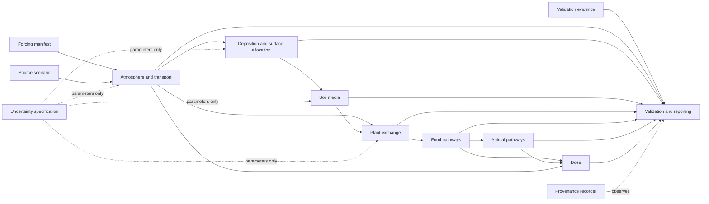

# V3 system context

Status: `ARCHITECTURE_ONLY`

Forcing, source, validation evidence, and parameter packages are external
inputs with checksums. Raw external evidence stays outside Git; tracked
manifests contain provenance, licence status, schema version, and hashes.

The numerical chain owns states and transfers. Validation compares immutable
results against preregistered evidence. Reporting and provenance observe
calculations but do not alter inventories, fluxes, parameters, or time steps.

The dynamic-air, advanced re-emission, formal three-box soil, HT chemistry, and
broad food expansion candidates are outside the executable context in this
baseline.
