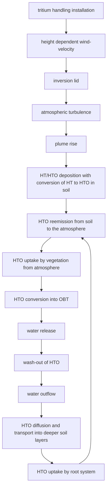
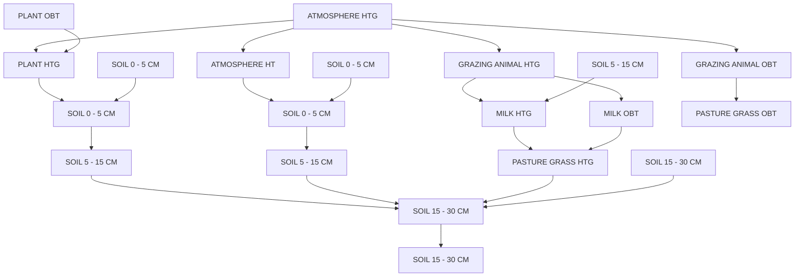
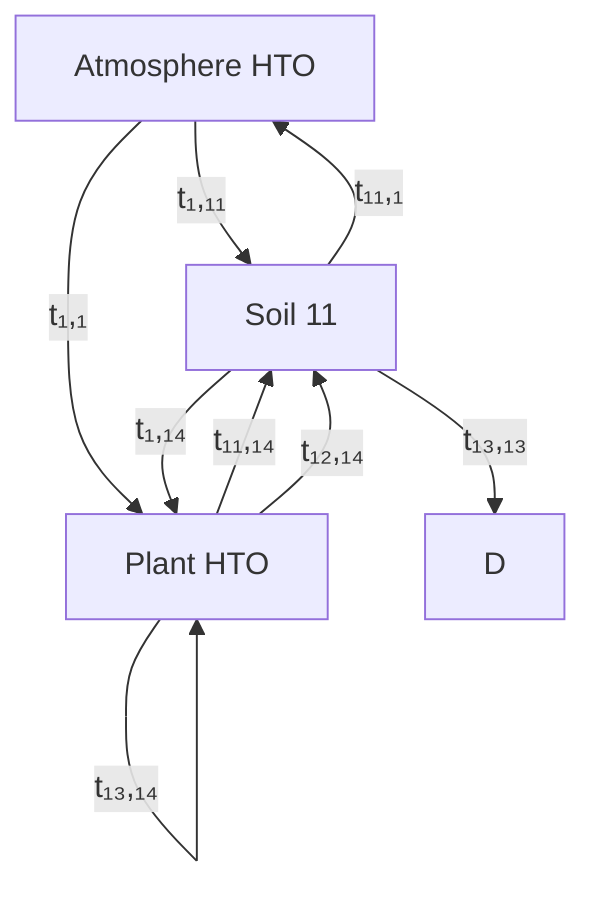
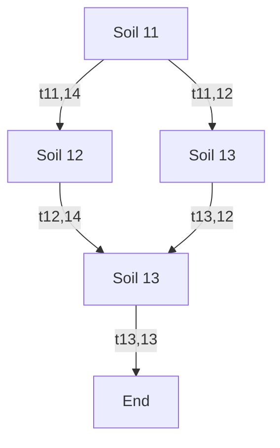
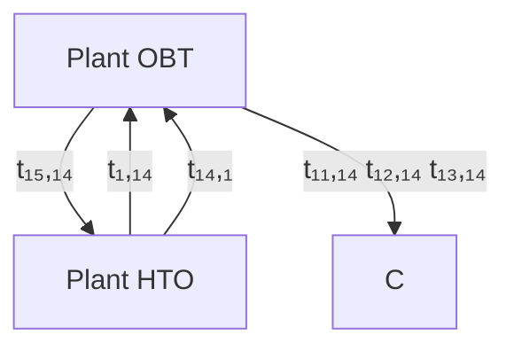
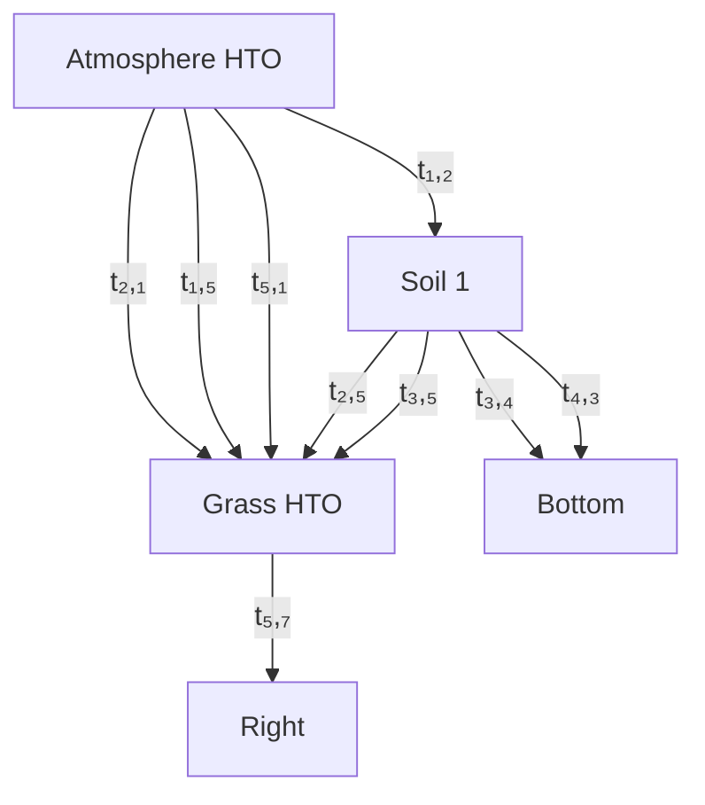
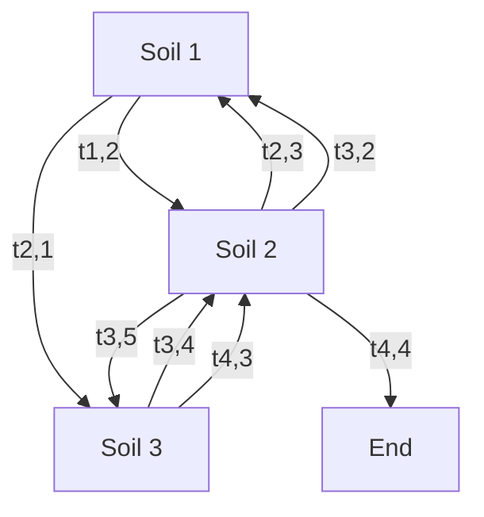
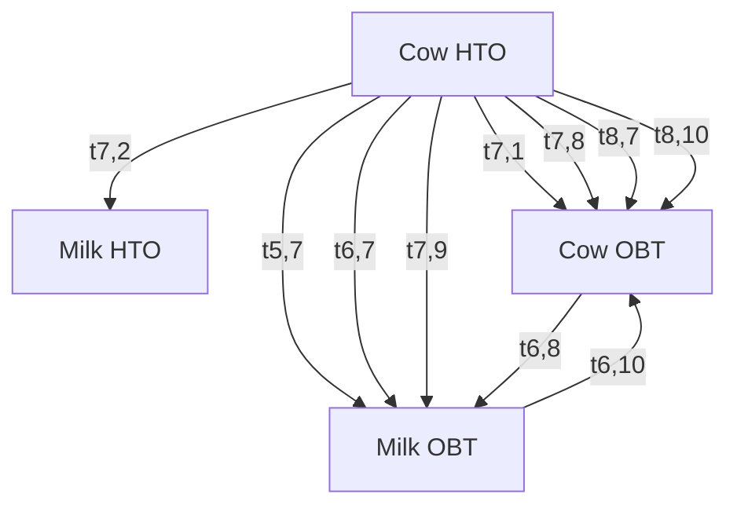
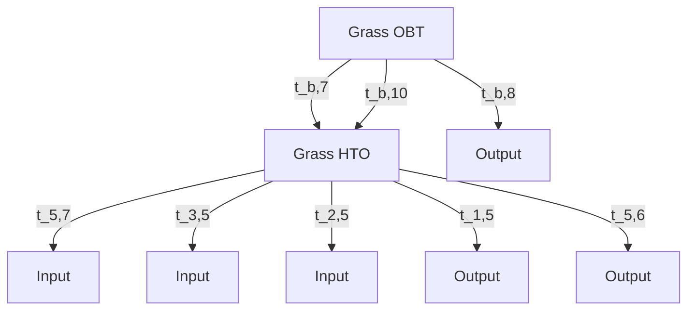

# UFOTRI: Program for Assessing the Off-Site Consequences from Accidental Tritium Releases

W. Raskob

Institut für Neutronenphysik und Reaktortechnik

Projekt Kernfusion

Kernforschungszentrum Karlsruhe

# KERNFORSCHUNGSZENTRUM KARLSURHE Institut für Neutronenphysik und Reaktortechnik Projekt Kernfusion

KfK 4605

# UFOTRI: Program for assessing the off-site consequences from accidental tritium releases

W. Raskob\*

\*D.T.I. Dr. Trippe Ingenieurgesellschaft m.b.H.

Kernforschungszentrum Karlsruhe GmbH, Karlsruhe

Als Manuskript gedruckt

Für diesen Bericht behalten wir uns alle Rechte vor

Kernforschungszentrum Karlsruhe GmbH

Postfach 3640, 7500 Karlsruhe 1

ISSN 0303-4003

# Abstract

In view of the operation of fusion reactors the release of tritium may play a dominant role during normal operation as well as after accidents. Because of its physical and chemical properties which differ significantly from those of other radionuclides, the model UFOTRI for assessing the radiological consequences of accidental tritium releases has been developed. It describes the behaviour of tritium in the biosphere and calculates the radiological impact on individuals and the population due to the direct exposure and by the ingestion pathways. Processes like the conversion of tritium gas into HTO in the soil, re-emission after deposition and the conversion of HTO into organically bound tritium are considered. A Gaussian trajectory model was slightly modified for describing dynamically, during a time period of some days, all the relevant transfer pathways of the tritium between the compartments of the biosphere like atmosphere, soil, plant and grazing animal. It is coupled to a first order compartment model which calculates the longer term pathways of tritium in the foodchains. The importance of the re-emission process is clearly demonstrated with example calculations of UFOTRI. First results of ITER benchmark calculations and comparative calculations with an HT release experiment in Canada 1987 are also presented.

# UFOTRI: Ein Programm zur Abschätzung der radiologischen Folgen nach einer unfallbedingten Freisetzung von Tritium

# Zusammenfassung

Im Hinblick auf den Betrieb von Fusionsreaktoren spielt die Freisetzung des Radionukli-des Tritium sowohl während des Normalbetriebes als auch im Anschluß an einen Unfall eine bedeutende Rolle. Wegen seiner physikalischen und chemischen Eigenschaften, die deutlich von denen anderer Radionuklide abweichen, wurde das Computermodell UFO-TRI erstellt, das nach einer unfallbedingten Freisetzung das Verhalten von Tritium in der Biosphäre beschreibt und die Belastung des Menschen über direkte Exposition und den Nahrungsmittelpfad berechnen kann. Hierbei müssen Prozesse wie die Umwandlung von HT in HTO im Boden, die Reemission des HTO nach der Ablagerung und die Umwandlung von HTO in organisch gebundenes Tritium mit berücksichtigt werden. Ein Gaußartiges Ausbreitungsmodell wurde derart ertüchtigt, daß alle relevanten Transferpfade zwischen den einzelnen Teilbereichen der Biosphäre wie Atmosphäre, Boden, Pflanzen und Weidetiere, innerhalb der ersten Tage dynamisch beschrieben werden können. Es wurde angekoppelt an ein Kompartimentmodell erster Ordnung, das den weiteren Weg des Tritiums über den Ingestionspfad beschreibt. Die Bedeutung des Reemissionsprozesses wurde an Hand von beispielhaften Modellrechnungen mit UFOTRI aufgezeigt. Erste Ergebnisse der ITER Benchmark Studie sowie die Nachrechnung eines großen Tritium Freisetzungsexperiments in Canada werden vorgestellt.

# Table of Contents

# 1. Introduction 1

# 2. Model Description 4

2.1 Primary Dispersion Model MUSEMET 4   
2.2 Description of the Secondary Model 5

2.2.1 Modelling of Area Sources 8   
2.2.2 Plant/Atmosphere Exchange Processes 13   
2.2.3 Soil/Atmosphere Exchange Processes and Transport in Soil ..... 22   
2.2.4 Re-emission 26   
2.2.5 Uptake of HTO by the Plant Root System 29   
2.2.6 Exchangeable and Non-Exchangeable Tritium 29   
2.2.7 Cow compartment 30

# 3. Ingestion module for UFOTRI 31

3.1 Overview 31   
3.2 Determination of the transfer rates 33   
3.3 First system 34

3.3.1 The plant-soil-atmosphere subsystem 34   
3.3.2 The soil subsystems 38   
3.3.3 Vegetables 41

3.4 Second system 42

3.4.1 Subsystem grass - soil - atmosphere 43   
3.4.2 The soil subsystem 46

3.5 Cow-plant subsystem 48

# 4. Dose calculation 58

4.1 General remarks 58   
4.2 Inhalation and skin absorption 59   
4.3 Ingestion dose 59

# 5. Applications 61

5.1 Influence of the re-emission process on the resulting dose 61   
5.2 The Canada-Experiment 1987 64

5.2.1 Site description and release details 64   
5.2.2 Input parameters 65   
5.2.3 Comparison of measured and calculated results 67

5.3 ITER benchmark calculations 73

5.3.1 HTO Results for the downwind Distance of 1 km under the plume axis 74   
5.3.2 HTO Results for the far distance range 74   
5.3.3 Results of the HT release in 1000m downwind distance .....75

5.3.4 Results of the HT release for the far distance range 75

Appendix A. 76

Appendix B. 81

References 126

# List of Illustrations

Figure 1. Key processes of tritium behaviour in the environment ..... 3

Figure 2. Coupling of the primary and secondary model 7

Figure 3. Comparison of hypotheses 1 and 2 for different distances ..... 10

Figure 4. Construction of an area source 10

Figure 5. Comparison of ISOLA and MUSEMET 12

Figure 6. Resistance analogies for water vapour circulation ..... 14

Figure 7. Logarithmic wind law with zero displacement ..... 17

Figure 8. Concentration curves in plants, calculated by different methods ..... 21

Figure 9. Soil water head for different types of soil 24

Figure 10. Diagram of the ingestion model of UFOTRI 32

Figure 11. Soil-plant-atmoshere subsystem 34

Figure 12. Soil 1 Subsystem 39

Figure 13. Vegetables 42

Figure 14. Soil-plant-atmosphere subsystem 2 43

Figure 15. Second soil subsystem 46

Figure 16. Cow subsystem 49

Figure 17. Plant subsystem 49

Figure 18. Dose commitment resulting from HT plume passage ..... 62

Figure 19. Dose commitment resulting from HT plume passage + re-emission .... 62

Figure 20. Field layout from 66

Figure 21. HT air concentrations during plume passage (\* = measurements) ..... 68

Figure 22. HT soil concentrations after plume passage (\* = measurements) ..... 69

Figure 23. Time dependent HTO soil concentration in 50 m distance ( $^{*}$ = measurements) 69

Figure 24. Time dependent HTO soil concentration in 180 m distance ( $^{*}$ = measurements) 70

Figure 25. Time dependent HTO air concentrations in 50 m distance ( $^{*}$ = measurements) ..... 71

Figure 26. Time dependent HTO air concentrations in 400 m distance ( $^{*}$ = measurements) ..... 72

Figure 27. Time dependent HTO concentrations in vegetation water in $40\mathrm{m}$ distance $(^{*} =$ measurements) 72

Figure 28. Time dependent HTO concentrations in vegetation water in 180 m distance (\* = measurements) 73

Figure 29. Neutral atmospheric conditions: plume centerline air concentration near ground 89

Figure 30. Neutral atmospheric conditions: plume centerline ground concentration . 90

Figure 31. Neutral atmospheric conditions: plume centerline prompt dose due to inhalation and skin absorption from plume passage only ..... 91

Figure 32. Neutral atm. conditions: plume centerline prompt dose due to inhalation and skin absorption from plume and with reemission 92

Figure 33. Neutral atm. conditions: plume centerline chronic dose due to inhalation and skin absorption from plume and with reemission ..... 93

Figure 34. Neutral atmospheric conditions: plume centerline prompt dose due to the ingestion pathway ..... 94

Figure 35. Neutral atmospheric conditions: plume centerline chronic dose due to the ingestion pathway 95

Figure 36. Neutral atm. conditions: plume centerline prompt dose due to the sum of ingestion pathway inhalation and skin absorption ..... 96

Figure 37. Neutral atm. conditions: plume centerline chronic dose due to the sum of ingestion pathway inhalation and skin absorption ..... 97

Figure 38. Stable atmospheric conditions: plume centerline air concentration near ground 98

Figure 39. Stable atmospheric conditions: plume centerline ground concentration . 99

Figure 40. Stable atmospheric conditions: plume centerline prompt dose due to inhalation and skin absorption from plume passage only ..... 100

Figure 41. Stable atm. conditions: plume centerline prompt dose due to inhalation and skin absorption from plume and with reemission ..... 101

Figure 42. Stable atm. conditions: plume centerline chronic dose due to inhalation and skin absorption from plume and with reemission ..... 102

Figure 43. Stable atmospheric conditions: plume centerline prompt dose due to the ingestion pathway ..... 103

Figure 44. Stable atmospheric conditions: plume centerline chronic dose due to the ingestion pathway ..... 104

Figure 45. Stable atm. conditions: plume centerline prompt dose due to the sum of ingestion pathway inhalation and skin absorption ..... 105

Figure 46. Stable atm. conditions: plume centerline chronic dose due to the sum of ingestion pathway inhalation and skin absorption ..... 106

Figure 47. Neutral atmospheric conditions: plume centerline air concentration near ground 107

Figure 48. Neutral atmospheric conditions: plume centerline ground concentration 108

Figure 49. Neutral atmospheric conditions: plume centerline prompt dose due to inhalation and skin absorption from plume passage only ..... 109

Figure 50. Neutral atm. conditions: plume centerline prompt dose due to inhalation and skin absorption from plume and with reemission ..... 110

Figure 51. Neutral atm. conditions: plume centerline chronic dose due to inhalation and skin absorption from plume and with reemission ..... 111

Figure 52. Neutral atmospheric conditions: plume centerline prompt dose due to the ingestion pathway ..... 112

Figure 53. Neutral atmospheric conditions: plume centerline chronic dose due to the ingestion pathway 113

Figure 54. Neutral atm. conditions: plume centerline prompt dose due to the sum of ingestion pathway inhalation and skin absorption ..... 114

Figure 55. Neutral atm. conditions: plume centerline chronic dose due to the sum of ingestion pathway inhalation and skin absorption ..... 115   
Figure 56. Stable atmospheric conditions: plume centerline air concentration near ground 116   
Figure 57. Stable atmospheric conditions: plume centerline ground concentration 117   
Figure 58. Stable atmospheric conditions: plume centerline prompt dose due to inhalation and skin absorption from plume passage only ..... 118   
Figure 59. Stable atm. conditions: plume centerline prompt dose due to inhalation and skin absorption from plume and with reemission ..... 119   
Figure 60. Stable atm. conditions: plume centerline chronic dose due to inhalation and skin absorption from plume and with reemission ..... 120   
Figure 61. Stable atmospheric conditions: plume centerline prompt dose due to the ingestion pathway ..... 121   
Figure 62. Stable atmospheric conditions: plume centerline chronic dose due to the ingestion pathway 122   
Figure 63. Stable atm. conditions: plume centerline prompt dose due to the sum of ingestion pathway inhalation and skin absorption ..... 123   
Figure 64. Stable atm. conditions: plume centerline chronic dose due to the sum of ingestion pathway inhalation and skin absorption ..... 124

# List of Tables

Table 1. Classification of micropores ..... 23   
Table 2. Collective dose in mSv 63   
Table 3. model input parameters 65   
Table 4. Transfer rates of the first COMA subsystem ..... 77   
Table 5. Transfer rates of the second COMA subsystem ..... 78   
Table 6. Calculated specific equilibrium for the ingestion module (1. system) ..... 79   
Table 7. Calculated specific equilibrium for the ingestion module (2. system) ..... 80   
Table 8. Parameter set of the benchmark calculations ..... 82   
Table 9. Diffusion coefficients of the S.C.N./C.E.N Mol, Belgium as a function of stability classes 84   
Table 10. Plume centerline dose in 1000 m distance for a HTO release of 100g and dispersion category D 85   
Table 11. Plume centerline dose in 1000 m distance for a HTO release of 100g and dispersion category F 86   
Table 12. Plume centerline dose in 1000 m distance for a HT release of 100g and dispersion category D 87   
Table 13. Plume centerline dose in 1000 m distance for a HT release of 100g and dispersion category F....88

# 1. Introduction

The consequences of a postulated release of tritium ( $^{3}H$ ) is estimated commonly in two separated steps. At first, Gaussian (trajectory) models describe all atmospheric transport processes which lead to activation concentration in air and ground surface and which result in direct exposure pathways, like inhalation and skin absorption. On the other hand and divided from the dispersion process, compartment models describe the pathway of tritium in the food chains, resulting in doses due to the nutriment uptake.

It was the main aim of this work to develop a realistic model of the behaviour of tritium released during a nuclear accident, by coupling an atmospheric dispersion module which describes the atmospheric transport and deposition processes (dispersion, deposition and re-emission) under consideration of all relevant transfer processes in the environment (soil, plant and animal) for approximately 100 hours after the release event (when the atmospheric transport plays the dominant role), with a first order compartment module /50/, which allows a dynamic description of the further behaviour of the two different chemical forms of tritium in the food chains.

Releases of tritium, however, require a special type of modelling of atmospheric dispersion, owing to the fact that tritium releases are chemically identical with hydrogen releases and therefore interact directly with water and organic substances. This requires especially an appropriate description of the re-emission processes after deposition of tritium. The result of the investigations is the computer program UFOTRI (Unfallfolgenmodell für Tritiumfreisetzungen), which will be used as a submodule of the program system UFOMOD /18/. In its original form, the model is used as a stand alone version independent of the above program package. Computing times are in the range of several minutes for a one-hour release followed by a 100-hour re-emission period. This enables to study individual model parameters more closely. Short computing times are an essential condition for the model in order to be applicable in probabilistic accident consequence assessments.

The most efficient way of developing a tritium dispersion module is to start from existing dispersion models. The present version of UFOTRI is based on the Gaussian trajectory model MUSEMET /55/ which is in use within the program system UFOMOD. MUSEMET was slightly modified for describing the behaviour of tritium in the environment in both chemical forms i.e. gaseous tritium (HT, $T_{2}$ ) and tritiated water vapour (HTO). The importance of the re-emission process necessitates dual modelling of the atmospheric dispersion. Primarily, MUSEMET calculates the dispersion after a single release event and the subsequent deposition on soil and plants. Source terms of more than one hour are divided into one-hour intervals and calculated individually. In a second step, the re-emission of tritium from soil (evaporation) and plants (transpiration) is taken into account by an area source model which was specially developed and combined with the original model.

In addition, the conversion of tritium gas into tritiated water (HT into HTO), the transport of tritium into deeper soil layers, the uptake of tritium by the plant root system, and the conversion of HTO into organically bound tritium (OBT), all of which may modify the total balance of the available HT or HTO inventory, are taken into account in the atmospheric dispersion module (Fig.1). Additional to the processes noted above the atmospheric module considers the production of milk, milk products and beef.

Some days after the release, when all the transport processes from grid point to grid point do no longer significantly change the concentration distribution in the environment, the extensive dispersion module will be stopped and the calculated actual and integral concentrations of all compartments are now the input of the ingestion module. Handling the ingestion pathway, a first order compartment model, which describes the transport processes between compartments in the form of exchange rates, is used. The compartments are autonomous parts of the overall system; they may exchange substances with other compartments, take up substances from outside, or give off substances to outside. The single compartments are shown in Fig.10 in chapter 3.1. The changes in relation to the dispersion module can be summarized in two statements.

The transport between two different grid points is suppressed   
- The transfer rates are not re-calculated each hour in dependence of the environmental conditions but they are now means, representing the vegetation period.

Apart from this, the transfer paths and transfer rates considered in both submodels are identical.

Output of UFOTRI are doses due to inhalation and skin absorption as well as the dose due to the ingestion pathway in a variable polar coordinate system. Default values are an azimuthal resolution of 5 degrees and a radial resolution of 20 radii.

Applications of UFOTRI show the importance of the re-emission process (chap. 5.1) and, evaluated from benchmark calculations, that the dose contribution resulting from the ingestion pathway is as much as high or higher than the dose from inhalation and skin absorption (chap. 5.2). In this chapter comparative calculations with an experiment in Canada 1987 will be presented too.

Because some modelling approaches (e.g. in the plant and soil modules) are rather simple, further investigations seems to be useful to minimize the uncertainties due to modelling assumptions.

flowchart

Figure 1. Key processes of tritium behaviour in the environment

# 2. Model Description

# 2.1 Primary Dispersion Model MUSEMET

MUSEMET models atmospheric dispersion assuming time-variable but spatially homogeneous wind, precipitation, and turbulence fields. The program calculates the trajectories of the radioactive plume on the basis of hourly records of wind velocities and wind directions of a meteorological measuring station for concrete weather sequences. On the straight hourly segments of the trajectory, the concentration distribution is described by the two-dimensional Gaussian model (segmented plume model). The corresponding sigma parameters are adapted on an hourly basis in accordance with the classification of weather events into dispersion categories A-F from the synoptic records according to Pasquill/Gifford.

The horizontal and vertical dispersion parameters $\sigma_{y}$ and $\sigma_{z}$ are power functions of the distance from the source /30/. The coefficients are classified due to atmospheric stability, surface roughness, and release height. Two different parameter sets are used: the experimental values determined by S.C.K./C.E.N., Mol/Belgium /10/ for smooth terrain (roughness stage 2) with a roughness length between 0.1m and 1m, and the height dependent Karlsruhe-Jülich parameters /59/ for rough terrain (roughness stage 3, roughnesses (>1m).

The height of the mixing layer in which dispersion takes place varies with the atmospheric stability. Once it has reached a certain height during the dispersion process, it cannot be reduced in the model. The upper limit of the mixing layer with height h cannot be permeated by the plume, therefore $\sigma_{z}$ is limited to 0.8 h.

Dry deposition of radioactivity from the plume is described by the source depletion model /30/. The parameters of dry deposition were determined in experiments with tritium gas and tritium water vapour /15/, /24/, /37/ and /56/.

The process of tritium deposition on vegetation is modelled separately /2/; no distinction is made between dry and wet depositions. The process is described by a "resistance model". Its parameters are calculated on an hourly basis as a function of wind velocity, stability, roughness, precipitation and temperature. The calculations will be presented in detail in the report section describing the secondary model.

The process of wet deposition of tritium is in the model considered as washout from the whole plume. The washout coefficients normally depend on the intensity of precipitation. They are very small for HT, i.e. wet deposition is negligible. Experimentally determined washout coefficients of HTO are available only for a small number of precipitation intensities /56/, /6/. The results of Chamberlain's theoretical investigations /12/, however, were in the same order of magnitude as the small number of measured values available.

The coefficients were found to be hardly influenced by the intensity of precipitation. The model itself offers two different values for rain intensities $\leq 1mm/h$ and >1mm/h. These values may be modified as soon as further experimental values will be available.

Thermal lift, including a lift-off criterion, is considered as a function of the release characteristics /7/. The possible effects of power plant buildings on the plume behaviour are modelled in a simple manner /30/.

The final result of the atmospheric dispersion are distance-dependent, hourly time-integrated tritium concentrations in air near ground (1 m), in vegetation and on ground surface in a variable system of polar coordinates.

# 2.2 Description of the Secondary Model

This part of the report describes the enhancements required for the modelling of tritium dispersion:

• Uptake by, and evaporation from vegetation (via area source)   
Soil-atmosphere exchange processes (via area source)   
• Transport from the soil surface into deeper soil layers   
• Conversion of tritium into OBT   
Exchange processes by grazing animals

Conversion of tritium gas into tritiated water within the atmosphere is not included in the program due to the fact that the conversion rate is very slow (half-time of some years) /24/.

The first paragraph will discuss general aspects of area source modelling. The calculations provide time-dependent and/or time-integrated tritium concentrations in air, which are the basis for calculating inhalation doses. The tritium concentrations in air are calculated by the Gaussian algorithm (Equation 6). For this, the time-dependent source strength of the area sources influenced by the above-listed processes must be known (see also Fig.1). The following balance equations are obtained for tritium concentrations in soil and plants:

1) Balance equation of soil for HT and/or HTO, with direct conversion in the soil of HT into HTO indicated only by the deposition rate.

$$
\frac {d}{d t} C _ {s, H T O} = - D _ {0} \nabla^ {2} C _ {s, H T O} + v _ {d, H T O} X _ {H T O} + v _ {d, H T} X _ {H T} - R _ {s} C _ {s, H T O} - U _ {P} C _ {s, H T O} \tag {1}
$$

Assuming that in a first approximation the exchange processes are determined by the total tritium volume in the top few centimeters of soil, and not by its vertical distribution, the diffusion term is reduced to a downward flux into deeper layers:

$$
\frac {d}{d t} C _ {S, H T O} = - F _ {S, H T O} + v _ {d, H T O} X _ {H T O} + v _ {d, H T} X _ {H T} - R _ {s} C _ {S, H T O} - U _ {P} C _ {S, H T O} \tag {2}
$$

in which

$$
\begin{array}{l} C _ {S, H T O} = H T O \text { concentration   in   soil   (Index   S   for   Soil)   in } B q m ^ {- 2} \\ D _ {0} \quad = \text {   Diffusion   coefficient   in   soil   in   } m ^ {2} s ^ {- 1} \\ v _ {d, H T O} = \text { Deposition   velocity   of   HTO   in } m s ^ {- 1} \\ v _ {d, H T} = \text { Deposition   velocity   of   HT   in } m s ^ {- 1} \\ X _ {\text { HTO }} = \text { HTO   concentration   in   ground   level   air   in } B q m ^ {- 3} \\ X _ {H T} = H T \text { concentration   in   ground   level   air   in } B q m ^ {- 3} \\ R _ {S} = \text { R   e   -   e   m   i   s   s   i   o   n   f   a   c   t   o   r   f   o   r   s   o   i   l   i   n } s ^ {- 1} \\ U _ {P} \quad = \text { Transfer   factor   for   uptake   by   plant   root   system   in } s ^ {- 1} \\ F _ {S} = \text { Downward   flux   into   deeper   layers   in } B q m ^ {- 2} s ^ {- 1} \\ \end{array}
$$

2) The plant compartment is described by Equation 3. Here, too, the distribution of HTO by diffusion processes within the plant is neglected.

$$
\frac {d}{d t} C _ {P, H T O} = v _ {d P, H T O} X _ {H T O} - R _ {P} C _ {P, H T O} + U _ {P} C _ {s, H T O} - V _ {P} C _ {P, H T O} - G _ {P} C _ {P, H T O} \tag {3}
$$

in which

$$
C _ {P, H T O} = H T O \text { concentration   in   the   plant   (Index   P   for   Plant)   in } B q m ^ {- 2}
$$

$$
v _ {d P, H T O} = H T O \text { Deposition   velocity   in } m s ^ {- 1}
$$

$$
X _ {\text { HTO }} = \text { HTO   concentration   in   ground   level   air   in   Bq } m ^ {- 3}
$$

$$
R _ {P} = \text { R   e   -   e   m   i   s   s   i   o   n   f   a   c   t   o   r   f   o   r   p   l   a   n   t   s   i   n } s ^ {- 1}
$$

$$
U _ {P} = \text { Transfer   factor   for   uptake   by   plant   root   system   in } s ^ {- 1}
$$

$$
V _ {P} = \text { Factor   for   conversion   of   HTO   into   OBT   in } s ^ {- 1}
$$

$$
G _ {P} = \text { Transfer   factor   for   uptake   by   grazing   animals   in } s ^ {- 1}
$$

Further, all parameters are assumed to remain constant within each time interval (1 h). In general, all processes are described for a HT and/or HTO release. A special comment is made if a process is irrelevant for one of the two chemical forms of tritium.

In the dispersion calculation, the processes of re-emission are assumed to take place one hour after the primary dispersion of the radioactive plume (Fig.2).

text_image

plume
deposition
area source
reemitted plume

Figure 2. Coupling of the primary and secondary model

This means that after a time interval of one hour the tritium concentrations in soil and plants calculated by the primary atmospheric dispersion model will be transferred to the secondary atmospheric dispersion model as input values. In the secondary model, the concentrations of hour N, obtained with the primary model, are modified in hour N + 1 by the above processes. This process is continued until the primary plume has left the area of investigation. After this, the secondary model alone goes on calculating with its area sources for the soil and plant compartments. The period up to the end of the calculations has not been definitely fixed. It should be chosen so that the resulting acute dose will not be influenced by any further change in the environmental tritium distribution. Its optimum duration will be determined by parameter studies (first results show a period of about 70 - 100 hours).

# 2.2.1 Modelling of Area Sources

Like the two-dimensional depositions from the plume, also the secondary releases from soil and plants must be treated as area sources. The mathematical description of a plume according to a Gaussian algorithm which originates from an area source is based on a double integral:

$$
C = \frac {Q _ {e} (x)}{\pi u} \int_ {y ^ {\prime} = - \frac {L}{2}} ^ {+ \frac {L}{2}} \int_ {x ^ {\prime} = 0} ^ {x _ {i}} \frac {\exp \left[ - \frac {(y - y ^ {\prime}) ^ {2}}{2 \sigma_ {y} ^ {2}} - \frac {H ^ {2}}{2 \sigma_ {z} ^ {2}} \right]}{\sigma_ {y} \sigma_ {z}} d x ^ {\prime} d y ^ {\prime} \tag {4}
$$

in which:

$$
\begin{array}{l} C = \text { Concentration   in   air   in } B q m ^ {- 3} \\ Q _ {e} (x) = \text { Effective   source   strength   of   the   area   source   in } B q s ^ {- 1} \\ L = \text { Width   of   the   area   source   in } m \\ x _ {i} = \text { Length   of   the   area   source   in } m \\ \begin{array}{r l} {H} & {= \text {   Effective   dispersion   height   in   m   (with   identical   source   heights }} \\ & {\text { assumed   for   soil   and   plant   sources) }} \end{array} \\ \sigma = \text { Effective   sigma   parameters } \quad \sigma = \sigma (x - x ^ {\prime}) \text { in } m \\ u = \text { Wind   velocity   at   dispersion   height   in } m s ^ {- 1} \\ \end{array}
$$

Any numerical solution of this integral will require a large amount of computing time. Attempts were therefore made already in the Fifties and Sixties to describe the problem as accurately as possible using simplified assumptions /26/. Three methods were found to be practicable:

1. Replacing the area source by a sufficient number of individual source points /22/.   
2. Replacing the area source by a single source point in the center of the area, with a given initial widening of the plume /60/.   
3. Introduction of the "Narrow Plume" hypothesis /11/.

As to "1.", it must be noted that the substitution of a single area source by multiple point sources is hardly more efficient in terms of computing time. As shown in /22/, up to one hundred and more individual sources would be required for modelling a 500m x 500m area. This approach was therefore considered to be impracticable.

Method "3." assumes that an area source can be approximated by line sources, and also that any given grid point is contaminated only by that part of the area source that is located in the wind direction of said grid point. This assumption may result in marked concentration jumps in grid points located near to the edges of an area source. Better modelling of the edges, on the other hand, would reduce the win in computing time.

Method "2." presents the least difficulties in programming. The source point in the center of the area source is assigned an initial sigma $\sigma_{y0}$ value, whose square is added to sigma $\sigma_{y}$ .

$$
\sigma_ {y g} = \sqrt {\sigma_ {y} ^ {2} + \sigma_ {y 0} ^ {2}} \tag {5}
$$

The remaining calculational procedure is the same as for an individual source.

The applicability of this method was tested by comparative calculations using methods "1." and "3." and the height-dependent Karlsruhe-Jülich parameter set. Each area source was approximated by 81 individual source points. The initial sigma value $\sigma_{y0}$ was defined as the width of the area source divided by 4.3, a factor resulting from the geometry of a Gaussian plume. At a distance of $2.15 \times \sigma_{y0}$ from the plume axis in each lateral direction, the concentration has decreased to 1/10 of the concentration below the plume axis. This is the limiting criterion for a plume as commonly defined in the relevant literature /60/.

Fig.3 shows a satisfactory agreement of the two calculation methods at the edge of the area source. A difference of less than a factor of 2 at 3000m distance for neutral stratification can be observed. In case of unstable or stable stratification, the discrepancy of the maximum concentrations below the plume axis hardly exceeds the factor of 2 also at the edge of the area source.

If possible, the area sources should be rectangular. However, the calculation matrix is a polar $r - \phi$ coordinate system with an angular resolution of $5^{\circ}$ (72 sectors) and a maximum number of 20 radii. The rectangular shape can be approximated by selecting appropriate radii and by incorporating 7 grid points each of two neighbouring radii. The source strength can be determined by arithmetic averaging of the 14 grid points (Fig.4).

NEUTRAL DISPERSION CONDITIONS   

line

| Lateral Distance in H | Relative Concentration (Series 1) | Relative Concentration (Series 2) | Relative Concentration (Series 3) |
| --------------------- | ---------------------------------- | ---------------------------------- | ---------------------------------- |
| -1800.0               | 1e-10                              | 1e-10                              | 1e-10                              |
| -900.0                | 1e-9                               | 1e-9                               | 1e-9                               |
| 0.0                   | 1e-8                               | 1e-8                               | 1e-8                               |
| 900.0                 | 1e-9                               | 1e-9                               | 1e-9                               |
| 1800.0                | 1e-10                              | 1e-10                              | 1e-10                              |

<table><tr><td>AIR CONCENTRATION AT THE EDGE OF THE AREA SOURCE</td><td>.1 61 POINT SOU</td></tr><tr><td>AIR CONCENTRATION AT THE EDGE OF THE AREA SOURCE</td><td>g1 RIVER SOURCE</td></tr><tr><td>AIR CONCENTRATION IN 5000 M DISTANCE</td><td>e1 61 POINT SOU</td></tr><tr><td>AIR CONCENTRATION IN 5000 M DISTANCE</td><td>y1 RIES SOURCE</td></tr></table>

Figure 3. Comparison of hypotheses 1 and 2 for different distances

text_image

width
source point
area source
gridpoint

Figure 4. Construction of an area source

If the area of exposure is subdivided into 20 annular rings and 72 sectors, up to 240 area sources are obtained. Owing to the high requirements in terms of computing time and storage capacity, it is impossible to describe each area source by a time-dependent Gaussian trajectory model such as our primary atmospheric dispersion model. For this reason, a linear approximation of the dispersion process is attempted on the basis of the meteorological data of a single hour and the corresponding time-independent Gaussian formula, taking into account of the depletion effects of fallout and washout:

$$
C = \frac {Q}{\pi u \sigma_ {y} \sigma_ {z}} \exp \left[ - \frac {y ^ {2}}{2 \sigma_ {y g} ^ {2}} - \frac {H ^ {2}}{2 \sigma_ {z} ^ {2}} \right] \times f _ {\text {Fallout}} \times f _ {\text {Washout}} \tag {6}
$$

in which:

$$
{f _ {F a l l o u t}} = {\exp \left[ - \sqrt {\frac {2}{\pi}} \frac {v _ {d}}{u} \int_ {0} ^ {x} \frac {d x}{\sigma_ {z} (x) \exp \left[ \frac {h ^ {2}}{2 \sigma_ {z} ^ {2} (x)} \right]} \right]}
$$

$$
{f _ {W a s h o u t}} = {\exp \left[ - \lambda \frac {x}{u} \right]}
$$

x = Distance from the source in m

y = Lateral distance from the plume axis in m

H = Effective source height in m

u = Wind velocity at dispersion height in m s $^{-1}$

$\sigma =$ Sigma parameters according to Equation 5

Q = Initial source strength of the area source in Bq s $^{-1}$

$\lambda =$ Washout coefficient in $s^{-1}$

$V_{d}$ = Deposition velocity in $m s^{-1}$

Equation 6 is applied separately for the two compartments "soil" and "plants", using the respective specific parameters. The source strength is determined using Equations 2 and 3.

This method of determining the air concentration distribution of the re-emitted plumes using a reduced time dependence is applied in statistical Gaussian models, which calculate the mean exposure of an area for a given period of time by means of a four-parameter dispersion statistics of the wind velocity, wind direction, stability, and precipitation events. These four values, in varying combinations, determine the parameters for Equation 6.

radar

| PLOTTED RADII (M) |
| ------------------ |
| 1150.0             |
| 4900.0             |
| 21000.0            |
| 27000.0            |
| 37000.0            |
| 49000.0            |
| 65500.0            |
| 87500.0            |

radar

| Direction | Value     |
| --------- | --------- |
| N         | 1150.0    |
| E         | 4900.0    |
| S         | 21000.0   |
| W         | 27000.0   |
| E         | 37000.0   |
| S         | 49000.0   |
| W         | 65500.0   |
| E         | 87500.0   |

Figure 5. Comparison of ISOLA and MUSEMET

The resulting plumes are calculated assuming linear dispersion and superposition. In order to test the applicability of statistical models also for short-duration release events, a model of this type (ISOLA, /33/) was compared with the trajectory model MUSEMET in a comparative calculation. It was found that the concentrations (air and soil) integrated over an annular ring are in good agreement both in the short-distance and the long-distance range. Also the peaks indicated by MUSEMET are well modelled by ISOLA (Fig. 5) The results of the tests induced the author to abandon the rigid time correlation which would otherwise have extended the computing time dramatically. Furtheron, the concentrations resulting from earlier depositions on more distant grid points will result in an overestimate rather than an underestimate of the resulting radiological commitment.

# 2.2.2 Plant/Atmosphere Exchange Processes

Like the soil, plants are another compartment that may act both as a source and a sink for atmospheric tritium. There are two elements of a plant which may contain tritium, i.e. the organic matter and the plant water. The process of tritium incorporation into the organic matter will be described in a later section of this paper. It is less important for the air concentration and for the inhalation pathway. Organically bound tritium is highly relevant only if the ingestion pathway is taken into account.

The exchange reaction of the plant with the atmospheric HTO takes place via the water circulation in the leaves. This process of direct uptake is negligible in case of a pure HT atmosphere /53/. Another uptake pathway is via the plant root system. This pathway will be discussed in detail in Section 2.2.5.

Direct exchange of HTO vapour with the plant water is important because in some cases plants may take up approximately the same amount of HTO per unit area as the soil, while the re-emission rate of plants is much higher than the re-emission rate of the soil. Plants are thus a very important factor contributing to the secondary contamination in the first few hours of dispersion. At a later stage, the source strength of the soil is much higher than the source strength of the vegetation. Typical half-lives for tritium release from vegetation and soil without precipitation events are

Soil: Several days   
• Plants: Several hours

The mechanism of the plant/atmosphere exchange can be compared to an electric circuit /41/. Ohm's law describes the mechanism

$$
\text { electric   resistance } = \frac {\text { potential   difference }}{\text { current }} \tag {7}
$$

In the plant/atmosphere system, this equation is modified as follows:

$$
\text { exchange   resistance } = \frac {\text { concentration   difference }}{\text { water   vapour   flux }} \tag {8}
$$

The flux can be calculated if the concentration difference and the resistance are known. Therefore, the first task was to calculate the total resistance of the plants to exchange with water vapour, and thus with HTO. As shown in Equation 9, this resistance is the sum of the plant stomata resistance $r_{ST}$ and the atmospheric resistance of the plants $r_{AV}$ .

$$
r _ {G} = r _ {S T} + r _ {A V} \tag {9}
$$

in which:

$$
\begin{array}{l} r _ {G} = \text { Total   resistance   of   the   plant   in   s } m ^ {- 1} \\ r _ {S T} = \text { Plant   stomata   resistance   in } s m ^ {- 1} \\ r _ {A V} = \text { Atmospheric   resistance   of   the   plant   in   s } m ^ {- 1} \\ \end{array}
$$

text_image

e(z)
λE
rₐᵥ
r_bᵥ
T(0)
e(0)
rₛₜ
T(0)
e_w{T(0)}
a_w{T(0)}

Figure 6. Resistance analogies for water vapour circulation

In analogy to the definitions and as shown in Fig.6, the difference of the water vapour pressure $e(0) - e(z)$ is proportional to the atmospheric resistance for a given water vapour flux. The difference between the water vapour pressure in case of saturation in the stomata and the water vapour pressure at the leaf surface $e_{w}(T(0)) - e(0)$ can be assumed to be proportional to the physiological resistance. After some conversion steps and calculations described in detail in /58/, the following resistance equations are obtained:

$$
r _ {A V} = \frac {\rho c _ {p}}{\gamma} \frac {e (0) - e (z)}{\lambda E} \tag {10}
$$

and

$$
r _ {S T} = \frac {\rho c _ {p}}{\gamma} \frac {e _ {w} [ T (0) ] - e (0)}{\lambda E}. \tag {11}
$$

in which:

$$
\begin{array}{l} \rho = \text { Density   of   moist   air   in } k g m ^ {- 3} \\ c _ {p} = \text { Specific   heat   of   air   at   constant   pressure   in } J k g ^ {- 1} K ^ {- 1} \\ \gamma = \text {   Psychrometer   constant   in   } J m ^ {- 3} K ^ {- 1} \\ e = \text { Water   vapour   pressure   in } N m ^ {- 2} \\ e _ {w} = \text { Water   vapour   pressure   on   saturation   in } N m ^ {- 2} \\ \lambda E = \text { Flux   of   latent   heat   in } N m ^ {- 1} s ^ {- 1} \\ \end{array}
$$

For both resistances, a simple description using the model data is impossible. Both the plant resistance and the atmospheric resistance of the water vapour flux must be estimated by a suitable parametrization technique. Furthermore, the atmospheric resistance will be in general subdivided into two parts, an aerodynamic resistance $r_{av}$ and a quasi laminar boundary layer resistance $r_{bv}$ . The aerodynamic resistance characterizes the transfer from the free atmosphere to the surroundings of the leaf, whereas the boundary layer resistance describes the resistance to mass transfer through the quasi laminar layer of air which is connected to the surface.

The conversion from a single plant to a plant population (fields, forests, etc.) can be done, in a first approximation (see /49/ and /54/), by using the equations

$$
r _ {a} = r _ {a V} \tag {12}
$$

$$
r _ {b} = r _ {b V} \tag {13}
$$

$$
r _ {c} = \frac {1}{L} r _ {S T} \tag {14}
$$

in which

$$
\begin{array}{l} r _ {C} = \text { Stomata   resistance   of   plant   canopy   in   s } m ^ {- 1} \\ r _ {a} = \text { Aerodynamic   resistance   of   a   plant   canopy   in   s } m ^ {- 1} \\ r _ {b} = \text {   Bounday   layer   resistance   of   a   plant   canopy   in   s   } m ^ {- 1} \\ L = \text { Leaf   area   index   in } m ^ {2} m ^ {- 2} \\ \end{array}
$$

Concerning the main parameters for estimating $r_{c}$ , the following interdependencies are established:

• type of plant   
• temperature   
• photosynthetically active radiation (PAR)   
• water content in soil

Literature studies e.g. /43/ showed that the temperature dependence is comparatively low (in general less than a factor of 2).

Up to now the influences of the PAR conditions to the opening of the stomata will be considered by dividing the day in a daylight and night period. At night, the plant stomata, in which over 90% of the water vapour exchange takes place, are usually closed, and exchange takes place only via the plant epidermis whose resistance is higher by at least a factor of 10 than the stomata resistance /49/.

The influence of the soil water content on the diffusion resistance may be characterized by a step function /21/: if the water content in soil falls below a defined threshold, the diffusive resistance will increase rapidly to a second value which is nearly independent to a further decreasing water content. To consider this, the assumption was made in the model, that the stomata are closed (nighttime resistance values are employed) if the soil has lost all the water which is available for the plant.

In order to account for the different vegetation patterns, the resistances of many types of plants were measured, compared, and averaged in order to obtain mean values for daytime and nighttime resistances (daytime resistance = 4 s cm $^{-1}$ ; nighttime resistance = 60 s cm $^{-1}$ ). Further, a mean leaf surface index of 3 m $^{2}$ /m $^{2}$ was determined for the vegetation period between mid-April and late October /43/. Both values can be modified for different sites and vegetation patterns. In their present form, they correspond more or less to a typical field and forest landscape of the Federal Republic of Germany.

In case of precipitation, it is assumed that the leaf resistance $r_{C}$ goes towards 0 and only the atmospheric resistance is relevant. At night, when the stomata are closed, the leaf resistance (now: epidermal resistance) remains constant also in case of rain.

The aerodynamic resistance to water vapour transport can be modelled via the exchange function of the momentum transfer ( $r_{aM}$ ). In a first approximation, the aerodynamic resistance of water vapour transport equals the aerodynamic resistance of momentum transfer /54/.

$$
r _ {a V} = r _ {a M} \tag {15}
$$

An exact derivation of $(r_{aM})$ is described in /58/. In general, Equation 15 applies to the vertical turbulent momentum flux density $\tau$ in the ground level atmospheric boundary layer

$$
\tau = \rho \times u _ {\mathrm{x}} ^ {2} \tag {16}
$$

in which

$$
\tau = \text { Momentum   flux   density   or   friction   in } N m ^ {- 2}
$$

$$
\rho = \text { Density   in   kg } m ^ {- 3}
$$

$$
u _ {\mathrm{x}} = \text { Friction   velocity   in } m s ^ {- 1}
$$

In the same manner, Equation 15 implies that the transfer of momentum or water vapour from the atmosphere at height z (where the momentum flux density $\rho \times u(z) > 0$ ) into a body of vegetation and in the direction of a plant element (where the flux goes towards zero) is described by

$$
r _ {a M} = \rho \frac {u (z)}{\tau} \tag {17}
$$

Combined with Equation 16, we obtain

$$
r _ {a M} = \frac {u (z)}{u _ {\mathrm{x}} ^ {2}} \tag {18}
$$

The logarithmic wind law used for calculating $u _ {\mathrm{x}}$ must be modified for plant populations, i.e. the wind velocity goes towards zero not only at height $z_{0}$ but already at height $z_{0} + d$ , in which d stands for zero-displacement. The new zero point of the wind velocity is commonly located in the upper part of the vegetation layer (Fig.7). According to measurements of /57/, it is between 0.6 h and 0.8 h.

text_image

z
u=u(z)
rAM
h
d+z0
h
v=u(d+z0)=0
0
u(z)

Figure 7. Logarithmic wind law with zero displacement

The boundary layer resistance is an 'excess' resistance which is introduced because the resistance to mass and energy transfer is different from that for momentum /58/. The resistance is a function of wind speed and surface properties and is commonly expressed as

$$
r _ {b V} = \frac {1}{k u _ {\mathrm{x}}} \ln \left(\frac {z _ {0 m}}{z _ {0 V}}\right) \tag {19}
$$

in which:

$$
z _ {0 m} = \text { Roughness   length   due   to   momentum   transfer,   commonly   written   as } z _ {0}
$$

$$
z _ {0 \nu} = \text { Roughness   length   due   to   water   vapour   transfer }
$$

The scalar roughness length for water vapour transfer is often expressed in terms of the Stanton number B /13/.

$$
k B ^ {- 1} = \ln \left(\frac {z _ {0 m}}{z _ {0 V}}\right) \tag {20}
$$

Experimental data reviewed in /9/ lead to the assumption of a nearly constant value for $k B^{-1}$ . So $r_{bV}$ is evaluated as:

$$
r _ {b V} = \frac {2 . 0}{k u _ {\mathrm{x}}} \tag {21}
$$

For both resistances the friction velocity had to be evaluated. To calculate $u _ {\mathrm{x}}$ , one uses the known equations for neutral, stable, and unstable stratification /36/.

$$
\text { neutral }: u (z) = \frac {u _ {\mathrm{x}}}{k} \left[ \ln \left(\frac {z - d}{z _ {0}}\right) \right] \tag {22}
$$

$$
\text { stable }: u (z) = \frac {u _ {\mathrm{x}}}{k} \left[ \ln \left(\frac {z - d}{z _ {0}}\right) + 4. 7 \frac {z}{L} \right] \tag {23}
$$

$$
\begin{array}{l} u n s t a b l e: u (z) = \frac {u _ {\mathrm{x}}}{k} \left[ \ln \left(\frac {z - d}{z _ {0}}\right) - 2 \ln \left(\frac {1}{2} \left(1 + \frac {1}{\Phi_ {M}}\right)\right) \right. \\ \left. + 2 \operatorname{atan} \left(\frac {1}{\Phi_ {M}}\right) - \ln \left(\frac {1}{2} \left(1 + \frac {1}{\Phi_ {M} ^ {2}}\right)\right) - \frac {\pi}{2} \right] \\ \end{array}\tag {24}
$$

using the Dyer-Businger equations :

$$
\text { stable }: \Phi_ {m} = 1 + \frac {\beta z}{L}, \beta = 4. 7
$$

$$
u n s t a b l e: \Phi_ {m} = \left[ 1 - \frac {\gamma Z}{L} \right] ^ {- \frac {1}{4}}, \quad \gamma = 1 5. 0
$$

$$
L = \text { Monin - Obuchov   length }
$$

The Monin-Obuchov length is not available as an input value for the model and must be estimated /36/.

Wind velocities at height z are calculated with the help of $u _ {\mathrm{x}}$ . What is known is the wind velocity measured by a meteorological station at a given height above the ground. Vegetation is not considered. In order to transfer this value to vegetation heights of a few meters, the first step was to determine the wind velocity at greater heights (here: 100m) using the power equation

$$
u (z) = u (H _ {r}) \times \left[ \frac {h}{H _ {r}} \right]^m \tag {25}
$$

in which:

$$
m = \text { Wind   profile   exponent }
$$

$$
H _ {r} = \text { Measuring   height   of   wind   velocity   at   the   meteorological   station }
$$

The wind velocity at the desired height above the vegetation is then calculated using the logarithmic wind velocity equations (22 to 24). $u _ {\mathrm{x}}$ is determined by transforming Equations 22 to 24.

The following assumptions are contained in this approach:

$z_{0} = 0.1\mathrm{H}$ $\mathsf{H} =$ Height of vegetation in m   
d = 0.6 H d = Zero displacement for u(z=d) = 0, in m   
FLQH = 0.8 H FLQH = Emission height of area source in m

The minimum emission height was assumed to be 1m.

These data are sufficient for determining the total resistance $r_{G}$ . The quantification of the total resistance (exchange resistance) enables to pursue the original goal, namely to calculate the water vapour flux F. For this purpose, Equation 8 must be transformed into

$$
F = \frac {X - X _ {i}}{r _ {G}} \tag {26}
$$

in which:

$$
\chi = \text { Concentration   of   water   vapour   in   the   atmosphere   in   kg } m ^ {- 3}
$$

$$
\chi_ {i} = \text { Concentration   of   water   vapour   in   the   stomata   cavities   in } k g m ^ {- 3}
$$

$$
r _ {G} = \text { Total   resistance } r _ {a} + r _ {b} + r _ {c} \text { in } s m ^ {- 1}
$$

$$
F = \text { Water   vapour   flux   in   kg } m ^ {- 2} s ^ {- 1}
$$

Equation 26 is solved with the following assumptions /2/:

• 100% saturation of water vapour in the stomata cavities   
more than 90% of the plant leaf water is available for exchange   
- liquid diffusion of HTO in the plant is faster than gaseous diffusion through the stomata   
• water transport away from the leaves is low

• equilibrium conditions prevail

On these 5 assumptions, Equation 26 can be transformed into

$$
\mu \frac {d C}{d t} = \frac {1}{r} \left(\chi - \frac {\rho}{a} C\right) \tag {27}
$$

in which:

$$
\begin{array}{l} \mu = \text { Water   content   per   unit   area   of   leaf } g c m ^ {- 2} \\ \chi = \text { Concentration   of   tritium   in   air   in } p B q m l ^ {- 1} \\ C = \text { Tritium   concentration   in   tissue   water   in } p B q g ^ {- 1} \\ r = \text { Total   resistance   in } s c m ^ {- 1} \\ t = \text { Time   in } s \\ \rho = \text { Weight   of   water   vapour   in   saturated   air   in } g m l ^ {- 1} \\ a = H / T \text {isotope ratio in liquid and air, assumed to be 1.1} \\ \end{array}
$$

If $\chi$ , $\mu$ , $\rho$ and r are constant, an analytical solution of Equation 27 is possible:

$$
C = \chi \frac {a}{\rho} (1 - e ^ {- k t}) \tag {28}
$$

in which

$$
k = \frac {\rho}{a \mu r} \quad \left[ \frac {1}{\sec} \right] \quad \text {the time constant until equilibrium in} s ^ {- 1} \tag {29}
$$

and

$$
C = 0 \quad f o r t = 0
$$

From this equation, the contamination of the plant can be determined directly if the ground level air concentration is known.

Any loss of concentration from the plant is also determined by the time constant k:

$$
\delta C = C _ {0} e ^ {- k t} \tag {30}
$$

The resulting re-emission rate for plants is

$$
R _ {P} = \frac {C _ {0} - \delta C _ {0}}{C _ {0}} \times 1 0 0. \tag {31}
$$

in which:

$$
R _ {P} = \text { Re - emission   rate   in } \% \text { per   unit   time }
$$

The initial assumption C = 0 for t = 0 does not apply to long-duration releases subdivided into one-hour intervals, although the additive behaviour of Equation 28 is clearly seen.

The net concentration increase in the plant at hour N, as shown in Fig.8, comprises the concentration win at hour N and the residual concentrations of hours 1 to N-1. The topmost curve is the concentration curve for an assumed constant air concentration over a period of 40 time intervals. This curve can also be obtained by adding up the 4 bottom curves, each of which corresponds to a constant HTO concentration in air over 10 time intervals followed by a tritium-free atmosphere. In all cases, Equations 24 and 27 have been used. The identical shape of the top envelope shows that Equation 23 can be applied also in case of a given initial concentration.

line

| TIME IN RELAT. UNITS | CONCENTRATION B0 |
| --------------------- | ---------------- |
| 10                    | 0.02             |
| 20                    | 0.02             |
| 30                    | 0.02             |
| 40                    | 0.02             |

Figure 8. Concentration curves in plants, calculated by different methods

Additionally to the exchange of tritium via a diffusive process, a loss of tritium out of the plant due to water discharge via evaporation had to be considered. This is not performed explicitly in the program because it is assumed that this effect is partially included in the semi empirical Equation 28. If events with a high evaporation demand are calculated, this assumption leads to an overestimation of the specific tritium concentration in the plant water. For safety assessments a conservative estimation seems to be more suitable as long as a division of both processes seems impossible to be realized with the experimental data, available up to now; therefore it was implanted in UFOTRI.

The uptake of airborne HTO by plants is calculated in the program using the source depletion method. This necessitates the definition of a deposition velocity $v_{dp}$ .

$$
v _ {d P} = \frac {\text { concentration   in   ground   level   air }}{\text { concentration   in   plant }} \tag {32}
$$

The concentration in ground level air is known, and the concentration in the plant can be determined by Equation 23, so it is possible to calculate $v_{dP}$ .

UFOTRI considers two different plant species, namely nutriment plants and pasture grass. Because the plant specific parameters due to the exchange processes plant/environment are different, the model had to account for two different areas, one for the nutriment plants and one for the pasture grass. Due to missing land-use data, it is not possible in the model to realize presently a site specific relation of the two areas. So it is assumed that each grid point which is representative for a surrounding area contains pasture grass as well as cultivation fields for nutriment plants. This implies, that the model has to calculate two different deposition velocities to the vegetation, two different re-emission rates and two different soil/plant exchange pathways. The deposition velocity up to the distance of interest is the weighted mean of the two different deposition velocities for grass and nutriment plant. The contribution of each plant or area to the overall deposition and re-emission value depends on the relative size of both areas. Default values (but it can easily be changed by the user) are, that 20 % of the region is used for grazing of animals and on the other 80 % foodstuffs are produced. In the future it should be investigated if other land-use characteristics should be condensed in a third area type. In the present approximation they are implicitly included in the nutriment plants, because the simplified modelling of all exchange processes makes a more detailed division unreasonable. Only the behaviour of trees seems not be well modelled.

# 2.2.3 Soil/Atmosphere Exchange Processes and Transport in Soil

The tritium exchange processes soil/atmosphere and the transport of tritium in soil are highly complex and cannot be modelled in their full complexity at the present state of development. The following four points are particularly important:

• Dependence of the HT deposition rate on the type of soil   
Resuspension in the form of HTO   
• Transport and diffusion into deeper soil layers   
• Tritium uptake by the plant root system

The HT deposition rate depends on the type of soil and on the soil moisture. Once deposited, HT is transformed into HTO very quickly as a result of microorganism activity. Only the transformed part of HT remains in the soil. The process of transformation is assumed to take place very rapidly. The deposition rate can therefore be determined only if the above parameters are known. For a large-area assessment, we still have too little knowledge of the soil type and surface structure and of the number of microorganisms, so that an integral value with a seasonal variation must be chosen for the deposition rate ( with a lower value for the winter season in order to take account of the smaller number of active microorganisms). The deposition rate of HTO is assumed to remain constant throughout the year.

The re-emission processes can be modelled in different ways. Transport processes within the soil are relevant here. One possible approach couples the re-emission of HTO to the evaporation of water from soil /2/.

In another approximation an exchange rate is defined whose dependence on the conditions in soil and atmosphere had to be investigated in the future and is yet assumed in the models to be not noticeably variable /23/.

In order to understand the process of re-emission, one should start with describing the transport processes and transport compartments inside the soil. These determine the amount of tritium available for re-emission, owing to the fact that only the HTO in the top soil layer takes part in the re-emission process. Direct mass transfer via downward infiltration or via upward capillary transport, as well as diffusion in the soil are the determining factors. Mass transfer via flow processes in the soil in any direction will superpose the diffusion transfer process. It is therefore of top priority to find out if, and at what rate, mass transfer of water (and thus of HTO) occurs in the soil.

All soils consist in principle of two components, i.e. rock mass and air pores. The air pores may be further divided into micropores and macropores, depending on the pore size and the resulting different response to flow processes. Micropores have an equivalent diameter smaller than 2 mm. In macropores, the adhesive or suction tension ( $\Psi$ , also called suction- or matric head if the dimension of a length is selected), which equals the height of capillary rise and thus also the retention force, is negligible, i.e. transport processes in macropores are determined by gravity alone.

Micropores are subdivided into four categories on the basis of pore size and suction tension /17/.

<table><tr><td></td><td>equivalent diameter (mm)</td><td>suction head (cm)</td></tr><tr><td>fine pores</td><td>&lt; 0.0002</td><td>15000</td></tr><tr><td>medium-sized pores</td><td>0.0002 - 0.01</td><td>15000 - 300</td></tr><tr><td>narrow large pores</td><td>0.01 - 0.05</td><td>300 - 60</td></tr><tr><td>wide large pores</td><td>0.05 - 2.0</td><td>60 - 1</td></tr></table>

Table 1. Classification of micropores

Here we had to confirm that the use of the suction head only is a simplification of the physical processes. In general, the driving forces in the soil and so the energy status of soil water are characterized by Gibb's free enthalpy commonly called the water potential $\Psi_{\mathrm{soil}}$ .

$$
\Psi_ {s o i l} = \Psi_ {m} + \Psi_ {s} + \Psi_ {g} + \Psi_ {p} \tag {33}
$$

in which:

$$
\begin{array}{l} \Psi_ {m} = \text { Matric   potential } \\ \Psi_ {s} = \text { Osmotic   potential } \\ \Psi_ {g} = \text { Gravitational   potential } \\ \Psi_ {p} ^ {\circ} = \text { Gas   phase   potential } \\ \end{array}
$$

Fig. 9 also presents a classification of macropores which illustrates the importance of evaporation and water uptake by the plants. Pores with an equivalent diameter smaller than 0.0002 mm contain water that is not available to the plant, i.e. water whose capillary binding is too strong for it to be taken up by the plant root system. This water is also unavailable for evaporation. The water of the medium-sized and large pores is available to the plants. The water of the medium-sized pores is mostly adhesion water with very slow vertical currents. The water of the large pores, on the other hand, may have higher infiltration rates which depend on the pore diameter (suction tension).

line

| water content in vol.% or mm/dm | suction head (sand) | suction head (loam) | suction head (clay) |
| ------------------------------ | ------------------- | ------------------- | ------------------- |
| 0                              | 7                   | 7                   | 7                   |
| 15                             | 3                   | 3                   | 3                   |
| 30                             | 2                   | 2                   | 2                   |
| 40                             | 1                   | 1                   | 1                   |
| 50                             | 0.001               | 0.001               | 0.001               |
| 60                             | 0                   | 0                   | 0                   |

Figure 9. Soil water head for different types of soil /4/

Mathematically, the one-dimensional equation for unsaturated vertical movement of water in plane terrain is obtained by applying Darcy's law to the continuity equation

$$
\text {Continuity equation}: - \frac {\partial \Theta}{\partial t} = \frac {\partial q}{\partial z} \tag {34}
$$

in which:

$$
\Theta = \text { Volumetric   soil   moisture   content   in } m m d m ^ {- 1}
$$

$$
q = \text { Volume   flow   density   of   water   in } m ^ {3} s ^ {- 1} m ^ {- 2}
$$

$$
D a r c y ^ {\prime} s \text {   law }: q = - K (\Theta) \left[ \frac {\partial \Psi_ {s o i l}}{\partial z} - 1 \right] \tag {35}
$$

in which:

$$
K = \text { Hydraulic   conductivity   in } c m s ^ {- 1}
$$

$$
\Psi_ {\text { soil }} = \text { Water   potential   in   cm }
$$

From this, and if the only changes in the system are due to interaction between the soil matrix and the water, we obtain:

$$
\frac {\partial \Theta}{\partial t} = \frac {\partial}{\partial z} \left[ K (\Theta) \left(\frac {\partial \Psi_ {m}}{\partial z} - 1\right) \right] \tag {36}
$$

in which:

$$
\Psi_ {m} = \text {   matric   head   in   cm   }
$$

This equation uses the simplified assumption that $K(\Theta)$ and $\Psi(\Theta)$ are single-valued functions of the water content (no hysteresis) /32/.

In case of vegetation, another term must be added to Equation 31 in order to account for the water uptake by the plant root system (S(z,t)).

$$
\frac {\partial \Theta}{\partial t} = \frac {\partial}{\partial z} \left[ K (\Theta) \left(\frac {\partial \Psi_ {m}}{\partial z} - 1\right) \right] - S (z, t) \tag {37}
$$

This second-order nonlinear partial differential equation is solved numerically. Finite difference methods are well suited for this purpose. Analytical solutions are known only for a few initial and boundary value conditions. These analytical solutions are applicable for estimating the order of magnitude of individual parameters, e.g. transport rates and diffusion rates, owing to the fact that each process must be assumed to be constant. The process itself is dynamic, and marked variations may occur very rapidly /51/.

To solve this transport equation for water and thus for tritium, the soil water potential curve for the different soil types, the initial water content of the soil, and the vegetation pattern of the region must be known. This is not the case with the available tritium models. Complex but rather accurate models of this type cannot be used here.

Transport rates and soil moisture are estimated (daily averages) for selected soil layers using a simple model of soil moisture and vegetation as in /63/. Although the model is quite simple, large uncertainties in the selection of soil parameters (with different values given by each author) decide only the order of magnitude of the specific water flux and of the soil moisture distribution. In dry weather, the vertical motion $v_{s} \left( v_{s} = \frac{q}{\Theta_{A}} \right)$ , $\Theta_{A} = \text{initial water content in soil}$ is low (several mm per day), while water from deeper layers may be transported to the top layers by capillary forces. In case of rain, the transport rate is higher in the downward direction. These preliminary studies will be utilized in the re-emission section of the model.

# 2.2.4 Re-emission

The physical process of re-emission may be explained in a simplified manner as follows: The exchange between atmosphere and soil takes place in the boundary layer between the air-filled soil pores and the atmosphere. Empty only air containing soil pores are filled up with HTO by diffusion from the HTO-containing soil water. If the specific concentration in the ground level air is higher than the specific concentration in the atmospheric air, a net flux in atmospheric direction will take place; if not, there will be a net flux in soil direction. In the daytime, the diffusion process may be further enhanced by radiative processes, i.e. the re-emission rate will increase as a function of insolation. The model therefore divides the re-emission process into two components, i.e. re-emission caused by diffusion without insolation (nighttime), and re-emission from radiative effects, which is determined in the same way as the evaporation rate of water.

The above considerations led to the following simple soil model: Only the water content in the top five centimeters of soil is taken into account. Measurements and model calculations /25/ show that in a first approximation most of the HTO remains in the top soil layer initially. Assuming a given initial water content typical of temperate climates in central Europe (20%), the water content in the soil will increase in case of rain and will decrease as a result of evapotranspiration of plants and soil. Water transport will occur only if the influx from precipitation exceeds the maximum water uptake capacity.

The process of water loss from the top layer by evapotranspiration is divided up into two separate processes, i.e. evaporation from soil on the one hand and transpiration of plants on the other hand. The re-emission rate of HTO is assessed on the basis of the soil evaporation, and the plant transpiration determines the amount of water which must be transported from the root system to the plant in order to balance the loss of water. Together with the water, also a given amount of tritium is taken up by the plant root system.

The potential evapotranspiration is calculated using Penman's empirical equation /45/, which combines the radiation balance with the wind effects

$$
\lambda E _ {0} = \left[ \frac {\delta}{\gamma} R _ {n 0} + (1 + 0. 0 0 6 1 u) \left(e _ {s} - e _ {a}\right) \right] \left(\frac {\delta}{\gamma} + 1\right) ^ {- 1} \tag {38}
$$

in which:

$$
\begin{array}{l} \lambda = \text { Latent   heat   of   evaporation   in } J k g ^ {- 1} \\ E _ {0} = \text { Potential   evaporation   in } k g m ^ {- 2} s ^ {- 1} \\ R _ {n 0} = \text { Radiation   balance   in } W m ^ {- 2} \\ u = \text { Wind   velocity   in   km   per   day } \\ e _ {s} = \text { Actual   saturation   vapour   pressure   of   air   in } N m ^ {- 2} \\ e _ {a} = \text { Actual   vapour   pressure   of   air   in } N m ^ {- 2} \\ \delta = \text { Gradient   of   the   vapour   pressure   curve   at   ambient   temperature   in } J m ^ {- 3} K ^ {- 1} \\ \gamma = \text {   Psychrometer   constant   in   } J m ^ {- 3} K ^ {- 1} \\ \end{array}
$$

This equation neglects the heat flux in the soil. As $e_{s}$ and $e_{a}$ are not available in each standard meteorological data set, the equation is reduced to

$$
\lambda E _ {0} = \left[ \frac {\delta}{\delta + \gamma} \right] R _ {n 0} \tag {39}
$$

Equation 35 is often referred to as potential "equilibrium evapotranspiration" in the relevant scientific literature. It marks a lower limit for evaporation from moist surfaces.

The potential evaporation of soil is described in /47/ by a modification of this equation based on the shading effect of leaves on the soil.

$$
\lambda E _ {0 S} = \left[ \frac {\delta}{\delta + \gamma} \right] R _ {n 0} e ^ {- 0. 3 9 8 L} \tag {40}
$$

in which:

$$
L = \text { leaf   area   index }
$$

The difference between Equation 35 and Equation 36 is the plant transpiration.

The water lost by these processes must be replaced by the plant root system in the course of each day. A delay of three hours is assumed between moisture loss and moisture uptake by the roots /40/. The calculated potential evapotranspiration is an actual quantity only in case of sufficient water supply. This value may not be reached depending on the soil water content and the prevailing water potential. In hydrological models, this is often accounted for by the root system uptake, which depends either on the soil water content in the root zone /20/ or on the suction tension /16/. Both values are not available in our model. Concerning the modification of Equation 35 in order to account for the lower evapotranspiration, /9/ presents an approach which uses the water content in the top 5 cm of soil and the maximum water capacity of the soil as parameters

$$
\alpha = a \left[ 1 - \exp \left(- \frac {b \times B O D W A}{B O D M X}\right) \right] \tag {41}
$$

in which:

$$
\alpha = \text { Reduction   factor }
$$

$$
a = 1. 2 6
$$

$$
b = 1 0. 5 6
$$

$$
\mathrm{BODMX} = \text { Maximum   water   content   in } \%
$$

$$
\mathrm{BODWA} = \text { Actual   water   content   in } \%
$$

From this, we obtain the actual evapotranspiration

$$
E _ {a} = a E _ {0} \tag {42}
$$

and the actual soil evaporation

$$
E _ {a S} = a E _ {0 S} \tag {43}
$$

If the actual soil water content is below the withering point of plants, the actual transpiration is assumed to be zero. Equation 38, strictly speaking, is valid only for a soil type with sparse vegetation or covered with short-rooted plants. Several authors also used Equation 37, and there was a general trend in the behaviour of a in dependence of the actual soil moisture content.

The re-emission rate resulting from soil evapotranspiration is described as follows:

$$
R E E M = \frac {E _ {\mathrm{aS}}}{B O D W A} \times (1 - A B F L R) \times C _ {1} \times C _ {2} \times Z T \tag {44-1}
$$

in which:

$$
\text { REEM } = \text { Re - emission   rate   in } \% \text { per   unit   time }
$$

$$
E _ {a S} = \text { Actual   evaporation   in } k g m ^ {- 2} s ^ {- 1}
$$

$$
\text { BODWA } = \text { Actual   water   content   in   the   top   soil   layer   in   kg   m } ^ {- 2}
$$

$$
\text { ABFLR } = \text { Downward   flux   into   deeper   layers   in } \%
$$

$$
C _ {1}, \quad C _ {2} = \text { Constants }
$$

$$
\begin{array}{r l} {Z T} & {= \text { Reduction   of   the   initial   re - emission   rate   in   dependence }} \\ & {\text { of   the   time   after   the   release   (exponential   decrease) }} \end{array}
$$

The constant $C_{1}$ is chosen assuming a re-emission rate of 10% per hour for strong insolation and for a soil water content of 20%. The constant $C_{2}$ reduces the re-emission rate to the half if an essential part of the released tritium is in the chemical form of HT. This is due to the fact that HT gas penetrates into deeper soil layers which causes a diminished re-emission rate.

The re-emission rate for conditions without insolation (nighttime) was determined by comparisons with field experiments /15/, /44/ and /8/. In the model, a re-emission rate DIFF = 1% per hour is assumed, which decreases with the time after release (this is to account for the variation in the concentration difference between atmosphere and soil). This initial value of 1% applies only to an initial soil water content of 20%; it is modified for different soil water concentrations (specific HTO concentration in water).

Both re-emission values are added up for the daytime period. The resulting total emission rate is

$$
R E E M G = R E E M + D I F F \times Z T \tag {44-2}
$$

# 2.2.5 Uptake of HTO by the Plant Root System

As described above, the uptake of HTO by the plant root system depends on the actual transpiration of the plant. The tritium is assumed to be concentrated in the top 5 cm soil layer. Only a very small fraction is assumed to be transported into deeper soil layers at a constant diffusion rate of 0.4% per hour.

The roots of agricultural plants take up water, and thus also HTO, from soil layers up to a depth of 30 cm. Earlier publications (e.g. /16/) stated that up to 20% of the water taken up by the plant comes from the top few centimeters of soil. For the model, the conclusion is that 20% of the water taken up by the plant contains HTO in the specific concentration characteristic of the top 5 cm of soil. The remainder of the water (80%) taken up by the plant is assumed to have a specific HTO concentration characteristic of deeper soil layers. The root distribution and uptake rates of water for each soil layer and vegetation type are described in chapter 3 in more detail. But trees, for example, whose roots may go down several meters, are not accounted for.

# 2.2.6 Exchangeable and Non-Exchangeable Tritium

Plants exposed to a tritium atmosphere contain HTO not only in the plant water, but tritium atoms are also incorporated in the organic matter of the plant. This so-called OBT (Organically Bound Tritium) is classified into exchangeable and non-exchangeable OBT, depending on the stability of incorporation. Tritium atoms in compounds with oxygen, sulphur, or nitrogen can be separated easily. This so-called exchangeable OBT is in equilibrium with the free HTO in the plant water, i.e. the loss rates resulting from plant-atmosphere exchange are similar to those of HTO. This leads to the conclusion that the exchangeable OBT need not be distinguished from free HTO in our model and can be treated in the same manner.

Non-exchangeable OBT causes more modelling problems. Here, the tritium atom is permanently bound to a carbon atom by two different processes: On the one hand, stable incorporation of tritium into the organic matter may take place via a process of photosynthesis (in which water reduces carbon dioxide to carbohydrate); on the other hand, tritium may be incorporated into the organic matter of the plant via a reaction between exchangeable organic hydrogen and free HTO molecules. According to /28/, the first-mentioned process is about three times more efficient than the second one.

The OBT incorporation and separation in plants and animals is described in more details together with the ingestion pathway in chapter 3. In general we can say that all transfer paths and transfer rates expressed there are transmitted to the dispersion submodule by adapting them to hourly time steps.

Measurements presented in /28/ and /38/ suggest a rate of OBT uptake into the organic matter in the range of a few percent of the HTO concentration in the plant water. In the model, the uptake rate (daily average) is assumed to be 0.06 % per hour of the actual HTO concentration in the plant. Furtheron the uptake rate will be divided into an increased daytime (photosynthesis) and a reduced nighttime value. A loss out of the organic tritium compartment is observed as well. Assuming an exponential concentration decrease in the OBT compartment, whose half-life ranges from 80 h /28/ to some 10 days /38/, a mean loss rate of 0.3 % per hour is decided in the model.

# 2.2.7 Cow compartment

All exchange processes cow/atmosphere, cow/plant and cow/soil, which are important for the ingestion pathways via milk, beef and dairy products, are considered in the atmospheric part of UFOTRI. They will be described in detail in chapter 3. The transfer rates are in general the same for the ingestion module of UFOTRI, which were derived on the basis of a constant dayly rate, but now converted to an hourly value.

The shortening of the time step allows to model some processes more accurately than in the compartment module. So the cows do not ingest their pasture grass continuously as assumed in the ingestion model but they are grazing only during the daytime. During the nighttime an uptake of tritium results only by the breathing of the animals. Furtheron the cows do not produce milk continuously but they are usually milked two times a day in the morning and in the evening. These modifications are important especially in the initial stage of an accident, because e.g. a delayed uptake of grass by the cows may result in a reduced collective dose of the population. This is relevant for an HTO release event in the night, because the tritium in the vegetation after the passage of the primary plume is partially re-emitted before the grazing of the cows may start.

# 3. Ingestion module for UFOTRI

# 3.1 Overview

The ingestion part of the tritium model UFOTRI has the task to assess the long term doses of the population in the vicinity of a site up to about 50 km, due to the consumption of tritium contaminated foodstuffs. Hereto the model calculates the time integrated tritium concentrations of vegetable, meat and milk products. The dose resulting from the uptake of drinking water is negligibly small with regard to the dilution processes of tritium in rivers, lakes and ground water, before it may be used for consumption.

To consider all relevant components of the foodchains and their link to the dispersion module, it was necessary to subdivide the whole complex into two parts, corresponding to the production of nutrient plants only and for production of milk products and meat, respectively. In contrast to the atmospheric part and because of the neglected exchange between the grid points, both subareas will be handled separately. The simplification that the whole area consists only of two different plant species has to be investigated in the future. The complicated exchange processes between plant soil and atmosphere and the great variability of plant species, do not allow to consider them all in detail, especially with regard to the unacceptable computer time required by such a model.

To describe the transport processes mathematically, the areas in the environment where tritium may appear will be divided into different compartments. A compartment is an idealized range of the environment in which specific material can be enriched or diluted by exchange processes. In the case of tritium, the exchange processes between the individual compartments are treated by first order differential equations which describe linear dependencies of tritium concentrations or concentration differences. The system of differential equations resulting from many compartments of the foodchain models cannot be solved analytically. According to this, the computer model COMA (Compart-ment Model Analysis) developed at NRPB (National Radiological Protection Board), UK, was chosen to solve the problem numerically /27/. The basic system of compartments and transfer coefficients of COMA /50/ was transferred into the model UFOTRI. But it was necessary to extend some transferpaths between compartments and to modify the transfer coefficients with regard to new scientific knowledge.

Normally, the transfer rates are averaged values valid for longer periods and calculated assuming equilibrium conditions. The estimated transfer coefficients will be applied in two different modes. In the dispersion module of the UFOTRI with its time resolution of one hour, all transferpaths and transfer rates are taken over from the ingestion module but most of the transfer rates are re-calculated within each time step. Afterwards, when the atmospheric dispersion processes are no longer important the transfer rates are used in the foodstuff model COMA for calculating the actual and time integrated concentrations of tritium in each compartment and each grid point for a preselected time interval, chosen by the user. Here the averaged transfer rates will be employed.

flowchart

Figure 10. Diagram of the ingestion model of UFOTRI

# 3.2 Determination of the transfer rates

The exchange processes considered between atmosphere and ground surface are dry deposition, rainfall, evapotranspiration, diffusion and mass transport of water in soil. To calculate the transfer rates the knowledge of different states of the compartment system must be available. If the equilibrium between two compartments is known, we can chose the transfer rates in a way, that under constant external conditions equilibrium is reached. But without any information about experimental determined transfer rates, the equilibrium induced method will produce transfer rates which are exact only relative to each other.

In general, equilibrium conditions means, that a compartment should not lose or take up any mass during the considered time period. Because the cow consumes pasture grass, and water moves down to soil layers which are not considered here in the program, the principle of mass conservation is damaged. Therefrom results a difference in the specific equilibrium state which is proportional to the mass lost in one of the two compartments. The differences will increase some percent (Tab. 6 in Appendix A). These relatively small errors seems to be tolerable in view of the lack of information about some of the transfer processes and the missing values of some transfer rates.

The transfer rates are calculated on the basis of hydrogen inventory in and hydrogen exchange between the compartments. The following assumption are made.

• Hydrogen content in water ≈ 11%   
Hydrogen content in the organic parts of the plant $\approx 8\%$   
• Hydrogen content in the organic parts of the cow ≈ 8%   
Hydrogen content in the organic parts of the milk ≈ 8%

Furtheron it was necessary to define a mean mass content for each compartment.

The transfer rates will not be presented in the order of their indices, but they are indicated when the exchange process or the equilibrium state of a system of compartments, interacting with each other, is described. This leads to a presentation of blocks within all relevant exchange processes are defined and transfer rates are quantified. In Table 4 of Appendix A the transfer rates and their default values will be listed.

The transfer rates have the dimension $d^{-1}$ ; they are all derived for one square meter, but this normalization does not appear explicitly in the formulae.

# 3.3 First system

# 3.3.1 The plant-soil-atmosphere subsystem

In the focus of the first subsystem, the water vapor cycle in the plant-soil-atmosphere interface layer is described.

flowchart

Figure 11. Soil-plant-atmosphere subsystem

The processes which play the dominant role are firstly the gaseous exchange processes as evaporation from the soil, transpiration from the plants and dry deposition from the atmosphere, and secondly the mass flow processes as washout from the atmosphere and mass transport in the soil to the roots and to deeper layers.

The outflow from the deepest soil layer which is considered in the program (15 - 30 cm) is an effective loss of mass out of the system. But the absolute value is small compared with the total mass content of the system. Nevertheless the equilibrium will be reached with a negligible error.

Fixed values, which were determined by measurements, are the following transfer rates or equilibrium conditions:

• transpiration of the plants

• dry deposition of HT and HTO from the atmosphere   
- loss of water into deeper soil layers   
• equilibrium plant-atmosphere is 0.5 /1/

Free eligible:

• evaporation of the soil   
- washout of HTO from the atmosphere

# Transfer rate $t_{13,13}$ , loss from soil 13

$t_{13,13}$ was taken over from the english COMA version, and measurements, published in /42/.

$$
t _ {1 3, 1 3} = 8. 2 \times 1 0 ^ {- 3} d ^ {- 1} \tag {45}
$$

The mass of hydrogen in the last soil compartment was assumed to be $4.17 \, kg m^{-2}$

# Transfer rate $t_{14,1}$ , plant $\Rightarrow$ atmosphere

The combination of measurements and calculations with the model from /2/ (assuming a mean diffusive resistance) leads to a half-time of loss of tritium from plants of about one hour during the daytime. During nighttime the exchange processes are strongly reduced, because the stomata are normally closed (see also chap. 2.2.2). So the half-time off loss is doubled in order to have a representative value for the whole 24 hours.

$$
t _ {1 4, 1} = \frac {\ln 2 \times 2 4}{2 \times \text { half   time   of   loss }} = 8. 3 d ^ {- 1} \tag {46}
$$

The mass of water in the plant compartment was assumed to be $0.4 \, kg m^{-2}$ which determine a hydrogen content of $0.044 \, kg m^{-2}$ . With respect to the model of Belot, the program calculates new loss rates from the HTO plant compartment if other values for the anorganic content in the plant compartment or different diffusive resistances are suggested.

# Transfer rate $t_{1,14}$ , atmosphere $\Rightarrow$ plant

Obtained from a number of measurements as provided in /1/ the ratio of the specific activity of the plant water to the water vapour in the atmosphere for conditions where the soil is uncontaminated has been set to 0.5. Assuming an air humidity of $8 \, g m^{-3}$ the water content of a column with a diameter of one meter and a height of one kilometer (mean height of the mixing layer during the vegetation period) is about 8 kg or 0.889 kg of hydrogen.

$$
\begin{array}{l} t _ {1, 1 4} = \frac {0 . 5 \times t _ {1 3 , 1 3} \times P _ {H T O}}{A _ {H T O}} \\ = \frac {0 . 5 \times 8 . 3 \times 0 . 0 4 4}{0 . 8 8 9} \tag {47} \\ = 0. 2 0 5 d ^ {- 1} \\ \end{array}
$$

in which

$$
P _ {H T O} = \text { hydrogen   content   of   plant   water   compartment   in   kg } m ^ {- 2}
$$

$$
A _ {H T O} = \text { hydrogen   content   of   the   atmosphere   water   compartment   in } k g m ^ {- 2}
$$

# Transfer rate $t_{1,11}$ , atmosphere $\Rightarrow$ soil

The most significant processes which determine the flux from the atmosphere to the soil are dry deposition and rainfall.

Derived from many measurements, a mean deposition velocity of HTO of about 0.005 m/s is assumed. Concerning as assumed before, a mean height of the mixing layer of 1000m, the mass flux from the atmosphere to the soil via the dry deposition process is

$$
\begin{array}{l} F _ {d r y} = \frac {V _ {d}}{1 0 0 0} \times \text {time} \times A _ {H T O} \\ = \frac {0 . 005 \times 8 6 4 0 0 \times 0 . 8 8 9}{1 0 0 0} \tag {48} \\ = 0. 3 8 2 k g m ^ {- 2} d ^ {- 1} \\ \end{array}
$$

in which

$$
F _ {d r y} \quad = \text { Mass   flow   concerning   dry   deposition   processes }
$$

$$
v _ {d} \quad = \text { dry   deposition   velocity   of   HTO   in } m s ^ {- 1}
$$

$$
\text { time } = \text { one   day   in   seconds }
$$

$$
A _ {H T O} = \text { hydrogen   content   of   the   atmosphere   water   compartment   in   kg } m ^ {- 2}
$$

With the assumption of a mean rainfall rate R of about 710 mm m $^{-2}$ y $^{-1}$ the mass flow of hydrogen for wet deposition is

$$
\begin{array}{l} F _ {w e t} = \frac {R}{3 6 5 \times 9} \tag {49} \\ = 0. 2 1 6 k g m ^ {- 2} d ^ {- 1} \\ \end{array}
$$

in which

$$
F _ {\text { wet }} = \text { Mass   flow   of   hydrogen   concerning   wet   deposition   processes }
$$

$$
R = \text { rainfall   rate   in   kg   per   square   meter   and   year }
$$

$$
3 6 5 = \text { number   of   days   per   year }
$$

$$
9 = \text { division   factor   for   hydrogen   in   water }
$$

The sum of both fluxes is about 0.6 kg $d^{-1}$ , so $t_{1,11}$ is calculated by

$$
\begin{array}{l} t _ {1, 1 1} = \frac {F _ {\text {dry}} + F _ {\text {wet}}}{A _ {\text {HTO}}} \\ = \frac {0 . 6}{0 . 8 8 9} \tag {50} \\ = 0. 6 8 d ^ {- 1} \\ \end{array}
$$

# Transfer rate $t_{11,1}$ , soil $\Rightarrow$ atmosphere

When equilibrium is reached the flux out of the soil to the atmosphere is defined as the difference between outgoing and incoming mass transports like evaporation from the soil surface and the gaseous exchange with the atmosphere.

$$
\begin{array}{l} F _ {s o i l} = F _ {d r y} + F _ {w e t} - t _ {1 3, 1 3} \times M _ {s o i l _ {1 3}} - t _ {1, 1 4} \times A _ {H T O} \\ = 0. 6 - 0. 0 3 4 - 0. 1 8 3 \tag {51} \\ = 0. 3 8 3 k g m ^ {- 2} d ^ {- 1} \\ \end{array}
$$

The transfer rate $t_{11,1}$ will be defined with the assumption of a water content of about 12.5 kg m $^{-2}$ of the first soil layer to

$$
\begin{array}{l} t _ {1 1, 1} = \frac {F _ {\text {soil}} \times 9}{M _ {\text {soil} _ {1 1}}} \\ = \frac {0 . 3 8 2 \times 9}{1 2 . 5} \tag {52} \\ = 0. 2 7 d ^ {- 1} \\ \end{array}
$$

in which

$$
M _ {\text { soil } 1 1} = \text { Mass   content   of   the   first   soil   layer   (0 - 5   cm)   in   kg   m } ^ {- 2}
$$

When the mass balance of the atmosphere for the equilibrium is listed

$$
\begin{array}{l} \delta M _ {A} = t _ {1 1, 1} \times \frac {M _ {\mathrm{soil} _ {1 1}}}{9} + t _ {1 4, 1} \times P _ {H T O} - t _ {1, 1 4} \times A _ {H T O} - t _ {1, 1 1} \times A _ {H T O} \\ = 0. 3 6 5 + 0. 3 8 3 - 0. 6 - 0. 1 8 3 \tag {53} \\ = - 0. 0 3 4 k g d ^ {- 1} \\ \end{array}
$$

in which

$$
\delta M _ {A} = \text { Mass   ballance   deficit   of   the   atmosphere }
$$

we find an effective loss of mass which corresponds to the loss of mass from the deepest soil layer. So the resulting equilibrium state between the specific concentrations in the plant-soil-atmosphere system never reaches 1 which was assumed for the calculations.

# Transfer rate $t_{1,1}$ , loss from the atmosphere

If real transport processes are regarded, we find an effective change in the concentration of an atmospheric cube. The processes which play the dominant role are the loss of material by dry and wet deposition and transport out of the atmospheric cube and the enrichment due to advection and re-emission. To simulate the advection process in compartment models, often a mean transport velocity is used.

But in UFOTRI another way was chosen. Calculations with the dispersion part of the model show that the advection process results in an effective loss of material out of the regarded region with values between 20% and 80% of the resuspended tritium during one time step which has left an area within a 50 km radius around the source, assuming an instantaneous Gaussian transport equation. Furtheron the assumption was made that if the loss rate of the whole area is about 50%, the loss rate of one part of the area, here an atmospheric compartment of one grid point, is 50% per hour too. Based on these reflections and when neglecting effects due to the position of some grid points at the centre and also near the outer radius, a mean half-time of loss of about one hour was established.

$$
\begin{array}{l} t _ {1, 1} = \frac {\ln 2 \times 2 4}{\text { half   time   of   loss }} \tag {54} \\ = 1 6. 6 \\ \end{array}
$$

# 3.3.2 The soil subsystems

The processes which play the dominant role in the soil compartment system are diffusion between the single layers, root uptake from each layer and mass flow to deeper soil strada and also out of the considered soil depth of 30 cm. It was assumed that the flux of tritium from the soil compartment two and three in the direction of the surface, resulting from the diffusion process, is equal to the loss of tritium from the third soil compartment to deeper soil layers. This statement includes the assumption, that the mass flow concerning all other forces which exists in the soil matrix (gravitation, adhesion, root uptake e.o.) neutralize each other in the equilibrium state.

Furtheron the postulation was made, that the mean volumetric water content in each soil layer is 25 percent. With the thickness of each soil compartment we find:

water content of the first soil compartment (0 - 5 cm) is $M_{soil11} = 12.5 \, kg \, m^{-2}$   
• water content of the second soil compartment (5 - 15 cm) is $M_{soil12} = 25.0 \, kg m^{-2}$   
• water content of the third soil compartment (15 - 30 cm) is $M_{soil13} = 37.5 \, kg m^{-2}$

With the declarations announced before and the knowledge about the rate constant $t_{13,13}$ the transfer rate $t_{12,11}$ and $t_{13,12}$ can be calculated.

flowchart

Figure 12. Soil 1 Subsystem

Transfer rate $t_{12,11}$ , $\text{soil}_{12} \Rightarrow \text{soil}_{11}$

$$
t _ {1 2, 1 1} = \frac {t _ {1 3 , 1 3} \times M _ {\text {soil} _ {1 3}} \times 9}{M _ {\text {soil} _ {1 2}} \times 9} = \frac {8 . 2 \times1 0 ^ {- 3} \times 3 7 . 5}{2 5 . 0} = 1. 2 \times 1 0 ^ {- 2} d ^ {- 1} \tag {55}
$$

and

Transfer rate $t_{13,12}$ , soil 13 $\Rightarrow$ soil 12

$$
t _ {1 3, 1 2} = \frac {t _ {1 3 , 1 3} \times M _ {s o i l _ {1 3}} \times 9}{M _ {s o i l _ {1 3}} \times 9} = \frac {8 . 2 \times 1 0 ^ {- 3} \times 3 7 . 5}{3 7 . 5} = 8. 2 \times 1 0 ^ {- 3} d ^ {- 1} \tag {56}
$$

To define the remaining transfer rates for the three soil compartments an assumption about the distribution of the root system in the soil and coupled with this, the uptake of tritium by the plants had to be done. Following some results of lysimeter measurements, model hypothesis from /32/ and reasonable assumptions, that the plants take up most of the water near the surface, the distribution of root uptake was assumed as listed below:

• from $soil_{11}$ (0 - 5 cm) uptake of 20 %   
• from $soil_{12}$ (5 - 15 cm) uptake of 40 %   
• from $soil_{13}$ (15 - 30 cm) uptake of 40 %

of the water which flows in equilibrium to the plant.

The transfer rates $t_{11,14}$ , $t_{12,14}$ and $t_{13,14}$ are calculated in the following manner.

$$
t = \frac {\text {total uptake of plant}}{\text {hydrogen content of soil compartment}} \times \frac {\text {distribution factor in} \%}{100} \tag{57}
$$

Transfer rate $t_{11,14}$ , soil $_{11}$ ⇒ plant

$$
\begin{array}{l} t _ {1 1, 1 4} = \frac {0 . 1 8 3 \times 9}{1 2 . 5} \times 0. 2 \tag {58} \\ = 2. 6 \times 1 0 ^ {- 2} d ^ {- 1} \\ \end{array}
$$

Transfer rate $t_{12,14}$ , soil $_{12}$ ⇒ plant

$$
\begin{array}{l} t _ {1 2, 1 4} = \frac {0 . 1 8 3 \times 9}{2 5 . 0} \times 0. 4 \tag {59} \\ = 2. 6 \times 1 0 ^ {- 2} d ^ {- 1} \\ \end{array}
$$

Transfer rate $t_{13,14}$ , soil $_{13}$ ⇒ plant

$$
\begin{array}{l} t _ {1 3, 1 4} = \frac {0 . 1 8 3 \times 9}{3 7 . 5} \times 0. 4 \tag {60} \\ = 1. 7 \times 1 0 ^ {- 2} d ^ {- 1} \\ \end{array}
$$

Transfer rate $t_{11,12}$ , $\text{soil}_{11} \Rightarrow \text{soil}_{12}$

The transfer rate will be determined from equilibrium condition, that the inflow and outflow of the soil compartment 12 counterbalance each other.

$$
\begin{array}{l} F _ {s o i l _ {1 1}} = t _ {1, 1 1} \times A _ {H T O} + t _ {1 2, 1 1} \times \frac {M _ {s o i l _ {1 2}}}{9} - t _ {1 1, 1 4} \times \frac {M _ {s o i l _ {1 1}}}{9} - t _ {1 1, 1} \times \frac {M _ {s o i l _ {1 1}}}{9} \\ = 0. 6 + 0. 0 3 4 - 0. 3 8 - 0. 0 3 6 =  0. 2 1 4 k g m ^ {- 2} d ^ {- 1}\tag {61} \\ \end{array}
$$

in which

$$
\begin{array}{l} M _ {\text { soil } _ {1 1}} = \text { Mass   content   of   the   first   soil   layer   (0   -   5   cm) } \\ M _ {\text { soil } 1 2} = \text { Mass   content   of   the   second   soil   layer   (5   -   15   cm) } \\ \end{array}
$$

and

$$
\begin{array}{l} t _ {1 1, 1 2} = \frac {F _ {s o i l _ {1 1}} \times 9}{M _ {s o i l _ {1 1}}} \\ = \frac {0 . 2 1 4 \times 9}{1 2 . 5} \tag {62} \\ = 0. 1 5 d ^ {- 1} \\ \end{array}
$$

Transfer rate $t_{12,13}$ , $soil_{12} \Rightarrow soil_{13}$

$$
\begin{array}{l} F _ {s o i l _ {1 2}} = t _ {1 1, 1 2} \times \frac {M _ {s o i l _ {1 1}}}{9} + t_{13,12} \times \frac {M _ {s o i l _ {1 3}}}{9} - t _ {1 2, 1 1} \times \frac {M _ {s o i l _ {1 2}}}{9} - t _ {1 2, 1 4} \times \frac {M _ {s o i l _ {1 2}}}{9} \\ = 0. 2 1 4 + 0. 0 3 4 - 0. 0 3 4 - 0. 0 7 3=  0. 1 4 1 k g m ^ {- 2} d ^ {- 1} \tag {63} \\ \end{array}
$$

in which

$M_{soil_{13}} =$ Mass content of the third soil layer (15 - 30 cm)

and

$$
\begin{array}{l} t _ {1 2, 1 3} = \frac {F _ {\text {soil} _ {1 2}} \times 9}{M _ {\text {soil} _ {1 2}}} \\ = \frac {0 . 1 4 1 \times 9}{2 5 . 0} \tag {64} \\ = 0. 0 5 d ^ {- 1} \\ \end{array}
$$

# 3.3.3 Vegetables

If vegetables are considered (no grazing animals), the assumption was made, that the ratio of the specific tritium concentrations of the organic and inorganic compartments is 1 in the equilibrium. Furtheron it is known from experiments that half-times of loss of tritium from the organic compartment lay in the range of about 10 days /39/. So the transfer rates $t_{14,15}$ and $t_{15,14}$ are calculated as:

Transfer rate $t_{15,14}$ , plant OBT $\Rightarrow$ plant HTO

$$
t _ {1 5, 1 4} = \frac {\ln 2}{1 0} \tag {65}
$$

With the assumption that the mass content of the organic plant compartment is about 0.1 kg m $^{-2}$ and the inorganic mass compartments weights about 0.4 kg m $^{-2}$ we find :

flowchart

Figure 13. Vegetables

# Transfer rate $t_{14,15}$ , plant HTO $\Rightarrow$ plant OBT

$$
\begin{array}{l} t _ {1 4, 1 5} = \frac {t _ {1 5 , 1 4} \times M _ {O B T} \times 9}{M _ {H T O} \times 1 3} \\ = \frac {6 . 9 \times 1 0 ^ {- 2} \times 1 0 0 \times 9}{1 3 \times 4 0 0} \tag {66} \\ = 1. 2 \times 1 0 ^ {- 2} d ^ {- 1} \\ \end{array}
$$

in which

$$
M _ {H T O} = \text { Mass   content   of   the   inorganic   plant   compartment }
$$

$$
M _ {O B T} = \text { Mass   content   of   the   organic   plant   compartment }
$$

# 3.4 Second system

The transfer rates described in the following paragraphs refer to the second area in the foodchain model, where animal breeding and milk production is described (Fig. 14). It is assumed in the model, that the cows are always grazing at the same place and additional fodder is not taken into account. The specific activity of the meat of the dairy cow is considered to be equal to that of a cattle, raised for beef production. If the physical processes and the mathematical formalism for deriving a transfer rate are similar to those in the former chapters, only a rather short description is given. The loss rate from the atmosphere out of the system is identical for both subsystems, so the transfer rate $t_{1,1}$ is an overall rate constant, estimated in the previous chapter. Here it should be remembered again that the assignment of two different types of land-use to one grid point is a fictive assumption but necessary to calculate the doses when assuming consumption of foodstuffs produced only around the site.

# 3.4.1 Subsystem grass - soil - atmosphere

In the centre of the reflections in the last chapter on the transport between the soil - plant - atmosphere compartment system stands the equilibrium which controls the mutual fluxes and transfer rates. Regarding Fig. 14 and compared to the first subsystem described in chapter 3.3.1 three additional transferpaths have to be considered, namely respiration and secretion of the cow.

flowchart

Figure 14. Soil-plant-atmosphere subsystem 2

These additional fluxes were ignored calculating the equilibrium but are handled as a disturbance of the whole system. Especially the production of milk leads to a loss of material out of the system. The biggest problem is the parametrization of the grass uptake by cows. The consumption of plant material leads in the equilibrium to a less specific activity of tritium in the plants because the rate of loss is bigger than the rate of entry. This is due to the fact, that growing of plants is not considered in this version of the foodchain model. The difference when calculating the equilibrium is very small (Tab. 7 in Appendix A), which seems to be a justification of the simple assumption of a constant plant and grass state, also if we look at all the other simplifications which come from the lack of knowledge about some physical parameters, also necessary for the identification of the real transport processes.

The following assumptions are identical with these in the nutrient plant treating area of the model (chap. 3.3). The volumetric water content of all three soil layers is $25\%$ . This leads to a mass of water in the compartments of:

water content of the first soil compartment (0 - 5 cm) is: $M_{soil_1} = 12.5 \, kg \, m^{-2}$   
water content of the second soil compartment (5 - 15 cm) is: $M_{soil/2} = 25.0 \, kg \, m^{-2}$   
• water content of the third soil compartment (15 - 30 cm) is: $M_{soil/3} = 37.5 \, kg m^{-2}$

The amount of water in the atmosphere was set to $8 \, gm^{-3}$ too. The mean height of the mixing layer was assumed to be 1000 m.

Only the mass of the grass compartment differs from the mass of the plant compartment. This is not necessarily the fact when other nutrient plants are considered. But to show how the program will handle different plant yields, the mass of water in the grass compartment was selected to be greater than in nutrient plants. Assuming a plant water content of 80 % and a wet weight between 0.5 and 1.5 kg m $^{-2}$ (e.g. /52/) the anorganic compartment of the grass variates from 0.4 - 1.2 kg m $^{-2}$ . The mass of dry organic matter has then a value of 0.1 or 0.3 kg m $^{-2}$ . As a mean value for the anorganic mass content 0.6 kg m $^{-2}$ was selected, which imply an organic mass content of 0.15 kg m $^{-2}$ .

As mentioned above the transfer from the grass to the cow and from cow to the atmosphere and soil surface is not considered when calculating the equilibrium of this subsystem. At first the differences in transfer rates dependent on the increase of the mass of the grass compartment have to be investigated. It is known from experiments and calculations with the Equ. 28 that the half-time of loss for a plant community with a water content of about $0.4 \, kg m^{-2}$ and a mean diffusion resistance is about one hour during the daytime. When all other parameters except the water content are equal, the comparison of the two results of Equ. 28 one with a mass of $0.4 \, kg m^{-2}$ and one with $0.6 \, kg m^{-2}$ leads to a half-time of loss of 1.0 and 1.5 hours, respectively. If the mean diffusion resistance change from plant species to plant species the half-time of loss will also change, dependent on Equ. 30. So the program calculates the transfer rate out of the plant for fixed atmospheric conditions which are representative during the vegetation period, but with variations in the mean daytime diffusion resistance and the mean water content. The difference in diffusion resistances during day and night cycle is taken into account by dividing the half-time of loss by a factor of two.

# Transfer rate $t_{4,4}$ , loss from soil

$$
t _ {4, 4} = 8. 2 \times 1 0 ^ {- 3} d ^ {- 1} \tag {67}
$$

# Transfer rate $t_{5.1}$ , grass $\Rightarrow$ atmosphere

As mentioned above, calculations with the model from /2/ with the variable input parameters mass of water and diffusive resistance and the fixed values, describing average conditions during the daytime and vegetation period, leads to the following expression

$$
\begin{array}{l} t _ {5, 1} = \frac {\ln 2 \times 1 2}{\mathrm{It}} \tag {68} \\ = 5. 4 d ^ {- 1} \\ \end{array}
$$

in which

It = loss time in hours from Equ. 28

# Transfer rate $t_{1,5}$ , atmosphere $\Rightarrow$ grass

It was also assumed that the ratio of the specific activity of the plant water to the water vapour in the atmosphere for conditions where the soil is uncontaminated is about 0.5. With an air humidity of $8 \, g m^{-3}$ and a mean height of the mixing layer of about 1000 m, we find:

$$
\begin{array}{l} t _ {1, 5} = \frac {0 . 5 \times t _ {4 , 4} \times P _ {H T O}}{A _ {H T O}} \\ = \frac {0 . 5 \times 5 . 4 \times 0 . 0 6 6 7}{0 . 8 8 9} \tag {69} \\ = 0. 2 d ^ {- 1} \\ \end{array}
$$

in which

$$
G _ {H T O} = \text { hydrogen   content   of   the   grass   water   compartment   in } k g m ^ {- 2}
$$

$$
A _ {H T O} = \text { hydrogen   content   of   the   atmosphere   water   compartment   in } k g m ^ {- 2}
$$

# Transfer rate $t_{1,2}$ , atmosphere $\Rightarrow$ soil

The mean deposition velocity of HTO of about 0.5 cm/s and thus the mass flows from the atmosphere to the soil via the dry deposition process and via rain fall is assumed to be identical with these of the other area. The sum of both fluxes is about 0.6 kg d $^{-1}$ , so $t_{1,2}$ is calculated by:

$$
\begin{array}{l} t _ {1, 2} = \frac {F _ {d r y} + F _ {w e t}}{A _ {H T O}} \\ = \frac {0 . 6}{0 . 8 8 9} \tag {70} \\ = 0. 6 8 d ^ {- 1} \\ \end{array}
$$

# Transfer rate $t_{2,1}$ , soil $\Rightarrow$ atmosphere

When equilibrium is reached the flux to the atmosphere is defined as the difference between mass transports from and into the soil:

$$
\begin{array}{l} F _ {s o i l} = F _ {d r y} + F _ {w e t} - t _ {4, 4} \times M _ {s o i l _ {1}} - t _ {1, 5} \times A _ {H T O} \\ = 0. 6 - 0. 0 3 4 - 0. 1 8 3 \tag {71} \\ = 0. 3 8 3 k g d ^ {- 1} \\ \end{array}
$$

The transfer rate $t_{2,1}$ will be calculated as:

$$
\begin{array}{l} t _ {2, 1} = \frac {F _ {\text {soil}} \times 9}{M _ {\text {soil} _ {1}}} \\ = \frac {0 . 3 8 3 \times 9}{1 2 . 5} \tag {72} \\ = 0. 2 7 d ^ {- 1} \\ \end{array}
$$

in which

$$
M _ {\text { soil } 1} = \text { Mass   content   of   the   first   soil   layer   (0 - 5   cm) } = 1 2. 5 \mathrm{kg} \mathrm{m} ^ {- 2}
$$

# 3.4.2 The soil subsystem

The transfer rates concerning the system of the three soil layers are determined referring to these of the first soil subsystem, described in chapter 3.

flowchart

Figure 15. Second soil subsystem

Because the root zone of grass is less deep compared with the nutrient plant root system, the loss of the soil to the grass is limited to the first and second stratum. Again the assumption was made, that the uptake of the root system is highest near to the surface. This leads to a flux out of the first layer, 5 cm thick, of 40 % and of the second 10 cm thick layer of 60 %. With the mass of water in the soil system the transfer rates could be decided.

# Transfer rate $t_{2,5}$ , soil $_{2}$ ⇒ soil $_{1}$

$$
t _ {3, 2} = \frac {t _ {4 , 4} \times M _ {\text {soil} _ {3}} \times 9}{M _ {\text {soil} _ {2}} \times 9}= \frac {8 . 2 \times 1 0 ^ {- 3} \times 3 7 . 5}{2 5 . 0} = 1. 2 \times 1 0 ^ {- 2} d ^ {- 1} \tag {73}
$$

and

# Transfer rate $t_{4,3}$ , soil $_{3}$ ⇒ soil $_{2}$

$$
t _ {4, 3} = \frac {t _ {4 , 4} \times M _ {s o i l _ {3}} \times 9}{M _ {s o i l _ {3}} \times 9}= \frac {8 . 2 \times 1 0 ^ {- 3} \times 3 7 . 5}{3 7 . 5} = 8. 2 \times 1 0 ^ {- 3} d ^ {- 1}\tag {74}
$$

With the assumptions made above about the root system, root uptake mechanism and equilibrium, the transfer rates $t_{2,5}$ and $t_{3,5}$ are calculated in the following manner.

$$
t = \frac {\text {total uptake of plant}}{\text {hydrogen content of soil compartment}} \times \frac {\text {distribution factor in} \%}{100} \tag{75}
$$

# Transfer rate $t_{2,5}$ , soil $_1$ $\Rightarrow$ grass

$$
t _ {2, 5} = \frac {0 . 1 8 3 \times 9}{1 2 . 5} \times 0. 4= 5. \dot {2} \times 1 0 ^ {- 2} d ^ {- 1} \tag {76}
$$

# Transfer rate $t_{3,5}$ , soil $_2$ $\Rightarrow$ grass

$$
t _ {3, 5} = \frac {0 . 1 8 3 \times 9}{2 5 . 0} \times 0. 6 = 3. 9 \times 1 0 ^ {- 2} d ^ {- 1}\tag {77}
$$

# Transfer rate $t_{2,3}$ , soil $_{1}$ ⇒ soil $_{2}$

Like in soil system one, the transfer rate will be decided under equilibrium condition, which means that the in- and outflow of a soil compartment counterbalance each other.

$$
\begin{array}{l} F _ {s o i l _ {1}} = t _ {1, 2} \times A _ {H T O} + t _ {3, 2} \times \frac {M _ {s o i l _ {2}}}{9} - t _ {2, 5} \times \frac {M _ {s o i l _ {1}}}{9} - t _ {2, 1} \times \frac {M _ {s o i l _ {1}}}{9} \\ = 0. 6 + 0. 0 3 4 - 0. 0 7 3 - 0. 3 8 \tag {78} \\ = 0. 1 8 1 k g d ^ {- 1} \\ \end{array}
$$

in which

$$
F _ {\text { soil } 1} = \text { Mass   flow   from   the   first   soil   layer   (0   -   5   cm)   to   the   second   one }
$$

and

$$
\begin{array}{l} t _ {2, 3} = \frac {F _ {\text { soil1 }} \times 9}{M _ {\text { soil } _ {1}}} \\ = \frac {0 . 1 8 1 \times 9}{1 2 . 5} \tag {79} \\ = 0. 1 3 d ^ {- 1} \\ \end{array}
$$

Transfer rate $t_{3,4}$ , soil $_{2}$ $\Rightarrow$ soil $_{3}$

$$
\begin{array}{l} F _ {s o i l 2} = t _ {2, 3} \times \frac {M _ {s o i l _ {1}}}{9} + t _ {4, 3} \times \frac {M _ {s o i l _ {3}}}{9} - t _ {3, 2} \times \frac {M _ {s o i l _ {2}}}{9} - t _ {3, 5} \times \frac {M _ {s o i l _ {2}}}{9} \\ = 0. 1 8 1 + 0. 0 3 4 - 0. 0 3 4 - 0. 1 0 9 \tag {80} \\ = 0. 0 7 2 k g d ^ {- 1} \\ \end{array}
$$

in which

$$
F _ {\text { soil } 2} = \text { Mass   flow   from   the   second   soil   layer   (5   -   15   cm)   to   the   third   one }
$$

and

$$
\begin{array}{l} t _ {3, 4} = \frac {F _ {\text {soil2}} \times 9}{M _ {\text {soil2}}} \\ = \frac {0 . 0 7 2 \times 9}{2 5 . 0} \tag {81} \\ = 2. 4 5 \times 1 0 ^ {- 2} d ^ {- 1} \\ \end{array}
$$

# 3.5 Cow-plant subsystem

All relevant components of this second area of the foodchain model were investigated in correlation to each other. The starting-point of the determination of most of the transfer rates is again the state of equilibrium. Experimental results like the delay-time of tritium in the organic part of cows and plants and the disposition of the water supply of the dairy cows help to quantify the relevant fluxes. But it remains to be mentioned that the total system is not in real equilibrium (grazing and milk production of cows). Nevertheless it was taken care as much as possible that the basic statement for equilibrium rate of entry = rate of loss remained valid.

flowchart

Figure 16. Cow subsystem

flowchart

Figure 17. Plant subsystem

To have a better clearness the remaining part of the foodchain model is separated into two figures which show the actual main contributors cow and plant (Fig. 16 and Fig. 17). Before starting with the calculations it was necessary to identify a determining or fixed transfer rate which is a basic point for defining the other variables. The delay time of water in the dairy cow seemed to be a good starting point. Experimental results which were referred in /61/, show a mean half-time of loss of water of about three and a half days. Similar values were also measured for young fattened cattle /5/. Here it should be remembered again that the transfer rates of the dairy cow are treated as representative for the exchange processes of the cattle, which leads to the assumption that the specific tritium activity of meat is identical for both species of animals.

All transfer processes are now calculated on the basis of an area of one square kilometer, which is represented by the same grid point used for the transfer calculations on the basis of one square meter. The following assumptions are made:

250 cows graze on the area of 1 km²   
a cow weights 500 kg   
- 70 % of a cow's body consists of water $\Rightarrow$ 38.9 kg of hydrogen   
30 % of a cow's body consists of organic material $\Rightarrow$ 11.5 kg of hydrogen

The total delay time of water in the cow was converted in an overall rate constant of loss of:

$$
\begin{array}{l} t _ {c g} = \frac {\ln 2}{3 . 5} \tag {82} \\ = 0. 2 d ^ {- 1} \\ \end{array}
$$

in which

$$
t _ {c g} \quad = \text { overall   rate   constant   of   loss   from   the   cow }
$$

This overall rate had to be distributed into single fluxes like breathing, milk production and secretion with reference to /50/.

65 % to soil   
• 15 % to atmosphere   
20 % to milk

Similar values can be found in /46/ and /61/.

Now two transfer rates will be calculated with the use of the overall rate constant and the distribution made above.

Transfer rate $t_{7,1}$ , cow $\Rightarrow$ atmosphere

$$
\begin{array}{l} t _ {7, 1} = t _ {c g} \times 0. 1 5 \\ = 3. 0 \times 1 0 ^ {- 2} d ^ {- 1} \\ \end{array} \tag {83}
$$

and Transfer rate $t_{7,2}$ , cow $\Rightarrow$ soil $_{1}$

$$
\begin{array}{l} t _ {7, 2} = t _ {c g} \times 0. 6 5 \\ = 1. 3\times 1 0 ^ {- 1} d ^ {- 1} \\ \end{array} \tag {84}
$$

Before the third transfer cow $\Rightarrow$ milk is ready for determination two additional fluxes into the anorganic part of the milk have to be investigated.

# Transfer rate $t_{6,10}$ , grass OBT $\Rightarrow$ milk OBT

In the original transfer matrix of COMA the flux of organic matter from the organic part of the cow to the organic milk compartment was not considered. It was assumed that the organic bound tritium is reduced in the cow's water pool and will be then again synthesized to OBT for the milk production. The ratio of the specific activity of organic and anorganic milk components was set to 0.25. But experiments show that this conception of the physical process is not longer valid.

When feeding cows with water, containing HTO, the specific activity in the anorganic parts of the milk was found to be higher than in the organic parts /62/. This supported the simple assumption made before. But when feeding with hey containing OBT the specific activity of the organic parts of the milk was now higher than the specific activity of the anorganic water compartment. The simple model with only one single way into the water pool cannot explain these results any more. So the modification of two additional transfer pathways was introduced to follow the experimental results in a better way. It was not possible to quantify the process in an exact manner; but the assumed value for this transfer rate reproduces the tendency, shown in the experiments.

$$
t _ {6, 1 0} = 1. 7 \times 1 0 ^ {- 3} d ^ {- 1} \tag {85}
$$

# Transfer rate $t_{8,10}$ , cow OBT $\Rightarrow$ milk HTO

The second new transfer pathway cow OBT - milk OBT was handled in a comparable way. The experimental results mentioned above, that the anorganic part of the milk show higher specific activities than the organic part when feeding water containing HTO, sustain the assumption that synthetization of the organic matter of the milk is influenced by two reservoirs, the cow's water pool and the cow's anorganic compartment. The transfer rate was assumed to be about 12 % of the total hydrogen flux out of the organic part of the cow. With the total flux out of the cow under equilibrium conditions, explained in a subchapter later on, we find:

$$
\begin{array}{l} t _ {8, 1 0} = \frac {6}{4 9} \times t _ {c, O B T, t} \tag {86} \\ = 2. 1 \times 1 0 ^ {- 3} d ^ {- 1} \\ \end{array}
$$

in which

$$
t _ {c, O B T, t} = \text { total   loss   rate   from   the   cow's   OBT   compartment }
$$

$$
4 9 = \text { total   loss   of   bounded   hydrogen   of   250   cows   in   kg   km } ^ {- 2}
$$

$$
\begin{array}{r l} 6 & = \text { fraction   of   bounded   hydrogen   of   250   cows   which   is   transferred   in } \\ & \text { the   anorganic   milk   pool   kg   km } ^ {- 2} \end{array}
$$

# Transfer rate $t_{7,9}$ , cow $\Rightarrow$ milk HTO

To quantify the transfer rate $t_{7,9}$ the proposed part of 20 % of the overall rate constant of loss from the cow's body had to be separated again in a transfer to the organic and anorganic part of the milk. With the assumptions made above it is now possible to determine the total transfer from the cow to the milk

$$
\begin{array}{l} F _ {c, m i l k} = M _ {c, H T O} \times N _ {c} \times t _ {t, m i l k} \\ = 3 8. 9 \times 2 5 0 \times 0. 0 4 \tag {87} \\ = 3 8 9 k g k m ^ {- 2} d ^ {- 1} \\ \end{array}
$$

in which

$$
\begin{array}{l} F _ {c, \text { milk }} = \text { total   transfer   of   hydrogen   from   cow   to   milk } \\ M _ {c, H T O} = \text { mass   of   hydrogen   in   the   anorganic   compartment   of   one   cow } \\ N _ {c} \quad = \text { number   of   cows   per   square   kilometer } \\ t _ {t, \text { milk }} = \text { total   transfer   rate   to   both   milk   compartments: } t _ {c g} \times 0. 2 = 0. 0 4 d ^ {- 1} \\ \end{array}
$$

After the determination of the overall transfer value, the partition into the both single fluxes concerning the HTO and OBT compartment of the milk is possible. But first the distribution of hydrogen in the milk has to be defined. The organical dry matter of milk was assumed to be 13 %. This is adequate to a hydrogen content of 10 g per litre milk. The anorganic portion of hydrogen is than about 97 g per litre. When summarizing all fluxes into both milk compartments it is possible to calculate the total milk production per cow.

$$
\begin{array}{l} P _ {m i l k} = \frac {F _ {c , m i l k} + t _ {8 , 1 0} \times M _ {c , O B T} + t _ {6 , 1 0} \times M _ {g , O B T}}{N _ {c} \times H T C} \\ = \frac {3 8 9 + 6 + 2 0}{2 5 0 \times 0 . 1 0 7} \tag {88} \\ = 1 5. 5 L d ^ {- 1} \text {per cow} \\ \end{array}
$$

in which

$$
\begin{array}{l} P _ {m i l k} = \text { milk   production   per   day   and   cow   in   litre } \\ M _ {c, O B T} = \text { mass   of   hydrogen   in   the   organically   cow   compartment   in } k g k m ^ {- 2} \\ M _ {g, O B T} = \text { mass   of   hydrogen   in   the   organically   grass   compartment   in } k g k m ^ {- 2} \\ \end{array}
$$

To extract the anoranic part of the hydrogen flux from the organic part, the milk production rate was multiplied by the hydrogen content of one litre milk and the number of cows.

$$
\begin{array}{l} F _ {m, a} = P _ {m i l k} \times N _ {c} \times M _ {m, H T O} \\ = 1 5. 5 \times 2 5 0 \times 0. 0 9 7= 3 7 6 k g d ^ {- 1} k m ^ {- 2} \\ \end{array}\tag {89}
$$

in which

$$
F _ {m, a} = \text { flux   from   the   water   pool   to   the   anorganic   milk   compartment   in } k g d ^ {- 1} k m ^ {- 2}
$$

$$
\hat {M} _ {m, H T O} = \text { mass   of   hydrogen   in   the   anorganic   compartment   of   milk }
$$

After the determination of the flux from the water pool of the cows to the anorganic milk component, the transfer rate is now:

$$
\begin{array}{l} t _ {7, 9} = \frac {F _ {m , a}}{M _ {c , H T O} \times N _ {c}} \\ = \frac {3 7 6}{3 8 . 9 \times 2 5 0} \tag {90} \\ = 3. 9 \times 1 0 ^ {- 2} d ^ {- 1} \\ \end{array}
$$

# Transfer rate $t_{7,10}$ , cow HTO $\Rightarrow$ milk OBT

There rest about 13 kg hydrogen which have to be transported out of the cow's water pool to the organic part of the milk, equilibrium assumed:

$$
\begin{array}{l} t _ {7, 1 0} = \frac {1 3}{M _ {c , H T O} \times N _ {c}} \\ = \frac {1 3}{3 8 . 9 \times 2 5 0} \tag {91} \\ = 1. 3 \times 1 0 ^ {- 3} d ^ {- 1} \\ \end{array}
$$

# Transfer rate $t_{8.7}$ , cow OBT $\Rightarrow$ cow HTO

Here the overall loss rate from the organic parts of the cow has to be estimated first. A mean value of a half-time of loss of about 40 days was assumed, which can be found in the literature as a mean value from investigations about the tritium exchange of inner organs and the blood of cows was investigated (see e.g. /61/ and /46/).

$$
\begin{array}{l} t _ {c, O B T} = \frac {\ln 2}{4 0} \tag {92} \\ = 1. 7 \times 1 0 ^ {- 2} d ^ {- 1} \\ \end{array}
$$

in which

$$
t _ {c, O B T} = \text { overall   loss   rate   from   the   organic   part   of   the   cow }
$$

This constant rate results in an overall mass flow, mentioned some paragraphs before, of

$$
\begin{array}{l} F _ {c, O B T} = N _ {c} \times t _ {c, O B T} \times M _ {c, O B T} \\ = 2 5 0 \times 1. 7 \times 1 0 ^ {- 2} \times 1 1. 5 \tag {93} \\ = 4 9 k g k m ^ {- 2} d ^ {- 1} \\ \end{array}
$$

in which

$$
F _ {c, O B T} = \text { overall   mass   flow   out   of   the   organic   part   of   the   cow   in } k g k m ^ {- 2} d ^ {- 1}
$$

$$
M _ {c, O B T} = \text { mass   of   hydrogen   of   the   organic   part   of   the   cow   in   kg }
$$

For the transfer pathway $t_{8,7}$ remain a mass flow of $49 - t_{8,10} \times M_{c,OBT} \times N_{c} = 43 \, kg \, km^{-2} \, d^{-1}$ which leads to a transfer rate of:

$$
\begin{array}{l} t _ {8, 7} = \frac {4 3}{M _ {c , O B T} \times N _ {c}} \\ = \frac {4 3}{1 1 . 5 \times 2 5 0} \tag {94} \\ = 1. 5 \times 1 0 ^ {- 2} d ^ {- 1} \\ \end{array}
$$

# Transfer rate $t_{7,8}$ , cow HTO $\Rightarrow$ cow OBT

It was derived from a literature review /61/, that the ratio at equilibrium between the specific activity of OBT in cow's tissue and the specific activity of HTO in the body water is 0.25. Hence it follows the equilibrium condition

$$
0. 2 5 = \frac {t _ {7 , 8} \times M _ {c , H T O}}{t _ {8 , 7} \times M _ {c , O B T}} \tag {95}
$$

and thus the transfer rate $t_{7,8}$ of:

$$
t _ {7, 8} = \frac {0 . 2 5 \times 1 . 5 1 0 ^ {- 2} \times 1 1 . 5}{3 8 . 9} = 1. 1 \times 1 0 ^ {- 3} d ^ {- 1} \tag {96}
$$

# Transfer rate $t_{6.8}$ , grass OBT $\Rightarrow$ cow OBT

After the determination of nearly all transfer rates (without $t_{6,8}$ ) concerning the organic part of the cow's body, the desired one can be derived from the balance equation at equilibrium

$$
\begin{array}{l} (t _ {8, 7} + t _ {8, 1 0}) M _ {c, O B T} \times N _ {c} = N _ {c} (t _ {7, 8} \times M _ {c, H T O} + t _ {6, 8} \times M _ {g, O B T}) \\ t _ {6, 8} = \frac {4 3 + 6 - 1 1}{1 1 5 3 8} \tag {97} \\ = 3. 3 \times 1 0 ^ {- 3} d ^ {- 1} \\ \end{array}
$$

# Transfer rate $t_{1,7}$ , atmosphere $\Rightarrow$ cow HTO

The tritium uptake via inhalation is determined by the breathing rate which was assumed to be $130 \, m^{3}$ per cow and day /50/. Skin absorption is taken into account by a multiplication factor of 1.5, which is a simple but common used method of approach for this process. With the other relevant conditions (mixing height and area) follows:

$$
\begin{array}{l} t _ {1, 7} = \frac {1 3 0 \times N _ {c} \times 1 . 5}{\text { area } \times \text { mixing   height }} \\ = \frac {1 3 0 \times 2 5 0 \times 1 . 5}{1 . 0 \times 1 0 ^ {6} \times 1 0 0 0} \tag {98} \\ = 4. 9 \times 1 0 ^ {- 5} d ^ {- 1} \\ \end{array}
$$

# Transfer rate $t_{5,7}$ , grass $\Rightarrow$ cow HTO

When the transfer rate from the grass to the cow is treated in a very simple manner, the grazing rate of cattle determines the uptake of tritium by the cow. Thereby the uptake of drinking water or feeding with hey is neglected. But when equilibrium conditions are expected, the intake of water has to be simulated by an increased transfer from the grass water compartment. To proof this, the specific activities of water, consumed by cows and water which is taken up when eating grass has to be compared. In the model it is assumed that the ratio of the specific activity in the soil and the specific activity in plants is about 0.5, assuming no tritium in the atmosphere. Because there is tritium in the atmosphere too, the specific activity in the plants will exceed this ratio of 0.5 compared to the soil. During the period when the primary HTO plume and the re-emission processes are dominating the transport and thus the activity of tritium in the air, the model will overpredict the activity intake via plant water. Later on when the specific activity of the plant is more influenced by the specific activity of the soil, the model will underestimate the specific activity of a fountain water. When the cow is drinking water only coming from deeper ground water layers, the model always overestimates the intake of tritium. If the intake via drinking water is a mixing about fountain and ground water, which might occur sometimes, the resulting activity concentrations in the cow could be rather good approximated. Nevertheless the error which may result is small, because most of the integrated activity has its origin from inhalation during plume passage, re-emission and consumption of grass without taken the water balance into account.

When equilibrium is assumed the following balance equation may be established:

$$
\sum \text { loss   from   the   cow } = \sum \text { uptake   by   the   cow } \tag {99}
$$

Thus:

$$
(t _ {7, 1 0} + t _ {7, 9} + t _ {7, 2}) (N _ {c} \times M _ {c, H T O}) + t _ {8, 1 0} (N _ {c} \times M _ {c, O B T}) = t _ {5, 7} \times M _ {g, H T O} + (t _ {6, 7} + t _ {6, 8}) M _ {g, O B T}+ t _ {1, 7} \times A _ {H T O}\tag {100-1}
$$

$$
1 2 6 1 + 2 9 1 + 3 8 8 + 6 - t _ {1, 7} \times A _ {H T O} = t _ {5, 7} \times M _ {g, H T O} + (t _ {6, 7} + t _ {6, 8}) M _ {g, O B T} \tag {100-2}
$$

$$
1 9 0 3 = t _ {5, 7} \times M _ {g, H T O} + (t _ {6, 7} + t _ {6, 8}) M _ {g, O B T} \tag {100-3}
$$

Furtheron the right side has to be quantified by separating the single transfer rates. Hereto the ratio of hydrogen in the anogranic and the organic part of the grass was calculated as 5.78. Now the overall mass flow can be divided into

$$
t _ {5, 7} \times M _ {g, H T O} = \frac {5 . 7 8}{6 . 7 8} \times 1 9 0 3 \tag {101}
$$

and

$$
\left(t _ {6, 7} + t _ {6, 8}\right) M _ {g, O B T} = \frac {1 . 0}{6 . 7 8} \times 1 9 0 3 \tag {102}
$$

The transfer rate $t_{5,7}$ will be calculated using Equ. 28.

$$
\begin{array}{l} t _ {5, 7} = \frac {\frac {5 . 7 8}{6 . 7 8} \times 1 9 0 3}{M _ {g , H T O}} \\ = \frac {1 6 1 5}{6 . 6 7 \times 1 0 ^ {4}} \tag {103} \\ = 2. 4 \times 1 0 ^ {- 2} d ^ {- 1} \\ \end{array}
$$

# Transfer rate $t_{6,7}$ , grass OBT $\Rightarrow$ cow HTO

When applying Equ. 28 the transfer rate $t_{6,7}$ is

$$
\begin{array}{l} t _ {6, 7} = \frac {\frac {1 . 0}{6 . 7 8} \times 1 9 0 3 - t _ {6 , 8} \times M _ {g , O B T}}{M _ {g , O B T}} \tag {104} \\ = 2. 1 \times 1 0 ^ {- 2} d ^ {- 1} \\ \end{array}
$$

# Transfer rate $t_{5,6}$ , grass HTO $\Rightarrow$ grass OBT

The derivation of the transfer rate between the organic and anorganic part of the grass is done in nearly the same way as explained in the nutrient plant subsystem. Equilibrium conditions and a half-time of loss of tritium from the organic matter of about 10 days are assumed too. In contrast to the nutrient plants the outflow of the organic plant compartment is separated into several transfer pathways, one to the milk, a second to the cow and a third to the plant HTO compartment (Fig. 16). As mentioned above in the beginning of this chapter, Tab. 7 demonstrate, that the differences in the specific activity concentrations of the organic and anorganic matter of grass are very small, when equilibrium conditions are assumed. The reason is, that the relatively big anorganic plant compartment determines the reaction equilibrium, because not only the mass content is bigger but also the exchange fluxes exceed these of the organic part by more than one order of magnitude.

With the half-time of loss of tritium out of the organic part of the grass as a starting-point, we find the following balance equation:

$$
t _ {g, O B T} \times M _ {g, O B T} = t _ {5, 6} \times M _ {g, H T O}, t _ {5, 6} = \frac {6 . 9 \times 1 0 ^ {- 2} \times 1 1 5 3 8}{6 6 6 6 7} = 1. 2 \times 1 0 ^ {- 2} d ^ {- 1}\tag {105-1}
$$
in which

$$
t _ {g, O B T} = \text {overall loss rate from the organic part of grass:} \quad \frac {\ln 2}{1 0} = 6. 9 \times 1 0 ^ {- 2}
$$

# Transfer rate $t_{6,5}$ , grass OBT $\Rightarrow$ grass HTO

Based on the overall loss rate from the organic part of the grass and under consideration of all other loss rates from the organic grass compartment, the following balance equation is established.

$$
\begin{array}{l} t _ {6, 5} = t _ {g, O B T} - (t _ {6, 8} + t _ {6, 7} + t _ {6, 1 0}) \\ = 6. 9 \times 1 0 ^ {- 2} - \left(3. 3 \times 1 0 ^ {- 3} + 2. 1 \times 1 0 ^ {- 2} + 1. 7 \times 1 0 ^ {- 3}\right) \tag {105-2} \\ = 4. 3 \times 1 0 ^ {- 2} d ^ {- 1} \\ \end{array}
$$

# 4. Dose calculation

# 4.1 General remarks

Tritium is a radioactive isotope with a half-life of 12.36 years, which emits $\beta$ -radiation with a mean energy of about 5.7 KeV. Due to this low energy, the range of the emitted electron in air and also in biological material is very small, which indicates that the external exposure from the plume or from ground surface has not to be taken into account. The absorption of $\beta$ -particles in the body material within about $0.9\mu \mathrm{m}$ limits the effect of a single tritium atom to its narrow surroundings. But the overall distribution of HTO in the whole body, independent from the kind of intake, and the fitting in cell material and DNA by replacing normal hydrogen increases considerably the risk of radiation induced cell damages.

The value of the quality factor, which expresses the biological effectiveness, is still under discussion. The International Commission on Radiological Protection (ICRP) /34/ has adopted the quality factor of 1 for tritium. But in 1986 a Joint Task Group of the ICRP and ICRU (International Commission on Radiation Units and Measurements) has established a quality factor of 2 for tritium $\beta$ -rays based on the linear energy transfer in $1\mu \mathrm{m}$ diameter sphere of the ICRU tissue (muscel) /35/.

When deriving the dose-conversion factor which converts the emitted energy per decay event to a biologically relevant dose, only the behaviour of water soluble HTO in the human body is taken into account. With the assumption of a mean half-time of loss of about 10 days and an integration time greater than 30 days the dose-conversion factor for adults /31/ is set to $1.7 \times 10^{-11} \mathrm{Sv} / \mathrm{Bq}$ . If we consider children and infants, the dose conversion factor is higher up to a factor of ten. Organically bound tritium with retention times from 21 days up to 580 days, dependent on the type of biological incorporation /19/ is not considered here. Neglecting to the OBT portion in the human diet leads to an underestimation of the dose. /14/ summarizes results from calculations and measurements indicating an additional amount of some 10 percent up to 400 percent of the dose resulting from HTO only. In the present version of the model UFOTRI, the ingested OBT is treated like HTO, the resulting dose consequently is underestimated. But in the program both chemical forms of the ingested tritium, OBT and HTO, are calculated separately for the plant-, cow- and milk- compartments and will be added up before the dose calculation starts. Whenever an individual dose-conversion factor for OBT will be derived, it is therefore possible to consider both doses separately in the model.

The following formula describes how to calculate individual doses at each grid point. The collective dose is determined by multiplying these values with the number of people of the corresponding grid elements and summing up over all products.

# 4.2 Inhalation and skin absorption

The incorporation of HTO by inhalation is calculated with an average breathing rate, averaged over the daily normal activities of an average individual of the corresponding population group and assuming that all tritium is resorbed in the body. The divergent behaviour of HT is described by a reduced dose conversion factor of about four orders of magnitude. Skin absorption is assessed by the simple but common used approximation, that it is 50% as effective as incorporation by inhalation. The time-integrated air concentration near the ground surface is provided by the dispersion model. With the dose-conversion factor selected by the user, dependent on the integration time and age of the individual of interest and with a quality factor QF, it follows:

$$
D _ {I H} = B R \times D F \times C _ {a, t} \times Q F \times 1. 5 \tag {106}
$$

in which

$D_{IH}$ = dose from inhalation and skin absorption in Sv

BR = breathing rate in $m^{3}s^{-1}$

DF = dose-conversion factor in SV/Bq

$C_{a,t}$ = time-integrated air concentration in $\frac{Bq\ s}{m^{3}}$

QF = Quality factor (= 1)

# 4.3 Ingestion dose

For estimating the individual intake, the assumption is made that all food consumed is produced locally. The foodproducts which have to be considered in the foodchain model are chosen according to their significance for the consumption habits of the population in the surrounding of the site. Most of the foodstuffs can be assigned to the three classes:

- vegetable products   
• meat and meat products   
- milk and milk products

From each of these 3 classes at present only one representative foodstuff can be considered in the program, namely beef from a cattle, milk from a dairy cow, and one sort of green vegetable. Most of the other nutrient plants like potatoes, grain and root crops can not be simulated in a satisfactory manner. This is due to the fact that the plant species is modelled as a single compartment which is only subdivided into an organic and anorganic part. But for each of the species mentioned above, it seems to be necessary to divide the plant into three parts, one for the bulb below the surface, one for the body of the plant and one for the fruits. But at present it is very difficult, if not impossible, to find some reliable transfer rates between these fractions of a plant. So the model uses as plant compartment only the body part, which is a rather good approximation for green vegetables and grass.

The dose results by summing up the incorporated activity of the relevant foodstuffs:

$$
D _ {I N} = Q F \times D F \times \sum_ {N = 1} ^ {3} c _ {N} \times C _ {N, f} \tag {107}
$$

in which

$$
D _ {I N} \quad = \text { dose   from   ingestion }
$$

$$
c _ {N} \quad = \text { consumption   rate   in } k g d ^ {- 1}
$$

$$
C _ {N, f} = \text { time - integrated   specific   concentration   in   the   foodstuff   in } \frac {\mathrm{Bq} d}{k g}
$$

However, the specific tritium concentration in root crops may be determined approximately under the assumption of a common delay time of HTO and OBT in the bulb and the above surface parts of the plant. If the uptake of HTO from the plume is suppressed, most of the incorporated activity into the plant comes from the soil. Comparing the activity in the plants with and without direct atmospheric uptake, we find that in the first case the time integrated specific activity in the plants body is considerably higher than in the second case. The reduction quantifies the uptake of HTO in the bulbs by the plants roots only. If only a HT release is considered, the difference between root crops and green vegetables may be small.

For grain there is no simple way to determine the deviation of the model's hypothesis from the reality. But it seems to be obvious and there exist results for beans /48/, that the specific activity of HTO in the plant is much higher than in the fruits. Only the time integrated specific OBT activity in the fruits, which is the smaller part of the whole activity in the plant, may exceed the specific activity in the plant's body.

Summarizing the reflections made above, the choice of green vegetables as representative for all nutrient plants leads to a conservative assessment of the ingestion dose. In the future it might be possible to calculate the reduction factor for root crops and grain, or, what would be a more favourable solution, to develop a more sophisticated description of the transfers through plants.

# 5. Applications

# 5.1 Influence of the re-emission process on the resulting dose

There is still a lack of knowledge on the physical processes determining the behaviour of tritium in the environment. For example, the parameters influencing the re-emission of HTO from soil cannot be determined quantitatively with sufficient accuracy at the present state of knowledge. Further, the common assumption that direct uptake of atmospheric HT into the plant is negligible is not sufficiently founded as yet /3/. These few examples are to show that tritium models are a valuable help in determining the effects of certain parameters on the doses to be expected. These parameter studies will help the experimenting scientists to determine those factors which require further investigation.

Gaseous HT is not absorbed as efficiently by the human body as HTO and therefore has a lower radiological effect. The dose conversion factor of HTO is higher by more than 4 orders of magnitude than the dose conversion factor of HT, but the resulting radiological commitments are not as different as one might expect, owing to the fact that HT is converted into HTO in the soil and then re-emitted. The re-emission process therefore is almost as important as the deposition process for a realistic modelling of the tritium transport in the environment and the resulting radiological commitment.

Using the atmospheric part of UFOTRI only, the influence of these key parameters will now be illustrated by the example of a HT release with and without re-emission after deposition. The calculations show that the collective dose resulting from a HT release will be lower by only one or two powers of ten than the collective dose resulting from a HTO release of the same source strength, assuming that the exposed persons will remain at their place of residence. Although the first authors of scientific publications on the subject of tritium modelling (about a decade ago and earlier) were aware of the phenomenon of HTO re-emission, they took no account of it in their models. In order to more or less compensate for this fact, their models assumed HT emission in the radiologically more important form of HTO. This, on the one hand, led to an undue overestimate of the dose in the region of the radioactive plume, whilst on the other hand the distance dependent distribution of the activity was not correctly modelled. The argument of a conservative estimate therefore applied only for the region below the plume and not for the neighbouring regions. Present models, which are capable of describing the process of re-emission as well, can make more realistic predictions of the radiological exposure to be expected in terms of concentration and regional distribution.

In the following example, only the case with and without re-emission will be investigated. A weather sequence of June 1982 was selected for this purpose, in which 10 Curie were released within a 1-hour period. Fig.18 shows the doses resulting from plume passage only and the doses resulting from plume passage followed by re-emission. The trajectory and the geometry of the plume are clearly represented by the isodose lines. Fig.19 is less easily interpretable. Here, the changing meteorological conditions during the 100-hour re-emission phase have caused tritium contamination of the whole area around the source (calculations apply up to a distance of 32 km).

radar

| Direction | Value     |
| --------- | --------- |
| N         | 875.0     |
| E         | 2100.0    |
| S         | 4900.0    |
| S         | 15500.0   |
| S         | 37000.0   |

Figure 18. Dose commitment resulting from HT plume passage

radar

| PLOTTED RADI (M) |
| ----------------- |
| 875.0             |
| 2100.0            |
| 4900.0            |
| 15500.0           |
| 37000.0           |

Figure 19. Dose commitment resulting from HT plume passage + re-emission

The peaks of the doses resulting from plume passage alone are significantly lower than the dose values resulting from plume passage followed by re-emission. The following tables, which are to illustrate this, show the collective dose for the annular ring (area between two radii) for HT plume passage, HT plume passage plus re-emission, HTO plume passage, and HTO plume crossover plus re-emission. The comparison with a HTO release of the same order of magnitude clearly illustrates the difference in doses caused by the two chemical forms of tritium.

<table><tr><td>area element (distance in m)</td><td>dose from HT plume</td><td>dose from HT plume + re-emission</td><td>dose from HTO plume</td><td>dose from HTO plume + re-emission</td></tr><tr><td>65</td><td>0.00084</td><td>0.073</td><td>19.7</td><td>20.6</td></tr><tr><td>100.</td><td>0.00095</td><td>0.082</td><td>22.1</td><td>23.7</td></tr><tr><td>145</td><td>0.00102</td><td>0.240</td><td>23.7</td><td>26.9</td></tr><tr><td>210</td><td>0.00082</td><td>0.260</td><td>18.9</td><td>22.6</td></tr><tr><td>320</td><td>0.00071</td><td>0.270</td><td>16.4</td><td>20.3</td></tr><tr><td>460</td><td>0.00086</td><td>0.360</td><td>19.6</td><td>24.3</td></tr><tr><td>680</td><td>0.00095</td><td>0.450</td><td>21.7</td><td>28.1</td></tr><tr><td>1000</td><td>0.00083</td><td>0.450</td><td>18.9</td><td>25.4</td></tr><tr><td>1500</td><td>0.00116</td><td>0.680</td><td>26.2</td><td>36.1</td></tr><tr><td>2100</td><td>0.00111</td><td>0.730</td><td>24.5</td><td>35.6</td></tr><tr><td>3200</td><td>0.00122</td><td>0.920</td><td>27.3</td><td>40.4</td></tr><tr><td>4600</td><td>0.00119</td><td>1.100</td><td>25.7</td><td>42.1</td></tr><tr><td>6800</td><td>0.00111</td><td>1.270</td><td>24.5</td><td>42.3</td></tr><tr><td>1000</td><td>0.00141</td><td>1.790</td><td>30.6</td><td>55.3</td></tr><tr><td>15000</td><td>0.00182</td><td>2.430</td><td>39.5</td><td>72.2</td></tr><tr><td>21000</td><td>0.00191</td><td>2.600</td><td>40.4</td><td>77.1</td></tr><tr><td>32000</td><td>0.00255</td><td>3.930</td><td>54.1</td><td>111.4</td></tr><tr><td>total dose</td><td>0.0205</td><td>17.70</td><td>455.3</td><td>706.2</td></tr></table>

Table 2. Collective dose in mSv

As the bottom line of Table 2 shows, re-emission results in an additional collective dose up to 32 km of about 18 mSv for HT release and 251 mSv for HTO release. The factor of

14 between the two values is consistent with the fact that the soil uptake of HTO is about 14 times higher than the soil uptake of HT.

This parameter study, and others not included in this report, will be completed in the further stages of model development. These investigations will also show inhowfar simplified assumptions are justifiable, and in what points more complex and consequently computing time consuming submodels will be required.

# 5.2 The Canada-Experiment 1987

The canadian HT release experiment on June 1987 /44/ was the last of three field studies of HT oxidation and dispersion in the environment, carried out in 1986 and 1987 in France and Canada. Because it is the best documented experiment with the most complete data basis, it was selected to compare the measured tritium concentrations in air, soil and plant with the calculated concentrations of the tritium dispersion model UFOTRI.

# 5.2.1 Site description and release details

The release took place on the area of the Chalk River Nuclear Laboratories (CRNL) which are located about 300 kilometers in the north-east of Toronto. The site at Chalk River consists of a circular field of 100 meters radius and, connected with, in the southeast an area of sparse vegetation of about 200 meters length. The free area is surrounded by trees (Fig. 20). The central field was covered by grass, herbs, orange hawkweed, moss and large-toothead aspen saplings. The soil texture contains here always sandy loam with an organic part of two or three percent. Beyond 200 m up to 400 m the field was sparsely covered and the soil was now a course sandy type with a very low organic content of about 0.2 %. Corresponding to the soil texture, the water content ranged from 11 % to 29 % in the circular field and was with 1.6 % very low at the 400 m sampling point near the coniferous forest.

The meteorological parameters like wind speed, wind direction, temperature, net solar radiation and relative humidity, averaged over one hour, are available for nearly each hour from June 9 to June 26. The amount of precipitation was only available as the sum of a single rain event of several hours.

For a more detailed description of the release- and sampling program see /44/.

# 5.2.2 Input parameters

To have a glance at the choice of some input values for the model, key parameters are described below and are also listed in Table 2. Deposition velocities of HT in the open area ranged from $0.027 \, cm \, s^{-1}$ to $0.11 \, cm \, s^{-1}$ . For the calculations, a value of $0.055 \, cm \, s^{-1}$ was chosen, which represents the arithmetic mean between the mean deposition velocity on the vegetated area with $0.07 \, cm \, s^{-1}$ and the mean deposition velocity on the sparsely vegetated sandy soil area with $0.043 \, cm \, s^{-1}$ .

<table><tr><td>input parameter</td><td>input value</td></tr><tr><td>release rate</td><td> $1.9 \times 10^{9} Bq$  s $^{-1}$ </td></tr><tr><td>wind direction</td><td>hourly averaged in degree</td></tr><tr><td>wind speed</td><td>hourly averaged in  $m$  s $^{-1}$ </td></tr><tr><td>stability class</td><td>hourly averaged in P.-G. notation</td></tr><tr><td>net solar radiation</td><td>hourly averaged in  $W$  m $^{-2}$ </td></tr><tr><td>soil water content</td><td>starting point 20%, new calculated for each hour</td></tr><tr><td>anorganic plant water content</td><td>200 g</td></tr><tr><td>organic plant matter</td><td>100 g</td></tr><tr><td>leaf area index</td><td> $3 \times m^{2} \times m^{-2}$ </td></tr><tr><td>diffusion resistance during the day for a single leaf</td><td>4 s cm $^{-1}$ </td></tr><tr><td>diffusion resistance during the night for a single leaf</td><td>60 s cm $^{-1}$ </td></tr><tr><td>re-emission rate of the soil during the day in %</td><td>new calculated for each hour, except hours with rain events</td></tr><tr><td>re-emission rate of the soil during night</td><td>starting point 1 % *), except hours with rain events</td></tr><tr><td>re-emission rate of the soil during rain</td><td>starting point 3 % *)</td></tr><tr><td colspan="2">note:* ) decreasing with time</td></tr></table>

Table 3. model input parameters

geo

| Location | Distance (m) |
| -------- | ------------ |
| Met Tower | 50 |
| Grass-Herb Covered Sandy Loam | 52 |
| Sparsely Vegetated Coarse Sand | 183 |
| Deciduous Forest | N |
| Deciduous Forest | O* |
| Deciduous Forest | 400 |
| Intensive Sampling Plots | 42-45 |
| Soil Sampling Arcs at 2, 5, 10, 20 m | N |
| HT Release Point | - |

# SAMPLING LEGEND

O Air, Soil   
● Air, Soil, Grass—Herbs

\* Red Pine, Soil, Litter   
△ Red Maple, Soil, Litter

Scale:

100 m

Figure 20. Field layout from /44/

The deposition velocity on the soil of the re-emitted HTO was set to 0.5 cm s $^{-1}$ , a mean value reviewed in the literature. The mass content of the vegetation per square meter varied from 200 g to 400 g. The anorganic water content ranged from 100g to 300 g, which leads to an organic mass content of about 100 g. As mentioned above the volumetric water content of the top soil layers fluctuate of more than one order of magnitude inside the open area. Because the tritium content in vegetation was of great interest, the soil water content was adjusted to the vegetated parts and set on 20 %.

The atmospheric stratification was assumed to be unstable, which means in the Pasquill-Gifford notation, stability class B. The release height was 1 m above the ground and the duration was half an hour. The instruments measuring the meteorological parameters were installed in a height of 2.75 m above the surface. To calculate the atmospheric dispersion of the HT plume, a set of sigma-parameters experimentally determined by S.C.K./C.E.N., Mol/Belgium were selected as representative for smooth terrain with roughness lengths less than 1m (0.1 - 1.m), in other words for obstacle heights less than 10 m.

# 5.2.3 Comparison of measured and calculated results

In the following the calculated HT soil- and air concentration in the plume centre line for plume passage and the time dependency of the calculated HTO concentration in air, soil and vegetation for single sampling points were compared with measurements. The measured values did not belong to a single point but to an area around that distance, some times 4 or 5 meters away from the indicated point. In the pictures, the diagonal crosses represent the measured values while the drawing line shows the calculated concentrations. All sampling points, discussed here, lay on or near by the plume centre line.

Fig. 21 and Fig. 22 show the HT concentrations in the plume axis during the passage of the HT plume and the HT soil concentration, respectively. In both plots it is remarkable, that in the first 100 meters the concentrations are rather underpredicted whereas in 400 m the model overpredicts the measured values. One possibility to explain this might be the release time of half an hour, which is too short to produce an ideal Gaussian dispersion distribution, predicted by Gaussian dispersion models. So higher peak concentrations may occur because the so-called meandering effect of the plume does not smear out the plume statistically over the whole terrain. Another reason may be the constant HT deposition velocity assumed in the model, which lay up to 200 m under and beyond 200 m to 400 m over the measured one.

The both following Figures 23 and 24 show the time dependent development of the HTO concentration in soil for the sampling points in about 50 m and 180 m distance. If we look at the point near to the source, during the whole period of 90 hours, the calculated concentrations are always lower than the measurd ones, but the slope of the curve, that means the decrease with time was reproduced. In the farther distances, the concentrations in the first day are in a good agreement, but later on the model underpredicts the real concentrations which might be affected by an overprediction of re-emitted HTO. In the sampling point of 50 m the displacement of the calculated curve depends on the deposited HT during plume passage, which was nearly three times higher than calculated by the model.

scatter

| DIST. IN M | CONCENTRATION BQ/M**3 |
| ---------- | --------------------- |
| 10^1       | 10^7                  |
| 10^2       | 10^5                  |
| 10^3       | 10^4                  |

Figure 21. HT air concentrations during plume passage ( $^{*}$ = measurements)

scatter

| DIST. IN M | CONCENTRATION BQ/M**2 |
| ---------- | --------------------- |
| 10         | 10^7                  |
| 20         | 10^6.5                |
| 30         | 10^6                  |
| 40         | 10^5.5                |
| 50         | 10^5                  |
| 60         | 10^4.5                |
| 70         | 10^4                  |
| 80         | 10^3.5                |
| 90         | 10^3                  |
| 100        | 10^2.5                |
| 110        | 10^2                  |
| 120        | 10^1.5                |
| 130        | 10^1                  |
| 140        | 10^0.5                |
| 150        | 10^0                  |
| 160        | 10^-0.5               |
| 170        | 10^-1                 |
| 180        | 10^-1.5               |
| 190        | 10^-2                 |
| 200        | 10^-2.5               |

Figure 22. HT soil concentrations after plume passage ( $^{*}$ = measurements)

scatter

| TIME IN HOURS | CONCENTRATION IN BQ/M**2 |
| ------------- | ------------------------ |
| 10            | ~10^6                    |
| 30            | ~10^6                    |
| 50            | ~10^6                    |
| 70            | ~10^6                    |
| 90            | ~10^6                    |

Figure 23. Time dependent HTO soil concentration in 50 m distance ( $^{*}$ = measurements)

line

| TIME IN HOURS | CONCENTRATION IN BQ/M**2 |
| ------------- | ------------------------ |
| 5             | 200000                   |
| 10            | 180000                   |
| 20            | 150000                   |
| 30            | 120000                   |
| 50            | 100000                   |
| 70            | 80000                    |
| 90            | 70000                    |

Figure 24. Time dependent HTO soil concentration in 180 m distance ( $^{*}$ = measurements)

The time behaviour of HTO air concentration in 50 m and 400 m distance is shown in Fig. 25 and Fig. 26, respectively. In the first 30 hours the measured concentrations in 50 m distance are significantly higher than the calculated values. But later on measurements and calculations agree quite well. This discrepancy might be caused by the fact, that during the first 30 hours measurements in 40 cm up to 100 cm heights are shown in Figure 25. If we consider small distances from the source point (50 m), there exists a great vertical gradient in HTO concentrations re-emitted from the area nearby. Such a strong concentration gradient between the ground level up to 2 m, which occurs especially in the evening and during the night, cannot be reproduced by an area source model with a justifiable effort. If we look at the point in 400 m distance (Fig. 26), the measured and calculated concentrations agree very good during the whole observation time. And what support the assumptions made before is the fact that at 400 m distance measurements have been performed at 1 m height only.

The comparison of calculated and measured specific HTO concentration in vegetation water is presented in Fig. 27 for 40 m and Fig. 28 for 175 m. It is obvious that the qualitative time dependent development of the concentrations in tissue free water is reproduced rather good. But if we look at some single hours we find differences of about one order of magnitude between calculations and experiment. In both cases, the increasing concentrations in the first ten hours are reproduced, in the nearest distance in a better way than in 180 m. But afterwards the calculations nearly touch the measured values in the second sampling point (Fig. 28). One of the reasons for the discrepancy between calculated and observed specific concentrations in the plant water might be as mentioned above, the vertical HTO concentration gradient near the ground surface, which might be strongly marked in the nearest distances from the HT source.

Nevertheless, it has to be pointed out, that, because of the simple modelling of e.g. the diffusion resistance for HTO transfer plant-atmosphere, the uncertainties in the root distribution in soil and the weight of the plant considered for the measurements, as well as the necessity to average most of the input parameters over the terrain, a more precise reproduction of the measurement values would rather be a result by chance than an indication of the quality of the model. The intention of the comparison was to proof, whether the model predicts qualitatively the time dependencies of the concentrations in air, soil and vegetation, that means the increase and decrease of the specific HTO concentrations during a period of some days after an HT release. When using a more detailed modelling approach and by optimizing the input variables for some special sampling points, the results obtainable with UFOTRI my be considerable improved.

line

| TIME IN HOURS | CONCENTRATION IN BQ/M**3 |
| ------------- | ------------------------ |
| 5             | 1000                     |
| 10            | 100                      |
| 20            | 10                       |
| 30            | 1                        |
| 40            | 10                       |
| 50            | 1                        |
| 60            | 10                       |
| 70            | 10                       |
| 80            | 10                       |
| 90            | 1                        |

Figure 25. Time dependent HTO air concentrations in 50 m distance ( $^{*}$ = measurements)

line

| TIME IN HOURS | CONCENTRATION IN BQ/M**3 |
| ------------- | ------------------------ |
| 0             | 10^1                     |
| 10            | ~10^0                    |
| 30            | ~10^-1                   |
| 50            | ~10^-2                   |
| 70            | ~10^0                    |
| 90            | ~10^-1                   |

Figure 26. Time dependent HTO air concentrations in 400 m distance ( $^{*}$ = measurements)

line

| TIME IN HOURS | CONCENTRATION IN 30/G |
| ------------- | --------------------- |
| 5             | 5                     |
| 10            | 150                   |
| 15            | 200                   |
| 20            | 100                   |
| 25            | 200                   |
| 30            | 50                    |
| 35            | 10                    |
| 40            | 5                     |
| 45            | 10                    |
| 50            | 20                    |
| 55            | 50                    |
| 60            | 10                    |
| 65            | 50                    |
| 70            | 10                    |
| 75            | 200                   |
| 80            | 150                   |
| 85            | 100                   |
| 90            | 5                     |

Figure 27. Time dependent HTO concentrations in vegetation water in 40 m distance ( $^{*}$ = measurements)

line

| TIME IN HOURS | CONCENTRATION IN BQ/G |
| ------------- | --------------------- |
| 10            | ~1.5                  |
| 20            | ~1.5                  |
| 30            | ~1.5                  |
| 40            | ~0.5                  |
| 50            | ~1.0                  |
| 60            | ~1.0                  |
| 70            | ~1.0                  |
| 80            | ~1.0                  |
| 90            | ~1.0                  |

Figure 28. Time dependent HTO concentrations in vegetation water in 180 m distance ( $^{*}$ = measurements)

# 5.3 ITER benchmark calculations

In the following sentences the results of the accident tritium release benchmark (ITER S+E Task (1) release of tritium /29/) will be explained. You can find a description of the problem in Table 8. Table 10 - 13 and Figure 29 - 65 contain the results for the two different chemical forms of tritium (HT/HTO) as well as for the two different atmospheric dispersion conditions (neutral and stable).

To calculate the atmospheric dispersion of the plume, a set of sigma-parameters experimentally determined by S.C.K./C.E.N., Mol/Belgium (Tab. 9) were selected as representative for smooth terrain with roughness less than 1m (0.1 - 1.m).

As described in chapter 3 the actual version of the tritium model considers two different plant species, on the one hand pasture grass as foodstuffs for the milk and beef producing animals and on the other hand a free selectable plant type. In the model the plant is described as a single compartment. So root crops like potatoes will not be modelled very accurate, because the concentration in the subterrainian parts of the plants are only influenced from the tritium concentration in the soil. Therefrom green vegetable was selected as representative for all foodstuffs. This may lead to a slight overestimation of the resulting dose.

In addition to the values specified in the benchmark, two plant specific parameters, namely the stomata resistance and the leaf area index were used to calculate the tritium exchange plant/atmosphere (stomata resistance = 4 s/cm; leaf area index = 3 m $^{2}$ /m $^{2}$ ). Under very stable atmospheric dispersion conditions, an additional aerodynamic resistance of nearly 10 s/cm was assumed.

# 5.3.1 HTO Results for the downwind Distance of 1 km under the plume axis

# (Tab. 10,11 in Appendix B)

As expected, the release events in a stable stratified atmosphere show in general higher doses than these of a neutral stratified atmosphere. If there are stable dispersion conditions the atmospheric turbulence is reduced and the spread of the plume will be smaller than under neutral atmospheric conditions.

The doses resulting from inhalation and skin absorption for a comparable release event (same release height) are under stable conditions by a factor of 2 - 4 higher than these under neutral conditions. These differences increase for the ingestion dose up to a factor of 6. The reason why the difference increases is probably the longer remain period of the tritium in the plants under stable atmospheric conditions and the reduced dilution in the atmosphere during the dispersion process.

Under both atmospheric stabilities the release event from a height of 10m shows the highest values for inhalation and ingestion doses. The resulting doses from the 20m release event with building wake effects are higher than these of the same release height but without any influence of obstacles. Building wake effects spread the lateral and vertical dimensions of the plume near the release point but on the other hand and this will lead to the higher doses in the near range, they decrease the release height. The lowest doses were calculated for the relase height of 60m, because the plume had first to spread before it can reach the ground and deposition starts.

# 5.3.2 HTO Results for the far distance range

# (Fig. 29 - 37, 47 - 55 in Appendix B)

For downwind distances greater than 30 km the relation of the resulting doses for the both different atmospheric stability conditions change. Now the release events under neutral conditions show higher doses for all release heights. But the absolute dose values are by a factor of $10^{2} - 10^{3}$ lower than these in the near range of 1 km. The reason for the inversion of the resulting doses is the amount of tritium deposited from the plume which is higher under stable atmospheric conditions. Here the mixing lid and the spread of the plume will be lower, so the air concentration will be higher and, coupled with, the deposition will be also higher than under neutral conditions.

# 5.3.3 Results of the HT release in 1000m downwind distance

# (Tab. 12,13 in Appendix B)

If we look about the HT release all events from 10m up to 60m release height with stable conditions show higher results than comparable releases with neutral atmospheric stability. The lifetime doses under stable conditions are by a factor of 13 higher than under neutral dispersion conditions. The increase of this difference in comparison with the HTO releases, is probably due to the fact that the re-emission process of the converted HTO plays the dominant role for an HT release. The calculated dose values are by a factor of 50 - 100 less than from a comparable HTO release.

# 5.3.4 Results of the HT release for the far distance range

# (Fig. 38 - 46, 56 - 64 in Appendix B)

The values obtained in the far distance range are not comparable with the HTO results. For HT, all release events with stable atmospheric dispersion conditions exceed those with neutral atmospheric stabilities. The amount of the resulting doses are in the far range only one or two power of ten less than for 1 km. So the reduction of the dose values against the HTO releases is much smaller. This is due to the fact, that the high deposition velocity of HTO leads with growing distance to a rapid reduction of the activity concentration in air and therefore to low dose values at far distances. The doses calculated for HT releases under stable atmospheric dispersion conditions are now in the same order of magnitude than for the comparable HTO releases, but under neutral stratification the resulting doses are significantly lower.

Appendix A.

<table><tr><td>transfer rate</td><td>from</td><td>to</td><td>value in  $d^{-1}$ </td></tr><tr><td> $t_{1,1}$ </td><td>atmosphere</td><td>outside</td><td>16.6</td></tr><tr><td> $t_{1,11}$ </td><td>atmosphere</td><td>soil</td><td>0.68</td></tr><tr><td> $t_{1,14}$ </td><td>atmosphere</td><td>plant HTO</td><td>0.205</td></tr><tr><td> $t_{11,1}$ </td><td> $soil_{11}$ </td><td>atmosphere</td><td>0.27</td></tr><tr><td> $t_{11,12}$ </td><td> $soil_{11}$ </td><td> $soil_{12}$ </td><td>0.15</td></tr><tr><td> $t_{11,14}$ </td><td> $soil_{11}$ </td><td>plant HTO</td><td> $2.6\ 10^{-2}$ </td></tr><tr><td> $t_{12,11}$ </td><td> $soil_{12}$ </td><td> $soil_{11}$ </td><td> $1.2\ 10^{-2}$ </td></tr><tr><td> $t_{12,13}$ </td><td> $soil_{12}$ </td><td> $soil_{13}$ </td><td> $5.0\ 10^{-2}$ </td></tr><tr><td> $t_{12,14}$ </td><td> $soil_{12}$ </td><td>plant HTO</td><td> $2.6\ 10^{-2}$ </td></tr><tr><td> $t_{13,12}$ </td><td> $soil_{13}$ </td><td> $soil_{12}$ </td><td> $8.2\ 10^{-3}$ </td></tr><tr><td> $t_{13,13}$ </td><td> $soil_{13}$ </td><td>ground water</td><td> $8.2\ 10^{-3}$ </td></tr><tr><td> $t_{13,14}$ </td><td> $soil_{13}$ </td><td>plant HTO</td><td> $1.7\ 10^{-2}$ </td></tr><tr><td> $t_{14,1}$ </td><td>plant HTO</td><td>atmosphere</td><td>8.3</td></tr><tr><td> $t_{14,15}$ </td><td>plant HTO</td><td>plant OBT</td><td> $1.2\ 10^{-2}$ </td></tr><tr><td> $t_{15,14}$ </td><td>plant OBT</td><td>plant HTO</td><td> $6.9\ 10^{-2}$ </td></tr><tr><td> $t_{1,2}$ </td><td>atmosphere</td><td> $soil_1$ </td><td>0.68</td></tr><tr><td> $t_{1,5}$ </td><td>atmosphere</td><td>grass HTO</td><td>0.2</td></tr><tr><td> $t_{1,7}$ </td><td>atmosphere</td><td>cow HTO</td><td> $4.9\ 10^{-5}$ </td></tr><tr><td> $t_{2,1}$ </td><td> $soil_1$ </td><td>atmosphere</td><td>0.27</td></tr><tr><td> $t_{2,3}$ </td><td> $soil_1$ </td><td> $soil_2$ </td><td>0.13</td></tr><tr><td> $t_{2,5}$ </td><td> $soil_1$ </td><td>grass HTO</td><td> $5.2\ 10^{-2}$ </td></tr><tr><td> $t_{3,2}$ </td><td> $soil_2$ </td><td> $soil_1$ </td><td> $1.2\ 10^{-2}$ </td></tr><tr><td> $t_{3,4}$ </td><td> $soil_2$ </td><td> $soil_3$ </td><td> $2.45\ 10^{-2}$ </td></tr><tr><td> $t_{3,5}$ </td><td> $soil_2$ </td><td>grass HTO</td><td> $3.9\ 10^{-2}$ </td></tr><tr><td> $t_{4,3}$ </td><td> $soil_3$ </td><td> $soil_2$ </td><td> $8.2\ 10^{-3}$ </td></tr><tr><td> $t_{4,4}$ </td><td> $soil_3$ </td><td>outside</td><td> $8.2\ 10^{-3}$ </td></tr><tr><td> $t_{5,1}$ </td><td>grass HTO</td><td>atmosphere</td><td>5.4</td></tr><tr><td> $t_{5,6}$ </td><td>grass HTO</td><td>grass OBT</td><td> $1.2\ 10^{-2}$ </td></tr><tr><td> $t_{5,7}$ </td><td>grass HTO</td><td>cow HTO</td><td> $2.4\ 10^{-2}$ </td></tr><tr><td> $t_{6,5}$ </td><td>grass OBT</td><td>grass HTO</td><td> $4.3\ 10^{-2}$ </td></tr><tr><td> $t_{6,7}$ </td><td>grass OBT</td><td>cow HTO</td><td> $2.1\ 10^{-2}$ </td></tr><tr><td> $t_{6,8}$ </td><td>grass OBT</td><td>cow OBT</td><td> $3.3\ 10^{-3}$ </td></tr><tr><td> $t_{6,10}$ </td><td>grass OBT</td><td>milk OBT</td><td> $1.7\ 10^{-3}$ </td></tr><tr><td> $t_{7,1}$ </td><td>cow HTO</td><td>atmosphere</td><td> $3.0\ 10^{-2}$ </td></tr><tr><td> $t_{7,2}$ </td><td>cow HTO</td><td> $soil_1$ </td><td>0.13</td></tr><tr><td> $t_{7,8}$ </td><td>cow HTO</td><td>cow OBT</td><td> $1.1\ 10^{-3}$ </td></tr><tr><td> $t_{7,9}$ </td><td>cow HTO</td><td>milk HTO</td><td> $3.9\ 10^{-2}$ </td></tr><tr><td> $t_{7,10}$ </td><td>cow HTO</td><td>milk OBT</td><td> $1.3\ 10^{-3}$ </td></tr><tr><td> $t_{8,7}$ </td><td>cow OBT</td><td>cow HTO</td><td> $1.5\ 10^{-2}$ </td></tr><tr><td> $t_{8,10}$ </td><td>cow OBT</td><td>milk HTO</td><td> $2.1\ 10^{-3}$ </td></tr></table>

Table 4. Transfer rates of the first COMA subsystem

Table 5. Transfer rates of the second COMA subsystem

<table><tr><td>time in days</td><td colspan="6">compartments</td></tr><tr><td></td><td>atmos/HTO</td><td>soil1</td><td>soil2</td><td>soil3</td><td>plant/HTO</td><td>plant/OBT</td></tr><tr><td>0.000E+00</td><td>0.000E+00</td><td>0.000E+00</td><td>0.000E+00</td><td>0.000E+00</td><td>0.000E+00</td><td>0.000E+00</td></tr><tr><td>1.000E+00</td><td>6.773E+04</td><td>2.260E+04</td><td>8.290E+02</td><td>8.999E+00</td><td>3.560E+04</td><td>1.903E+03</td></tr><tr><td>5.000E+00</td><td>6.886E+04</td><td>6.006E+04</td><td>1.259E+04</td><td>7.941E+02</td><td>4.247E+04</td><td>1.105E+04</td></tr><tr><td>1.000E+01</td><td>6.917E+04</td><td>6.800E+04</td><td>2.807E+04</td><td>3.873E+03</td><td>4.709E+04</td><td>2.103E+04</td></tr><tr><td>5.000E+01</td><td>6.964E+04</td><td>7.165E+04</td><td>6.429E+04</td><td>4.252E+04</td><td>6.228E+04</td><td>5.695E+04</td></tr><tr><td>1.000E+02</td><td>6.977E+04</td><td>7.210E+04</td><td>6.963E+04</td><td>6.311E+04</td><td>6.742E+04</td><td>6.640E+04</td></tr><tr><td>1.000E+03</td><td>6.982E+04</td><td>7.225E+04</td><td>7.136E+04</td><td>7.089E+04</td><td>6.930E+04</td><td>6.948E+04</td></tr></table>

<table><tr><td>time in days</td><td colspan="8">compartments</td></tr><tr><td></td><td>atmos/HTO</td><td>soil1</td><td>soil2</td><td>soil3</td><td>plant/HTO</td><td>plant/OBT</td><td>cow/HTO</td><td>cow/OBT</td></tr><tr><td>0.000E+00</td><td>0.000E+00</td><td>0.000E+00</td><td>0.000E+00</td><td>0.000E+00</td><td>0.000E+00</td><td>0.000E+00</td><td>0.000E+00</td><td>0.000E+00</td></tr><tr><td>1.000E+00</td><td>6.539E+04</td><td>2.178E+04</td><td>6.970E+02</td><td>3.727E+00</td><td>3.570E+04</td><td>1.731E+03</td><td>4.206E+03</td><td>1.559E+01</td></tr><tr><td>5.000E+00</td><td>6.654E+04</td><td>5.736E+04</td><td>1.068E+04</td><td>3.365E+02</td><td>4.712E+04</td><td>1.159E+04</td><td>2.274E+04</td><td>5.663E+02</td></tr><tr><td>1.000E+01</td><td>6.685E+04</td><td>6.470E+04</td><td>2.424E+04</td><td>1.704E+03</td><td>5.295E+04</td><td>2.292E+04</td><td>3.709E+04</td><td>2.195E+03</td></tr><tr><td>1.000E+02</td><td>6.726E+04</td><td>6.846E+04</td><td>6.541E+04</td><td>4.602E+04</td><td>6.642E+04</td><td>6.584E+04</td><td>6.481E+04</td><td>4.798E+04</td></tr><tr><td>2.000E+02</td><td>6.729E+04</td><td>6.870E+04</td><td>6.906E+04</td><td>6.313E+04</td><td>6.758E+04</td><td>6.743E+04</td><td>6.640E+04</td><td>6.318E+04</td></tr><tr><td>1.000E+03</td><td>6.730E+04</td><td>6.879E+04</td><td>7.039E+04</td><td>6.945E+04</td><td>6.800E+04</td><td>6.795E+04</td><td>6.694E+04</td><td>6.739E+04</td></tr></table>

Appendix B.

# 1. Emission

<table><tr><td>Release quantity</td><td>100g</td></tr><tr><td>Chemical forms</td><td>HT/HTO</td></tr><tr><td>Release height</td><td>0, 20 and 60 m</td></tr><tr><td>Duration of release</td><td>2 min</td></tr></table>

# 2. Meteorology

<table><tr><td>Atmospheric stability class (Pasquill)</td><td>D</td><td>F</td></tr><tr><td>Wind speed at 60 m height</td><td>5 m/s</td><td>3 m/s</td></tr><tr><td>Mixing lid</td><td>560 m</td><td>200 m</td></tr><tr><td>Air temperature</td><td>10 C</td><td>10 C</td></tr><tr><td>No rain</td><td></td><td></td></tr><tr><td>No plume rise</td><td></td><td></td></tr><tr><td>Height dependence of wind speed</td><td colspan="2"> $U = U_0 \left( h/h_0 \right)^a$ </td></tr></table>

$(U_{0} \text{ wind speed at reference height } h_{0}; \text{ values of a: 0.34 for Pasquill D and 0.44 for Pasquill F})$

# 3. Building wake effects

No building wake for 0, 20, 60 m release height.
Building wake for 20 m release height,
Building dimensions : 100 m (width), 70 m (height).

# 4. Code coefficients

<table><tr><td>Dry deposition velocity HTO</td><td>1.8 cm/s</td></tr><tr><td>Dry deposition velocity HT</td><td>0.05 cm/s</td></tr><tr><td>Diffusion coefficient in the soil HTO</td><td> $2.0 \times 10^{-5}$  cm $^{2}$  s $^{-1}$ </td></tr><tr><td>Diffusion coefficient in the soil HT</td><td> $5.0 \times 10^{-2}$  cm $^{2}$  s $^{-1}$ </td></tr><tr><td>Re-emission rate of HTO from soil</td><td>5 %/h</td></tr><tr><td>Oxidation rate in air</td><td>0.5 %/d</td></tr><tr><td>Breathing rate</td><td>2.66 E-4 m $^{3}$  s $^{-1}$ </td></tr><tr><td>Quality factor</td><td>1</td></tr><tr><td>Dose conversion factor</td><td></td></tr><tr><td>7-day dose commitment (inhalation)</td><td>6.3 E-12 Sv/Bq</td></tr><tr><td>50-a dose commitment (inhalation and ingestion)</td><td>1.7 E-11 Sv/Bq</td></tr></table>

Table 8. Parameter set of the benchmark calculations

# 5. Soil and vegetation

<table><tr><td>Type</td><td>sandy loam</td></tr><tr><td>Pore volume (contains 40 % water and 60 % air)</td><td>50 %</td></tr><tr><td>Average transpiration rate of vegetation</td><td>1 kg  $H_{2}O$  per kgof dry matter per day</td></tr><tr><td>Vegetation density</td><td>1 kg dry matter per  $m^{2}$ </td></tr></table>

# 6. Site and population specification

<table><tr><td>Population density</td><td>50 people/km2</td></tr><tr><td>Exclusion radius</td><td>1 km</td></tr><tr><td>Outer radius</td><td>80 km</td></tr></table>

# 7. Human diet

<table><tr><td rowspan="10">Food stuff</td><td></td><td>Ingestion ratefresh weight (kg/s)</td></tr><tr><td>Milk</td><td>3.5 E-6</td></tr><tr><td>Beef</td><td>2.3 E-6</td></tr><tr><td>Lamb</td><td>2.0 E-7</td></tr><tr><td>Other vegetables</td><td>9.0 E-7</td></tr><tr><td>Legumes</td><td>9.0 E-7</td></tr><tr><td>Roots</td><td>2.0 E-6</td></tr><tr><td>Grain</td><td>2.0 E-6</td></tr><tr><td>Water</td><td>1.7 E-5</td></tr><tr><td>Fish</td><td>3.5 E-7</td></tr></table>

Table 8. cont. Parameter set of the benchmark calculations

<table><tr><td rowspan="2">Stability Cate-gory</td><td colspan="4">Diffusion Coefficients</td></tr><tr><td> $p_y$ </td><td> $q_y$ </td><td> $p_z$ </td><td> $q_z$ </td></tr><tr><td>A</td><td>0.946</td><td>0.796</td><td>1.321</td><td>0.711</td></tr><tr><td>B</td><td>0.826</td><td>0.796</td><td>0.950</td><td>0.711</td></tr><tr><td>C</td><td>0.586</td><td>0.796</td><td>0.700</td><td>0.711</td></tr><tr><td>D</td><td>0.418</td><td>0.796</td><td>0.520</td><td>0.711</td></tr><tr><td>E</td><td>0.297</td><td>0.796</td><td>0.382</td><td>0.711</td></tr><tr><td>F</td><td>0.235</td><td>0.796</td><td>0.311</td><td>0.711</td></tr></table>

Table 9. Diffusion coefficients of the S.C.N./C.E.N Mol, Belgium as a function of stability classes

<table><tr><td>release height</td><td>early dose (inhalation and skin absorption) from plume passage (Sv)</td><td>early dose (inhalation and skin absorption) from pl. pas. + re-emission (Sv)</td><td>chronic dose(inhalation and skin absorption) from pl. pas. + re-emission (Sv)</td><td>early dose from ingestion (Sv)</td><td>chronic dose from ingestion (Sv)</td><td>sum of early doses (Sv)</td><td>sum of chronic doses (Sv)</td></tr><tr><td>10 m</td><td>1.2 E-3</td><td>2.3 E-3</td><td>6.2 E-3</td><td>6.5 E-3</td><td>4.1 E-2</td><td>8.8 E-3</td><td>4.7 E-2</td></tr><tr><td>20 m</td><td>9.7 E-4</td><td>1.7 E-3</td><td>4.7 E-3</td><td>5.0 E-3</td><td>3.2 E-2</td><td>6.7 E-3</td><td>3.7 E-2</td></tr><tr><td>60 m</td><td>5.4 E-4</td><td>7.6 E-4</td><td>2.1 E-3</td><td>2.3 E-3</td><td>1.4 E-2</td><td>3.1 E-3</td><td>1.6 E-2</td></tr><tr><td>20 m with building wake effects</td><td>1.1 E-3</td><td>2.0 E-3</td><td>5.4 E-3</td><td>5.7 E-3</td><td>3.6 E-2</td><td>7.7 E-3</td><td>4.1 E-2</td></tr><tr><td>10 m</td><td>5.5 E-3</td><td>1.1 E-2</td><td>3.0 E-2</td><td>1.6 E-2</td><td>2.8 E-1</td><td>2.7 E-2</td><td>3.1 E-1</td></tr><tr><td>20 m</td><td>4.5 E-3</td><td>7.5 E-3</td><td>2.0 E-2</td><td>1.2 E-2</td><td>1.9 E-1</td><td>2.0 E-2</td><td>2.1 E-1</td></tr><tr><td>60 m</td><td>1.4 E-3</td><td>1.8 E-3</td><td>4.9 E-3</td><td>2.9 E-3</td><td>4.6 E-2</td><td>4.7 E-3</td><td>5.1 E-2</td></tr><tr><td>20 m with building wake effects</td><td>4.8 E-3</td><td>8.6 E-3</td><td>2.3 E-2</td><td>1.3 E-2</td><td>2.2 E-1</td><td>2.2 E-2</td><td>2.4 E-1</td></tr><tr><td>10 m</td><td>5.6 E-8</td><td>2.6 E-5</td><td>7.0 E-5</td><td>6.7 E-5</td><td>5.5 E-4</td><td>9.3 E-5</td><td>6.2 E-4</td></tr><tr><td>20 m</td><td>4.3 E-8</td><td>1.7 E-5</td><td>4.6 E-5</td><td>4.5 E-5</td><td>3.8 E-4</td><td>6.2 E-5</td><td>4.3 E-4</td></tr><tr><td>60 m</td><td>2.2 E-8</td><td>4.7 E-6</td><td>1.2 E-5</td><td>1.5 E-5</td><td>1.3 E-4</td><td>2.0 E-5</td><td>1.4 E-4</td></tr><tr><td>20 m with building wake effects</td><td>5.0 E-8</td><td>2.0 E-5</td><td>5.4 E-5</td><td>5.2 E-5</td><td>4.4 E-4</td><td>7.2 E-5</td><td>4.9 E-4</td></tr><tr><td>10 m</td><td>3.1 E-7</td><td>1.8 E-4</td><td>4.9 E-4</td><td>3.6 E-4</td><td>7.8 E-3</td><td>5.4 E-4</td><td>8.3 E-3</td></tr><tr><td>20 m</td><td>2.1 E-7</td><td>8.9 E-5</td><td>2.4 E-4</td><td>2.2 E-4</td><td>4.6 E-3</td><td>3.1 E-4</td><td>4.8 E-3</td></tr><tr><td>60 m</td><td>5.9 E-8</td><td>9.3 E-6</td><td>2.5 E-5</td><td>3.7 E-5</td><td>8.9 E-4</td><td>3.8 E-5</td><td>9.2 E-4</td></tr><tr><td>20 m with building wake effects</td><td>2.3 E-7</td><td>1.2 E-4</td><td>3.2 E-4</td><td>2.4 E-4</td><td>5.5 E-3</td><td>3.6 E-4</td><td>5.8 E-3</td></tr></table>

Table 10. Plume centerline dose in 1000 m distance for a HTO release of 100g and dispersion category D

Table 11. Plume centerline dose in 1000 m distance for a HTO release of 100g and dispersion category F

Table 12. Plume centerline dose in 1000 m distance for a HT release of 100g and dispersion category D

Table 13. Plume centerline dose in 1000 m distance for a HT release of 100g and dispersion category F

TRITIUM-RELEASE OF 100 G AS HTO   

line

| DISTANCE IN M | AIR CONCENTRATION IN BQ/M*3 (Series 1) | AIR CONCENTRATION IN BQ/M*3 (Series 2) | AIR CONCENTRATION IN BQ/M*3 (Series 3) |
| ------------- | -------------------------------------- | -------------------------------------- | -------------------------------------- |
| 10^2          | ~10^7                                  | ~10^10                                 | ~10^11                                 |
| 10^3          | ~10^9                                  | ~10^9                                  | ~10^9                                  |
| 10^4          | ~10^8                                  | ~10^8                                  | ~10^8                                  |
| 10^5          | ~10^6                                  | ~10^6                                  | ~10^6                                  |

RELEASE HEIGHT = 10H
+3
RELEASE HEIGHT \~ 20H
Z:
RELEASE HEIGHT = 60H
\*:
RELEASE HEIGHT = 20H, WITH INFLUECE OF BUILDINGS
Y:

Figure 29. Neutral atmospheric conditions: plume centerline air concentration near ground

TRITIUM-RELEASE OF 100 G AS HTO   

line

| DISTANCE IN M | Ground CONCENTRATION IN BQ/M**2 |
| ------------- | ------------------------------ |
| 10^2          | 10^7                           |
| 10^3          | 10^9                           |
| 10^4          | 10^8                           |
| 10^5          | 10^7                           |

<table><tr><td>RELEASE HEIGHT = 10M</td><td>+:</td></tr><tr><td>RELEASE HEIGHT = 20M</td><td>x:</td></tr><tr><td>RELEASE HEIGHT = 60M</td><td>φ:</td></tr><tr><td>RELEASE HEIGHT = 20M, WITH INFLUECE OF BUILDINGS</td><td>γ:</td></tr></table>

Figure 30. Neutral atmospheric conditions: plume centerline ground concentration

TRITIUM-RELEASE OF 100 G AS HTO   

line

| DISTANCE IN M | PROMT DOSE IN SV (Series 1) | PROMT DOSE IN SV (Series 2) | PROMT DOSE IN SV (Series 3) |
| ------------- | --------------------------- | --------------------------- | --------------------------- |
| 10^2          | 10^-8                       | 10^-2                       | 10^-2                       |
| 10^3          | 10^-3                       | 10^-3                       | 10^-3                       |
| 10^4          | 10^-5                       | 10^-5                       | 10^-5                       |
| 10^5          | 10^-6                       | 10^-6                       | 10^-6                       |

RELEASE HEIGHT = 10M   
RELEASE HEIGHT - 20H x:   
RELEASE HEIGHT = 60M   
RELEASE HEIGHT = 20H, WITH INFLUECE OF BUILDINGS Y:

Figure 31. Neutral atmospheric conditions: plume centerline prompt dose due to inhalation and skin absorption from plume passage only

TRITIUM-RELEASE OF 100 G AS HTO   

line

| DISTANCE IN M | PRONT DOSE IN SV (Series 1) | PRONT DOSE IN SV (Series 2) | PRONT DOSE IN SV (Series 3) |
| ------------- | --------------------------- | --------------------------- | --------------------------- |
| 10^2          | 10^-8                       | 10^-2                       | 10^-2                       |
| 10^3          | 10^-4                       | 10^-3                       | 10^-3                       |
| 10^4          | 10^-5                       | 10^-4                       | 10^-4                       |
| 10^5          | 10^-6                       | 10^-5                       | 10^-5                       |

<table><tr><td>RELEASE HEIGHT = 10M</td><td>+:</td></tr><tr><td>RELEASE HEIGHT = 20M</td><td>x:</td></tr><tr><td>RELEASE HEIGHT = 60M</td><td>φ:</td></tr><tr><td>RELEASE HEIGHT = 20M, WITH INFLUCE OF BUILDINGS</td><td>γ:</td></tr></table>

Figure 32. Neutral atm. conditions: plume centerline prompt dose due to inhalation and skin absorption from plume and with reemission

TRITIUM-RELEASE OF 100 G AS HTO   

line

| DISTANCE IN M | DOSE IN SV (Series 1) | DOSE IN SV (Series 2) | DOSE IN SV (Series 3) |
| ------------- | --------------------- | --------------------- | --------------------- |
| 10^2          | 10^-8                 | 10^-2                 | 10^-1                 |
| 10^3          | 10^-3                 | 10^-2                 | 10^-2                 |
| 10^4          | 10^-4                 | 10^-3                 | 10^-3                 |
| 10^5          | 10^-5                 | 10^-5                 | 10^-5                 |

<table><tr><td>RELEASE HEIGHT = 10M</td><td>+:</td></tr><tr><td>RELEASE HEIGHT = 20M</td><td>x:</td></tr><tr><td>RELEASE HEIGHT = 60M</td><td>φ:</td></tr><tr><td>RELEASE HEIGHT = 20M, WITH INFLUECE OF BUILDINGS</td><td>γ:</td></tr></table>

Figure 33. Neutral atm. conditions: plume centerline chronic dose due to inhalation and skin absorption from plume and with reemission

TRITIUM-RELEASE OF 100 G AS HTO   

line

| DISTANCE IN M | DOSE IN SV (Series 1) | DOSE IN SV (Series 2) | DOSE IN SV (Series 3) |
| ------------- | --------------------- | --------------------- | --------------------- |
| 10^2          | 10^-8                 | 10^-2                 | 10^-1                 |
| 10^3          | 10^-3                 | 10^-2                 | 10^-2                 |
| 10^4          | 10^-4                 | 10^-3                 | 10^-3                 |
| 10^5          | 10^-5                 | 10^-4                 | 10^-4                 |

RELEASE HEIGHT = 10M
+1
RELEASE HEIGHT - 20M
x2
RELEASE HEIGHT = 60M
φ:
RELEASE HEIGHT = 20M, WITH INFLUENCE OF BUILDINGS
γ:

Figure 34. Neutral atmospheric conditions: plume centerline prompt dose due to the ingestion pathway

TRITIUM-RELEASE OF 100 G AS HTO   

line

| DISTANCE IN M | DOSE IN SV (Series 1) | DOSE IN SV (Series 2) | DOSE IN SV (Series 3) |
| ------------- | --------------------- | --------------------- | --------------------- |
| 10^2          | 10^-7                 | 10^-1                 | 10^0                  |
| 10^3          | 10^-2                 | 10^-2                 | 10^-1                 |
| 10^4          | 10^-3                 | 10^-3                 | 10^-2                 |
| 10^5          | 10^-4                 | 10^-4                 | 10^-3                 |

RELEASE HEIGHT = 10M
+:
RELEASE HEIGHT - 20M
g:
RELEASE HEIGHT = 60M
φ:
RELEASE HEIGHT = 20M, WITH INFLUENCE OF BUILDINGS
γ:

Figure 35. Neutral atmospheric conditions: plume centerline chronic dose due to the ingestion pathway

TRITIUM-RELEASE OF 100 G AS HTO   

line

| DISTANCE IN M | DOSE IN SV (Series 1) | DOSE IN SV (Series 2) | DOSE IN SV (Series 3) |
| ------------- | --------------------- | --------------------- | --------------------- |
| 10^2          | 0.00001               | 0.05                  | 0.1                   |
| 10^3          | 0.001                 | 0.01                  | 0.02                  |
| 10^4          | 0.0001                | 0.001                 | 0.002                 |
| 10^5          | 0.00001               | 0.0001                | 0.0002                |

<table><tr><td>RELEASE HEIGHT = 10M</td><td>+!</td></tr><tr><td>RELEASE HEIGHT - 20M</td><td>x!</td></tr><tr><td>RELEASE HEIGHT = 60M</td><td>#:</td></tr><tr><td>RELEASE HEIGHT = 20M, WITH INFLUECE OF BUILDINGS</td><td>y:</td></tr></table>

Figure 36. Neutral atm. conditions: plume centerline prompt dose due to the sum of ingestion pathway inhalation and skin absorption

TRITIUM-RELEASE OF 100 G AS HTO   

line

| DISTANCE IN M | DOSE IN SV |
| ------------- | ---------- |
| 10^2          | 10^-7      |
| 10^3          | 10^-2      |
| 10^4          | 10^-3      |
| 10^5          | 10^-4      |

RELEASE HEIGHT = 10M
+:
RELEASE HEIGHT = 20M
R:
RELEASE HEIGHT = 60M
φ!
RELEASE HEIGHT = 20M, WITH INFLUENCE OF BUILDINGS
γ:

Figure 37. Neutral atm. conditions: plume centerline chronic dose due to the sum of ingestion pathway inhalation and skin absorption

TRITIUM-RELEASE OF 100 G AS HTO   

line

| DISTANCE IN M | AIR CONCENTRATION IN BQ/M**3 (Series 1) | AIR CONCENTRATION IN BQ/M**3 (Series 2) | AIR CONCENTRATION IN BQ/M**3 (Series 3) |
| ------------- | ---------------------------------------- | ---------------------------------------- | ---------------------------------------- |
| 10^2          | ~10^11                                   | ~10^10                                   | ~10^9                                    |
| 10^3          | ~10^10                                   | ~10^9                                    | ~10^8                                    |
| 10^4          | ~10^8                                    | ~10^7                                    | ~10^6                                    |
| 10^5          | ~10^6                                    | ~10^5                                    | ~10^4                                    |

RELEASE HEIGHT = 10H +:   
RELEASE HEIGHT = 20M   
RELEASE HEIGHT = 60M   
RELEASE HEIGHT = 20M, WITH INFLUECE OF BUILDINGS Y:

Figure 38. Stable atmospheric conditions: plume centerline air concentration near ground

TRITIUM-RELEASE OF 100 G AS HTO   

line

| DISTANCE IN M | Ground CONCENTRATION IN BQ/M**2 |
| ------------- | ------------------------------ |
| 10^2          | 10^10                          |
| 10^3          | 10^10                          |
| 10^4          | 10^9                           |
| 10^5          | 10^6                           |

RELEASE HEIGHT = 10N   
RELEASE HEIGHT = 20M
x:   
RELEASE HEIGHT = 60M   
RELEASE HEIGHT = 20M, WITH INFLUECE OF BUILDINGS Y:

Figure 39. Stable atmospheric conditions: plume centerline ground concentration

TRITIUM-RELEASE OF 100 G AS HTO   

line

| DISTANCE IN M | PROMT DOSE IN SV (Series 1) | PROMT DOSE IN SV (Series 2) | PROMT DOSE IN SV (Series 3) |
| ------------- | --------------------------- | --------------------------- | --------------------------- |
| 10^2          | 10^-3                       | 10^-2                       | 10^-7                       |
| 10^3          | 10^-3                       | 10^-3                       | 10^-3                       |
| 10^4          | 10^-4                       | 10^-4                       | 10^-4                       |
| 10^5          | 10^-6                       | 10^-6                       | 10^-6                       |

RELEASE HEIGHT = 10M
+:   
RELEASE HEIGHT = 20M   
RELEASE HEIGHT = 60M   
RELEASE HEIGHT = 20M, WITH INFLUENCE OF BUILDINGS Y:

Figure 40. Stable atmospheric conditions: plume centerline prompt dose due to inhalation and skin absorption from plume passage only

TRITIUM-RELEASE OF 100 G AS HTO   

line

| DISTANCE IN M | PROMT DOSE IN SV (Series 1) | PROMT DOSE IN SV (Series 2) | PROMT DOSE IN SV (Series 3) |
| ------------- | --------------------------- | --------------------------- | --------------------------- |
| 100           | 0.1                         | 0.01                        | 0.001                       |
| 200           | 0.05                        | 0.02                        | 0.0001                      |
| 500           | 0.02                        | 0.01                        | 0.00005                     |
| 1000          | 0.01                        | 0.005                       | 0.00002                     |
| 2000          | 0.005                       | 0.002                       | 0.00001                     |
| 5000          | 0.002                       | 0.001                       | 0.000005                    |
| 10000         | 0.001                       | 0.0005                      | 0.000002                    |
| 20000         | 0.0005                      | 0.0002                      | 0.000001                    |
| 50000         | 0.0002                      | 0.0001                      | 0.0000005                   |
| 100000        | 0.0001                      | 0.00005                     | 0.0000002                   |

RELEASE HEIGHT = 10M
+:
RELEASE HEIGHT = 20M
Z:
RELEASE HEIGHT = 60M
\*:
RELEASE HEIGHT = 20M, WITH INFLUENCE OF BUILDINGS
Y:

Figure 41. Stable atm. conditions: plume centerline prompt dose due to inhalation and skin absorption from plume and with reemission

TRITIUM-RELEASE OF 100 G AS HTO   

line

| DISTANCE IN M | DOSE IN SV (Series 1) | DOSE IN SV (Series 2) | DOSE IN SV (Series 3) |
| ------------- | --------------------- | --------------------- | --------------------- |
| 10^2          | 0.1                   | 0.05                  | 0.001                 |
| 10^3          | 0.01                  | 0.005                 | 0.0001                |
| 10^4          | 0.001                 | 0.0005                | 0.00001               |
| 10^5          | 0.0001                | 0.00005               | 0.000001              |

RELEASE HEIGHT = 10M +   
RELEASE HEIGHT = 20M x:   
RELEASE HEIGHT = 60M   
RELEASE HEIGHT = 20N, WITH INFLUECE OF BUILDINGS Y:

Figure 42. Stable atm. conditions: plume centerline chronic dose due to inhalation and skin absorption from plume and with reemission

TRITIUM-RELEASE OF 100 G AS HTO   

line

| DISTANCE IN M | DOSE IN SV (Series 1) | DOSE IN SV (Series 2) | DOSE IN SV (Series 3) |
| ------------- | --------------------- | --------------------- | --------------------- |
| 10^2          | 0.001                 | 0.01                  | 0.00001               |
| 10^3          | 0.0001                | 0.001                 | 0.0001                |
| 10^4          | 0.00001               | 0.0001                | 0.00001               |
| 10^5          | 0.000001              | 0.00001               | 0.000001              |

<table><tr><td>RELEASE HEIGHT = 10M</td><td>+:</td></tr><tr><td>RELEASE HEIGHT = 20M</td><td>x:</td></tr><tr><td>RELEASE HEIGHT = 60M</td><td>φ:</td></tr><tr><td>RELEASE HEIGHT = 20M, WITH INFLUENCE OF BUILDINGS</td><td>γ:</td></tr></table>

Figure 43. Stable atmospheric conditions: plume centerline prompt dose due to the ingestion pathway

TRITIUM-RELEASE OF 100 G AS HTO   

line

| DISTANCE IN M | DOSE IN SV (Series 1) | DOSE IN SV (Series 2) | DOSE IN SV (Series 3) |
| ------------- | --------------------- | --------------------- | --------------------- |
| 10^2          | ~10^-1                | ~10^-1                | ~10^-6                |
| 10^3          | ~10^-2                | ~10^-2                | ~10^-4                |
| 10^4          | ~10^-3                | ~10^-3                | ~10^-5                |
| 10^5          | ~10^-5                | ~10^-5                | ~10^-7                |

<table><tr><td>RELEASE HEIGHT = 10M</td><td>+!</td></tr><tr><td>RELEASE HEIGHT - 20M</td><td>g:</td></tr><tr><td>RELEASE HEIGHT = 60M</td><td>*:</td></tr><tr><td>RELEASE HEIGHT = 20M, WITH INFLUENCE OF BUILDINGS</td><td>y:</td></tr></table>

Figure 44. Stable atmospheric conditions: plume centerline chronic dose due to the ingestion pathway

TRITIUM-RELEASE OF 100 G AS HTO   

line

| DISTANCE IN M | DOSE IN SV (Series 1) | DOSE IN SV (Series 2) | DOSE IN SV (Series 3) |
| ------------- | --------------------- | --------------------- | --------------------- |
| 10^2          | 0.1                   | 0.05                  | 0.00001               |
| 10^3          | 0.01                  | 0.005                 | 0.0001                |
| 10^4          | 0.001                 | 0.0005                | 0.00001               |
| 10^5          | 0.0001                | 0.00005               | 0.000001              |

RELEASE HEIGHT = 10M
+:
RELEASE HEIGHT = 20M
x:
RELEASE HEIGHT = 80M
φ:
RELEASE HEIGHT = 20M, WITH INFLUECE OF BUILDINGS
γ:

Figure 45. Stable atm. conditions: plume centerline prompt dose due to the sum of ingestion pathway inhalation and skin absorption

TRITIUM-RELEASE OF 100 G AS HTO   

line

| DISTANCE IN M | DOSE IN SV (Series 1) | DOSE IN SV (Series 2) | DOSE IN SV (Series 3) |
| ------------- | --------------------- | --------------------- | --------------------- |
| 10^2          | 10^-6                 | 10^-1                 | 10^0                  |
| 10^3          | 10^-2                 | 10^-1                 | 10^0                  |
| 10^4          | 10^-3                 | 10^-2                 | 10^-2                 |
| 10^5          | 10^-5                 | 10^-4                 | 10^-4                 |

<table><tr><td>RELEASE HEIGHT = 10M</td><td>4</td></tr><tr><td>RELEASE HEIGHT - 20M</td><td>8</td></tr><tr><td>RELEASE HEIGHT = 60M</td><td>9</td></tr><tr><td>RELEASE HEIGHT = 20M, WITH INFLUECE OF BUILDINGS</td><td>γ</td></tr></table>

Figure 46. Stable atm. conditions: plume centerline chronic dose due to the sum of ingestion pathway inhalation and skin absorption

TRITIUM-RELEASE OF 100 G AS HT   

line

| Distance IN M | AIR CONCENTRATION IN BQ/M**3 (Series 1) | AIR CONCENTRATION IN BQ/M**3 (Series 2) | AIR CONCENTRATION IN BQ/M**3 (Series 3) |
| ------------- | -------------------------------------- | -------------------------------------- | -------------------------------------- |
| 100           | 10^7                                   | 10^10                                  | 10^11                                  |
| 500           | 10^9                                   | 10^10                                  | 10^10                                  |
| 1000          | 10^9                                   | 10^9                                   | 10^9                                   |
| 5000          | 10^8                                   | 10^8                                   | 10^8                                   |
| 10000         | 10^7                                   | 10^7                                   | 10^7                                   |
| 50000         | 10^6                                   | 10^6                                   | 10^6                                   |
| 100000        | 10^6                                   | 10^6                                   | 10^6                                   |

RELEASE HEIGHT = 10M
+:
RELEASE HEIGHT - 20M
\*:
RELEASE HEIGHT = 60M
\*:
RELEASE HEIGHT = 20M, WITH INFLUECE OF BUILDINGS
Y:

Figure 47. Neutral atmospheric conditions: plume centerline air concentration near ground

TRITIUM-RELEASE OF 100 G AS HT   

line

| Distance IN M | Ground Concentration IN BQ/M**2 (Series 1) | Ground Concentration IN BQ/M**2 (Series 2) | Ground Concentration IN BQ/M**2 (Series 3) |
| ------------- | ------------------------------------------ | ------------------------------------------ | ------------------------------------------ |
| 10^2          | ~10^10                                     | ~10^9                                      | ~10^7                                      |
| 10^3          | ~10^8                                      | ~10^8                                      | ~10^8                                      |
| 10^4          | ~10^7                                      | ~10^7                                      | ~10^7                                      |
| 10^5          | ~10^6                                      | ~10^6                                      | ~10^6                                      |

<table><tr><td>RELEASE HEIGHT = 10H</td><td>+?</td></tr><tr><td>RELEASE HEIGHT = 20H</td><td>x:</td></tr><tr><td>RELEASE HEIGHT = 60H</td><td> $\phi$  :</td></tr><tr><td>RELEASE HEIGHT = 20H, WITH INFLUECE OF BUILDINGS</td><td>y:</td></tr></table>

Figure 48. Neutral atmospheric conditions: plume centerline ground concentration

TRITIUM-RELEASE OF 100 G AS HT   

line

| DISTANCE IN M | PROMT DOSE IN SV (Series 1) | PROMT DOSE IN SV (Series 2) | PROMT DOSE IN SV (Series 3) |
| ------------- | --------------------------- | --------------------------- | --------------------------- |
| 100           | 1e-6                        | 1e-7                        | 1e-8                        |
| 200           | 1e-6                        | 1e-7                        | 1e-8                        |
| 500           | 1e-7                        | 1e-8                        | 1e-8                        |
| 1000          | 1e-7                        | 1e-8                        | 1e-8                        |
| 2000          | 1e-8                        | 1e-9                        | 1e-9                        |
| 5000          | 1e-9                        | 1e-9                        | 1e-9                        |
| 10000         | 1e-9                        | 1e-9                        | 1e-9                        |
| 20000         | 1e-9                        | 1e-9                        | 1e-9                        |
| 50000         | 1e-9                        | 1e-9                        | 1e-9                        |
| 100000        | 1e-10                       | 1e-10                       | 1e-10                       |

RELEASE HEIGHT = 10M   
RELEASE HEIGHT - 20M   
RELEASE HEIGHT = 60M   
RELEASE HEIGHT = 20M, WITH INFLUECE OF BUILDINGS Y:

Figure 49. Neutral atmospheric conditions: plume centerline prompt dose due to inhalation and skin absorption from plume passage only

TRITIUM-RELEASE OF 100 G AS HT   

line

| DISTANCE IN M | PROMT DOSE IN SV (Series 1) | PROMT DOSE IN SV (Series 2) | PROMT DOSE IN SV (Series 3) |
| ------------- | --------------------------- | --------------------------- | --------------------------- |
| 10^2          | 10^-5                       | 10^-4                       | 10^-10                      |
| 10^3          | 10^-5                       | 10^-5                       | 10^-6                       |
| 10^4          | 10^-6                       | 10^-6                       | 10^-7                       |
| 10^5          | 10^-7                       | 10^-7                       | 10^-8                       |

<table><tr><td>RELEASE HEIGHT = 10M</td><td>+:</td></tr><tr><td>RELEASE HEIGHT = 20M</td><td>x:</td></tr><tr><td>RELEASE HEIGHT = 60M</td><td>φ:</td></tr><tr><td>RELEASE HEIGHT = 20M, WITH INFLUENCE OF BUILDINGS</td><td>y:</td></tr></table>

Figure 50. Neutral atm. conditions: plume centerline prompt dose due to inhalation and skin absorption from plume and with reemission

TRITIUM-RELEASE OF 100 G AS HT   

line

| DISTANCE IN M | DOSE IN SV (Series 1) | DOSE IN SV (Series 2) | DOSE IN SV (Series 3) |
| ------------- | --------------------- | --------------------- | --------------------- |
| 10^2          | 10^-4                 | 10^-5                 | 10^-9                 |
| 10^3          | 10^-4                 | 10^-5                 | 10^-6                 |
| 10^4          | 10^-5                 | 10^-6                 | 10^-7                 |
| 10^5          | 10^-6                 | 10^-7                 | 10^-8                 |

<table><tr><td>RELEASE HEIGHT = 10M</td><td>+:</td></tr><tr><td>RELEASE HEIGHT = 20M</td><td>x:</td></tr><tr><td>RELEASE HEIGHT = 60M</td><td>φ!</td></tr><tr><td>RELEASE HEIGHT = 20M, WITH INFLUECE OF BUILDINGS</td><td>γ:</td></tr></table>

Figure 51. Neutral atm. conditions: plume centerline chronic dose due to inhalation and skin absorption from plume and with reemission

TRITIUM-RELEASE OF 100 G AS HT   

line

| DISTANCE IN M | DOSE IN SV (Series 1) | DOSE IN SV (Series 2) | DOSE IN SV (Series 3) |
| ------------- | --------------------- | --------------------- | --------------------- |
| 100           | 1e-4                  | 1e-5                  | 1e-6                  |
| 1000          | 1e-5                  | 1e-6                  | 1e-7                  |
| 10000         | 1e-6                  | 1e-7                  | 1e-8                  |
| 100000        | 1e-7                  | 1e-8                  | 1e-9                  |

RELEASE HEIGHT = 10M
+?
RELEASE HEIGHT - 20M
=
+
RELEASE HEIGHT = 60M
=
+
RELEASE HEIGHT = 20M, WITH INFLUENCE OF BUILDINGS
Y:

Figure 52. Neutral atmospheric conditions: plume centerline prompt dose due to the ingestion pathway

TRITIUM-RELEASE OF 100 G AS HT   

line

| DISTANCE IN M | DOSE IN SV (Series 1) | DOSE IN SV (Series 2) | DOSE IN SV (Series 3) |
| ------------- | --------------------- | --------------------- | --------------------- |
| 10^2          | 10^-9                 | 10^-3                 | 10^-3                 |
| 10^3          | 10^-4                 | 10^-4                 | 10^-4                 |
| 10^4          | 10^-5                 | 10^-5                 | 10^-5                 |
| 10^5          | 10^-6                 | 10^-6                 | 10^-6                 |

RELEASE HEIGHT = 10M   
RELEASE HEIGHT - 20M   
RELEASE HEIGHT = 60M   
RELEASE HEIGHT = 20M, WITH INFLUENCE OF BUILDINGS Y:

Figure 53. Neutral atmospheric conditions: plume centerline chronic dose due to the ingestion pathway

TRITIUM-RELEASE OF 100 G AS HT   

line

| DISTANCE IN M | DOSE IN SV (Series 1) | DOSE IN SV (Series 2) | DOSE IN SV (Series 3) |
| ------------- | --------------------- | --------------------- | --------------------- |
| 100           | 1e-4                  | 1e-5                  | 1e-8                  |
| 200           | 1e-4                  | 1e-5                  | 1e-6                  |
| 500           | 1e-4                  | 1e-5                  | 1e-5                  |
| 1000          | 1e-5                  | 1e-5                  | 1e-5                  |
| 2000          | 1e-5                  | 1e-5                  | 1e-5                  |
| 5000          | 1e-5                  | 1e-5                  | 1e-5                  |
| 10000         | 1e-6                  | 1e-6                  | 1e-6                  |
| 20000         | 1e-6                  | 1e-6                  | 1e-6                  |
| 50000         | 1e-7                  | 1e-7                  | 1e-7                  |
| 100000        | 1e-7                  | 1e-7                  | 1e-7                  |

RELEASE HEIGHT = 10M
+8
RELEASE HEIGHT - 20M
8:
RELEASE HEIGHT = 60M
\*:
RELEASE HEIGHT = 20M, WITH INFLUENCE OF BUILDINGS
Y:

Figure 54. Neutral atm. conditions: plume centerline prompt dose due to the sum of ingestion pathway inhalation and skin absorption

TRITIUM-RELEASE OF 100 G AS HT   

line

| DISTANCE IN M | DOSE IN SV (Series 1) | DOSE IN SV (Series 2) | DOSE IN SV (Series 3) |
| ------------- | --------------------- | --------------------- | --------------------- |
| 10^2          | 10^-9                 | 10^-9                 | 10^-9                 |
| 10^3          | 10^-4                 | 10^-4                 | 10^-4                 |
| 10^4          | 10^-5                 | 10^-5                 | 10^-5                 |
| 10^5          | 10^-6                 | 10^-6                 | 10^-6                 |

RELEASE HEIGHT = 10M
RELEASE HEIGHT = 20M
RELEASE HEIGHT = 60M
RELEASE HEIGHT = 20M, WITH INFLUENCE OF BUILDINGS $\phi$ :

Figure 55. Neutral atm. conditions: plume centerline chronic dose due to the sum of ingestion pathway inhalation and skin absorption

TRITIUM-RELEASE OF 100 G AS HT   

line

| DISTANCE IN M | AIR CONCENTRATION IN BQ/M**3 |
| ------------- | ---------------------------- |
| 10^2          | ~10^11                       |
| 10^3          | ~10^9                        |
| 10^4          | ~10^8                        |
| 10^5          | ~10^7                        |

RELEASE HEIGHT = 10M
4:
RELEASE HEIGHT - 20M
8:
RELEASE HEIGHT = 60M
9:
RELEASE HEIGHT = 20M, WITH INFLUECE OF BUILDINGS
Y:

Figure 56. Stable atmospheric conditions: plume centerline air concentration near ground

TRITIUM-RELEASE OF 100 G AS HT   

line

| DISTANCE IN M | Ground CONCENTRATION IN BQ/M**2 (Series 1) | Ground CONCENTRATION IN BQ/M**2 (Series 2) | Ground CONCENTRATION IN BQ/M**2 (Series 3) |
| ------------- | ------------------------------------------ | ------------------------------------------ | ------------------------------------------ |
| 10^2          | ~10^10                                     | ~10^9                                      | ~10^8                                      |
| 10^3          | ~10^9                                      | ~10^8                                      | ~10^7                                      |
| 10^4          | ~10^8                                      | ~10^7                                      | ~10^6                                      |
| 10^5          | ~10^7                                      | ~10^6                                      | ~10^5                                      |

RELEASE HEIGHT = 10H + $^{2}$   
RELEASE HEIGHT = 20H x:   
RELEASE HEIGHT = 60M   
RELEASE HEIGHT = 20M, WITH INFLUECE OF BUILDINGS Y:

Figure 57. Stable atmospheric conditions: plume centerline ground concentration

TRITIUM-RELEASE OF 100 G AS HT   

line

| DISTANCE IN M | PROMT DOSE IN SV (Series 1) | PROMT DOSE IN SV (Series 2) | PROMT DOSE IN SV (Series 3) | PROMT DOSE IN SV (Series 4) |
| ------------- | --------------------------- | --------------------------- | --------------------------- | --------------------------- |
| 10^2          | 10^-6                       | 10^-7                       | 10^-8                       | 10^-9                       |
| 10^3          | 10^-7                       | 10^-8                       | 10^-9                       | 10^-10                      |
| 10^4          | 10^-8                       | 10^-9                       | 10^-10                      | 10^-10                      |
| 10^5          | 10^-9                       | 10^-10                      | 10^-10                      | 10^-10                      |

RELEASE HEIGHT = 10M   
RELEASE HEIGHT - 20M
x:   
RELEASE HEIGHT = 60M   
RELEASE HEIGHT = 20H, WITH INFLUECE OF BUILDINGS Y:

Figure 58. Stable atmospheric conditions: plume centerline prompt dose due to inhalation and skin absorption from plume passage only

TRITIUM-RELEASE OF 100 G AS HT   

line

| DISTANCE IN M | PROMT DOSE IN SV (Series 1) | PROMT DOSE IN SV (Series 2) | PROMT DOSE IN SV (Series 3) | PROMT DOSE IN SV (Series 4) |
| ------------- | --------------------------- | --------------------------- | --------------------------- | --------------------------- |
| 10^2          | 10^-7                       | 10^-4                       | 10^-3                       | 10^-3                       |
| 10^3          | 10^-5                       | 10^-4                       | 10^-4                       | 10^-4                       |
| 10^4          | 10^-6                       | 10^-5                       | 10^-5                       | 10^-5                       |
| 10^5          | 10^-7                       | 10^-6                       | 10^-6                       | 10^-6                       |

RELEASE HEIGHT = 10M
+:
RELEASE HEIGHT = 20M
=
RELEASE HEIGHT = 60M
\*:
RELEASE HEIGHT = 20M, WITH INFLUECE OF BUILDINGS
Y:

Figure 59. Stable atm. conditions: plume centerline prompt dose due to inhalation and skin absorption from plume and with reemission

TRITIUM-RELEASE OF 100 G AS HT   

line

| DISTANCE IN M | DOSE IN SV (Series 1) | DOSE IN SV (Series 2) | DOSE IN SV (Series 3) |
| ------------- | --------------------- | --------------------- | --------------------- |
| 10^2          | 10^-7                 | 10^-4                 | 10^-3                 |
| 10^3          | 10^-5                 | 10^-4                 | 10^-4                 |
| 10^4          | 10^-6                 | 10^-5                 | 10^-5                 |
| 10^5          | 10^-7                 | 10^-6                 | 10^-6                 |

<table><tr><td>RELEASE HEIGHT = 10M</td><td>+</td></tr><tr><td>RELEASE HEIGHT = 20M</td><td>x</td></tr><tr><td>RELEASE HEIGHT = 60M</td><td>φ</td></tr><tr><td>RELEASE HEIGHT = 20M, WITH INFLUECE OF BUILDINGS</td><td>γ</td></tr></table>

Figure 60. Stable atm. conditions: plume centerline chronic dose due to inhalation and skin absorption from plume and with reemission

TRITIUM-RELEASE OF 100 G AS HT   

line

| DISTANCE IN M | DOSE IN SV (Series 1) | DOSE IN SV (Series 2) | DOSE IN SV (Series 3) |
| ------------- | --------------------- | --------------------- | --------------------- |
| 10^2          | ~10^-5                | ~10^-4                | ~10^-9                |
| 10^3          | ~10^-4                | ~10^-4                | ~10^-5                |
| 10^4          | ~10^-5                | ~10^-5                | ~10^-6                |
| 10^5          | ~10^-6                | ~10^-6                | ~10^-7                |

RELEASE HEIGHT = 10M
+:
RELEASE HEIGHT - 20M
x:
RELEASE HEIGHT = 60M
\*:
RELEASE HEIGHT = 20M, WITH INFLUENCE OF BUILDINGS
Y:

Figure 61. Stable atmospheric conditions: plume centerline prompt dose due to the ingestion pathway

TRITIUM-RELEASE OF 100 G AS HT   

line

| DISTANCE IN M | DOSE IN SV (Series 1) | DOSE IN SV (Series 2) | DOSE IN SV (Series 3) |
| ------------- | --------------------- | --------------------- | --------------------- |
| 10^2          | 10^-3                 | 10^-2                 | 10^-6                 |
| 10^3          | 10^-4                 | 10^-3                 | 10^-5                 |
| 10^4          | 10^-5                 | 10^-4                 | 10^-6                 |
| 10^5          | 10^-6                 | 10^-5                 | 10^-7                 |

RELEASE HEIGHT = 10M
+?
RELEASE HEIGHT - 20M
E:
RELEASE HEIGHT = 60M
\*:
RELEASE HEIGHT = 20M, WITH INFLUENCE OF BUILDINGS
Y:

Figure 62. Stable atmospheric conditions: plume centerline chronic dose due to the ingestion pathway

TRITIUM-RELEASE OF 100 G AS HT   

line

| DISTANCE IN M | DOSE IN SV (Series 1) | DOSE IN SV (Series 2) | DOSE IN SV (Series 3) | DOSE IN SV (Series 4) |
| ------------- | --------------------- | --------------------- | --------------------- | --------------------- |
| 100           | 1e-5                  | 1e-3                  | 1e-3                  | 1e-9                  |
| 200           | 1e-4                  | 1e-3                  | 1e-3                  | 1e-7                  |
| 500           | 1e-4                  | 1e-3                  | 1e-3                  | 1e-6                  |
| 1000          | 1e-5                  | 1e-4                  | 1e-4                  | 1e-5                  |
| 2000          | 1e-5                  | 1e-4                  | 1e-4                  | 1e-5                  |
| 5000          | 1e-6                  | 1e-5                  | 1e-5                  | 1e-6                  |
| 10000         | 1e-6                  | 1e-5                  | 1e-5                  | 1e-6                  |
| 20000         | 1e-6                  | 1e-5                  | 1e-5                  | 1e-6                  |
| 50000         | 1e-6                  | 1e-5                  | 1e-5                  | 1e-6                  |
| 100000        | 1e-6                  | 1e-5                  | 1e-5                  | 1e-6                  |

<table><tr><td>RELEASE HEIGHT = 10M</td><td>+1</td></tr><tr><td>RELEASE HEIGHT - 20M</td><td>x:</td></tr><tr><td>RELEASE HEIGHT = 60M</td><td>*:</td></tr><tr><td>RELEASE HEIGHT = 20M, WITH INFLUENCE OF BUILDINGS</td><td>y:</td></tr></table>

Figure 63. Stable atm. conditions: plume centerline prompt dose due to the sum of ingestion pathway inhalation and skin absorption

TRITIUM-RELEASE OF 100 G AS HT   

line

| DISTANCE IN M | DOSE IN SV (Series 1) | DOSE IN SV (Series 2) | DOSE IN SV (Series 3) | DOSE IN SV (Series 4) |
| ------------- | --------------------- | --------------------- | --------------------- | --------------------- |
| 100           | 0.01                  | 0.005                 | 0.008                 | 0.002                 |
| 200           | 0.015                 | 0.01                  | 0.012                 | 0.005                 |
| 500           | 0.02                  | 0.015                 | 0.018                 | 0.01                  |
| 1000          | 0.025                 | 0.02                  | 0.022                 | 0.015                 |
| 2000          | 0.03                  | 0.025                 | 0.028                 | 0.02                  |
| 5000          | 0.04                  | 0.035                 | 0.04                  | 0.03                  |
| 10000         | 0.05                  | 0.045                 | 0.05                  | 0.04                  |
| 20000         | 0.06                  | 0.055                 | 0.06                  | 0.05                  |
| 50000         | 0.07                  | 0.065                 | 0.07                  | 0.06                  |
| 100000        | 0.08                  | 0.075                 | 0.08                  | 0.07                  |

RELEASE HEIGHT = 10M
+:
RELEASE HEIGHT = 20M
z:
RELEASE HEIGHT = 60M
φ:
RELEASE HEIGHT = 20M, WITH INFLUENCE OF BUILDINGS
γ:

Figure 64. Stable atm. conditions: plume centerline chronic dose due to the sum of ingestion pathway inhalation and skin absorption

# Acknowledgement

This work has been performed in the framework of Nuclear Fusion Project of the Kernforschungszentrum Karlsruhe and is supported by the European Communities within the European Technology Program.

The author thanks the Assessment Department of the National Radiological Protection Board (NRPB), UK, for providing the compartment model COMA.

# References

/1/ Anspaugh, L.R., Koranda, J.J., Robinson, W.L. and Martin, J.R.   
The Dose to Man via Food-Chain Transfer Resulting from Exposure to Tritiated Water Vapour
UCRL-73195 (1973)   
/2/ Belot, Y., Gauthiers, D., Camus, H. and Caput, C.   
Prediction of the Flux of Tritiated Water from Air to Plant Leaves. Health Physics Vol 38, pp. 575-583 (1979)   
/3/ Belot, J.  
Tritium in Plants, a Review
Radiation Protection Dosimetry, Vol. 16, No.1-2, pp. 111-114 (1986)   
/4/ Bischofsberger, W.   
Skriptum, Teil: Landwirtschaftlicher Wasserbau
Lehrstuhl für Wassergütewirtschaft und Gesundheitsingenieurwesen, TU München (1982)   
/5/ Black, A.L. et. al.   
Water Turnover in Cattle Science Vol. 144, pp 876-878 (1964)   
/6/ Bonka, H.  
Production and Emission of Tritium from Nuclear Facilities and the Resulting Problems.
IAEA-SM-232/12. (1978)   
/7/ Briggs, G.A.  
Plume Rise and Buoyancy Effects.
in: Randerson, D. (Ed.): Atmospheric Science and Power Production, pp. 327-366.
Technical Information Center, Office of Science and Technical Information, U.S.
Department of Energy, 1984   
/8/ Brown, R.M., Ogram, G.L. and Spencer, F.S.   
Field Studies of HT Oxidation and Dispersion in the Environment I. The 1986 August Experiment at Chalk River
Canadian Fusion Fuels Technology Project (1988)   
/9/ Brutsaert, W.H.  
Evaporation into the Atmosphere
D. Reidel Publishing Company, Dordrecht, Holland (1982)

/10/ Bultynck, H. and Malet, L.M.   
Evaluation of Atmospheric Dilution Factors for Effluents Diffused from an Elevated Continuous Point Source.
Tellus, XXIV, 455-472 (1972)   
/11/ Calder, K.L.   
Multiple-Source Plume Models of Urban Air-Pollution - Their General Structure. Atmospheric Environment Vol. 11, pp. 403-414 (1977)   
/12/ Chamberlain, A.C. and Eggleton, A.E.   
Washout of Tritiated Water Vapour by Rain.
Int. Journal of Air and Water Pollution Vol. 8, pp. 135-149 (1964)   
/13/ Chamberlain, A.C.  
Transport of Gases to and from Grass and Grasslike Surfaces Proc. Royal Soc. London ser. A, Vol. 290, pp. 236-253 (1966)   
/14/ Diabaté, S. and Strack, S.   
Doses Due to Tritium Releases by NET-Data Base and Relevant Parameters NET-No. 89-195 (1989)   
/15/ Djerassi, H. and Lesigne, B. (Ed.)   
Environmental Tritium Behaviour, Final Report of the French Experiment
Commissariat a l'Energie Atomique (CEA) / Institut de Protection et de Surete
Nucleaire (I.P.S.N.) (1988)   
/16/ Duynisveld, W.H.M.  
Entwicklung von Simulationsmodellen für den Transport von gelösten Stoffen in wasserungesättigten Böden und Lockersedimenten
Bundesanstalt für Geowissenschaften und Rohstoffe Hannover (1983)   
/17/ Dyck, S. and Peschke, G.   
Grundlagen der Hydrologie
VEB, Verlag für Bauwesen, Berlin (1983)   
/18/ Ehrhardt, J., Burkart, K., Hasemann, I., Matzerath, C., Panitz, H.-J., and Steinhauer, C.   
The Program System UFOMOD for Assessing the Consequences of Nuclear Accidents
KfK-Report 4330, Kernforschungszentrum Karlsruhe (1988)   
/19/ Etnier, E.L., Travis, C.C. and Hetrick, D.M.   
Metabolism of Organically Bound Tritium in Man Radiation Research Vol 100, pp. 487-502 (1984)

/20/ Federer, C.A.   
A Soil-Plant-Atmosphere Model for Transpiration and Availability of Soil Water Water Resources Research, Vol. 15, No.3, pp 555-562 (1979)   
/21/ Fisher, M.J. et. al.   
An Analysis of the Effects of Repeated Short-term Soil Water Deficits on Stomatal Conductance to Carbon Dioxide and Leaf Photosynthesis by the Legume Macroptilium atropurpureum cv. Siratro
Australian Journal of Plant Physiology, Vol. 8, pp. 347-357 (1981)   
/22/ Fortak, H.G.   
Numerical Simulation of the Temporal and Spatial Distribution of Urban Air Pollution Concentrations.
in : Symposium on Multiple Source Urban Diffusion Modells, North Carolina, Oct. 1969, pp. 9.1-9.34, (1970)   
/23/ Garland, J.A., Branson, J.R., and Muxlow, P.   
Behaviour of Tritiated Water in the Environment. Health Physics Vol 39, pp. 575-583 (1980)   
/24/ Garland, J.A. and Cox, L.C.   
The Absorption of Tritium Gas by English Soils, Plants and the Sea. Water, Air and Soil Pollution, Vol. 14, pp. 103-114 (1980)   
/25/ Garland, J.A.   
The Absorption and Evaporation of Tritiated Water Vapor by Soil and Grassland Water, Air and Soil Pollution, Vol. 13, pp. 317-333 (1980)   
/26/ F.A. Gifford, JR., and Hanna, S.R.   
Urban Air Pollution Modelling.
in: Englund, H.M., and Beery, W.T. (Eds.): Second International Clean Air Congress of International Union of Air Poll. Prevent Ass., New York pp. 1146-1151 (1971)   
/27/ A. Groh und C. Steinhauer   
Interner Bericht, Kernforschungszentrum Karlsruhe (1987)   
/28/ Guenot, J. and Y. Belot   
Assimilation of ${}^{3}$ H in Photosynthesizing Leaves Exposed to HTO Health Physics Vol 47, No.6, pp. 849-855 (1984)   
/29/ Gulden, W.  
Revised proposal for the accidental tritium release benchmark
Internal Report ITER-IL-SA-4-9-69, 1989

/30/ Hanna, S.R., Briggs, G.A. and Hosker, R.P.   
Handbook of Atmospheric Diffusion.   
Technical Information Center, U.S. Department of Energy, pp. 102 (1982)   
/31/ Henrichs, K.   
Pers. Communication Sept. 1987   
Gesellschaft für Strahlen- und Umweltforschung München   
/32/ Hillel, D.   
Fundamentals of Soil Physics   
Academic Press, New York (1980)   
/33/ Hübschmann, W. und Honcu, S.   
ISOLA IV - Ein FORTRAN 77-Programm zur Berechnung der langfristigen Dosisverteilung in der Umgegend kerntechnischer Anlagen.   
KfK-Bericht Nr. 4146 (1987)   
/34/ ICRP Publication no. 26   
International Commissions on Radiological Protection   
Annales of the ICRP 1,2-47 (1977)   
/35/ ICRU Report 40   
The Quality Factor in Radiation Protection: Report of the Joint Task Group of the ICRP and the ICRU to the ICRP and ICRU   
International Commission on Radiation Units and Measurements (1986)   
/36/ Irwin, J.S.   
A Theoretical Variation of the Wind Profile Power-Law Exponent as a Function of Surface Roughness and Stability.   
Atmospheric Environment Vol. 13, pp. 191-194 (1979)   
/37/ Karlsson, S.   
Deposition of Tritium from the Atmosphere. Studsvik-NW-82/270 (1983)   
/38/ Kirchmann, R. et al   
Accidental Release of Elemental Tritium Gas and Tritium Oxide: Models and in Situ Experiments on Various Plant Species   
Radiation Protection Dosimetry, Vol. 16, No.1-2, pp. 107-110 (1986)   
/39/ Koranda, J.J. and Martin, J.R.   
The Movement of Tritium in Ecological Systems   
in: Moghissi, A.A. and Carter, M.W. (Eds.)   
Tritium, Proceedings of a Symposium in Las Vegas, Aug. - Sept., Springfield, pp. 430-456 (1973)

/40/ Kramer, P.J.
Water Relations of Plants
Academic Press, New York (1983)   
/41/ McIntosh, D.H., and Thom, A.S.
Essentials of Meteorology.
Wykeham Science Series 3, London (1969)   
/42/ Miettinen, J.K.
Transfer and Uptake Mechanism of Tritium in Soil
in: Behaviour of Tritium in the Environment, Proceedings of the International Symposium on the Behaviour of Tritium in the Environment, IAEA, Vienna, pp. 337-347 (1979)   
/43/ Monteith, J.L. (Ed.)
Vegetation and the Atmosphere, Vol. 1 and Vol.2, Academic Press London (1975)   
/44/ Ogram, G.L.
The Canadian HT Dispersion Experiment at Chalk River - June 1987: Summary Report (DRAFT)
Canadian Fusion Fuels Technology Project (1988)   
/45/ Penman, H.L.
Evaporation: an Introductory survey
Netherl. J. Agric. Sci., Vol. 4, pp 9-29 (1956)   
/46/ Potter, D.G., Vattuone, G.M. and McIntyre, D.R. Metabolism of Tritiated Water in the Dairy Cow Health Physics Vol 22, pp. 405-409 (1972)   
/47/ Ritchie, J.T.
Model for Predicting Evaporation from a Row Crop with Incomplete Cover Water Resources Research, Vol. 8, No.5, pp 1204-1213 (1972)   
/48/ Roller, M.
Untersuchungen zur Aufnahme und zum Umsatz von tritiiertem Wasserdampf (HTO) in Gemüsepflanzen
KfK-Report 4514, Kernforschungszentrum Karlsruhe (1989)   
/49/ Rutter, A.J.
The Hydrological Cycle in Vegetation.
in: Monteith, J.L. (Ed.): Vegetation and the Atmosphere, Vol. 1, Academic Press
London (1975), pp 111-154

/50/ Shaw, P.V., Haywood, S.M.   
A Dynamic Model for Predicting the Movement of Tritium in the Environment Radiation Protection Dosimetry, Vol. 16, No.1-2, pp. 59-62 (1986)   
/51/ Schiffler, G.   
Pers. Communication June 1988   
Universität Karlsruhe, Institut für Hydrologie und Wasserwirtschaft   
/52/ Sims, P.I. Singh, J.S. and Lauenroth, W.K.   
The Structure and Function of ten Western North American Grasslands Journal of Ecology Vol. 66, pp. 251-285 (1978)   
/53/ Spencer, F.S., and Dunstall, T.G.   
Molecular Tritium Conversion in Vegetation, Litter and Soil.   
Radiation Protection Dosimetry Vol. 16, No. 1-2, pp. 89-93 (1986)   
/54/ Stanhill, G.   
Cotton.   
in: Monteith, J.L. (Ed.): Vegetation and the Atmosphere, Vol. 2, Academic Press London (1975), pp 121-150   
/55/ Straka, J., Geiß, H. and Vogt, K.J.   
Diffusion of Waste Air Puffs and Plumes under Changing Weather Conditions
Contr. Atm. Phys., Vol. 54, pp 207 - 221 (1981)   
/56/ Tadmor, J.   
Deposition of ${}^{85}$ Kr and Tritium Released From a Nuclear Fuel Reprocessing Plant. Health Physics Vol. 24, pp. 37-43 (1973)   
/57/ Thom, A.S.  
Momentum Absorption by Vegetation.   
Quarterly Journal of the Royal Meteorological Society, Vol. 97, pp. 414-428 (1971)   
/58/ Thom, A.S.   
Momentum, Mass and Heat Exchange of Plant Communities.   
in: Monteith, J.L. (Ed.): Vegetation and the Atmosphere, Vol. 1, Academic Press London (1975), pp 57-109   
/59/ Thomas, P., Nester, K.  
Experimental Determination of the Atmospheric Dispersion Parameters at the Karlsruhe Nuclear Research Center for 60m and 100m Emission Heights   
Part 2: Evaluation of Measurements   
KfK-Report 3091, Kernforschungszentrum Karlsruhe (1981)

/60/ Turner, D.B.
Workbook of Atmospheric Dispersion Estimates. Public Health Service Publication
No. 999-AP-26 (1970)   
/61/ Van den Hoek, J. and ten Have, M.H.J.
The Metabolism of Tritium and Water in the Lactating Dairy Cow Health Physics Vol 44, pp. 127-133 (1983)   
/62/ Van den Hoek, J. et al.
The Transfer to tritium-Labeled Organic Material from Grass into Cow's Milk Radiation Research Vol 103, pp. 105-113 (1985)   
/63/ Walley, W.J., and Hussein, D.E.D.A
Development and Testing of a General Purpose Soil-Moisture-Plant Model Hydrological Sciences Journal Vol. 27, No. 1, pp. 1-17 (1982)